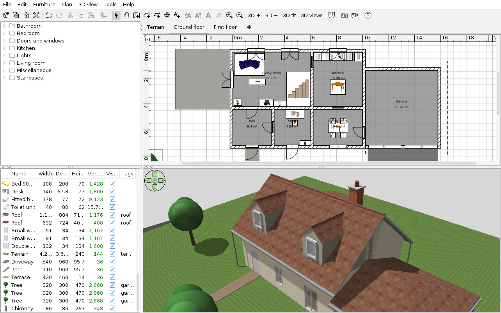
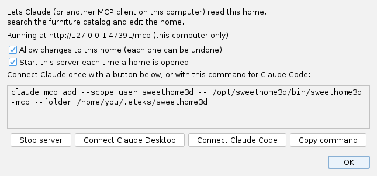
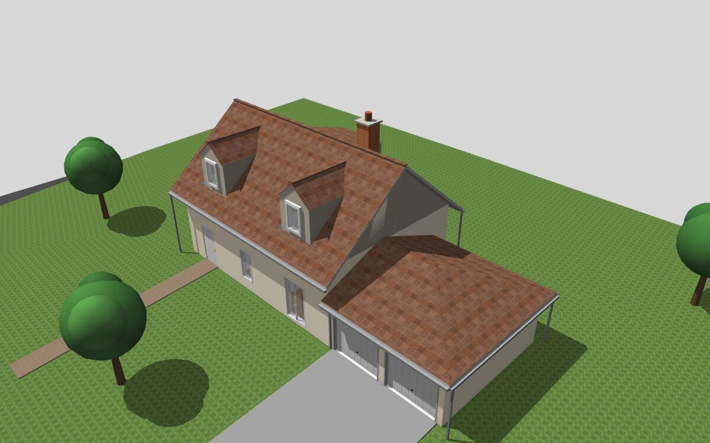
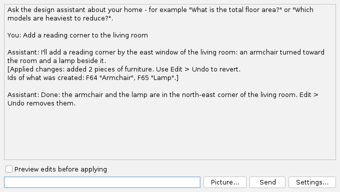
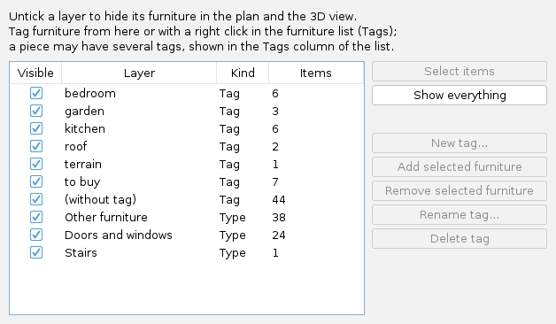
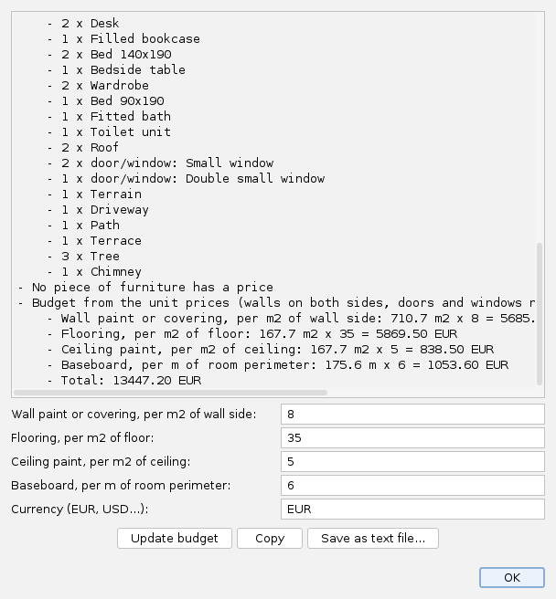
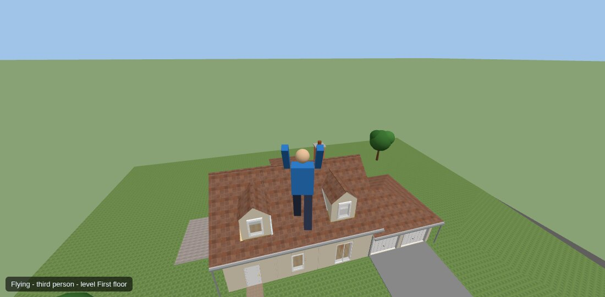
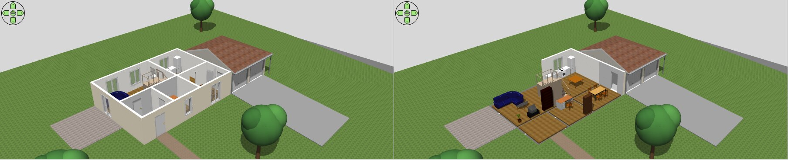

# Sweet Home 3D - AI, VR and fast 3D edition

A fork of [Sweet Home 3D](https://www.sweethome3d.com/), the free interior
design application: draw the plan of a home, furnish it, and see it in 3D.
This fork keeps everything of Sweet Home 3D 7.5 and adds an AI assistant, a
server that lets Claude edit the home, tools to model a whole house (roofs,
dormers, terrain), a walk-through for VR headsets, a game mode, an optional
OpenGL renderer and performance work for large homes.



The house above was built entirely by commands sent through the MCP server -
see the [house modeling tutorial](docs/HOUSE_MODELING_TUTORIAL.md).

## Download and run

Get the latest version from the
[releases page](https://github.com/mjcipriano/sweethome3d/releases/latest).
The Windows, Linux and macOS packages include their own Java runtime: there
is nothing else to install.

| System | File | How to run |
| --- | --- | --- |
| Windows 64-bit | `SweetHome3D-<version>-windows-x64.zip` | Unzip, open the `Sweet Home 3D` folder, double-click `Sweet Home 3D.exe` |
| Linux 64-bit | `SweetHome3D-<version>-linux-x64.tar.gz` | `tar xzf` it, then run `Sweet Home 3D/bin/Sweet Home 3D` |
| macOS (Intel) | `SweetHome3D-<version>-macos-x64.tar.gz` | Extract, then open `Sweet Home 3D.app` (the first time: right-click > Open) |
| Any system with Java | `SweetHome3D-<version>.jar` | `java -jar SweetHome3D-<version>.jar` |

`SHA256SUMS.txt` holds the checksums of the files. The packages aren't signed:
Windows and macOS warn the first time you open the application.

Homes are saved as standard `.sh3d` files: the file format isn't changed.
What this fork adds to a home (tags, notes, the description of a roof) is
stored as properties of the home and of its items.

New here? Read [Getting started](docs/GETTING_STARTED.md).

## What this edition adds

### Claude edits your home (MCP server)

**Help > Claude MCP server...** lets Claude Desktop, Claude Code or any other
[MCP](https://modelcontextprotocol.io) client on the same computer read the
home, search the catalog, look at pictures of the plan and the 3D view, and
change the home with undoable commands. No API key and no account are needed
in Sweet Home 3D.



- [Connecting Claude (MCP server)](docs/MCP_SERVER.md) - setup, tools,
  pictures, security.
- [Command reference](docs/MCP_COMMANDS.md) - every edit command.

Claude can also save versions of the home, compare and restore them, work on
a copy, export the home (PDF, OBJ, a 3D web page...), draw dimensioned
elevations, fence and plant the garden, furnish a room, and list doors,
windows and symbols in schedules. It writes the file of your home only if
you allow it.

### Model a whole house

Roofs over any polygon with hips and gables, dormers and cross gables with
their windows, walls cut to the slope of the roof, ceilings that follow it,
slabs and ramps, a ground with slopes, and the lot with its property lines
and setbacks - all on the real levels of the house.



- [House modeling tutorial](docs/HOUSE_MODELING_TUTORIAL.md) - the house of
  the pictures, step by step, with the commands to copy.

### Design assistant in the application

**Help > Design assistant...** is a chat inside Sweet Home 3D that answers
questions about the home and edits it. It works with any OpenAI-compatible
service (OpenRouter, DeepSeek, a local LM Studio or Ollama) or the Anthropic
API, with your own key.



- [Design assistant](docs/AI_ASSISTANT.md)

### Design tools

Room shapes (L, T, U), decoration styles, replace furniture in place, a home
report with a budget, named versions of a home, elevation drawings, room
dimensions in one step, tags and layers for furniture, furniture made from
simple parts and furniture libraries.

| | |
| --- | --- |
|  |  |

- [Design tools](docs/DESIGN_TOOLS.md)
- [Tags, layers and furniture made by the AI](docs/LAYERS_AND_FURNITURE_LIBRARIES.md)

### See it: 3D view, VR, game mode

- An optional **OpenGL renderer** for the 3D view, with antialiasing, shadows
  and ambient occlusion: [OpenGL renderer](docs/OPENGL_RENDERER.md).
- **Zoom**, standard views, a doll house display and a 360 degree panorama:
  [3D view navigation](docs/VIEW_3D_NAVIGATION.md).
- **Tools > WebXR Preview...** walks through the home at life size in a Meta
  Quest or SteamVR headset, from the headset's browser:
  [Walking through a home in VR](docs/WEBXR_VR.md).
- **Tools > Game mode...** plays the home as a video game in the browser:
  walk, jump, climb, fly, open doors: [Game mode](docs/GAME_MODE.md).
- **Review notes**: pin a note on a wall or a piece of furniture during a
  visit, and let Claude do what it says: [Review notes](docs/REVIEW_NOTES.md).
- **Tools > Export 3D web page...** writes a folder anyone can open in a
  browser: [Design tools](docs/DESIGN_TOOLS.md#3d-web-page-to-share).

| | |
| --- | --- |
|  |  |

### Large homes

Loading, the plan and the 3D view were measured and made faster for homes
with hundreds of heavy models; **3D view > Generate model LOD cache** builds
reduced models for the heaviest furniture. See
[Performance work](docs/PERFORMANCE.md).

## Documentation

[docs/README.md](docs/README.md) lists every guide, for users and for
developers.

## Build from source

The build needs the JDK 17 and the tools of the `sweethome3d` Conda
environment; the Java 3D and JOGL libraries are in `lib/`.

```bash
scripts/setup-conda-env.sh
conda activate sweethome3d
make build       # compile the application
make run         # build the executable JAR and run it
make test-core   # tests that need no display
make test-gui    # Swing and controller tests (need a display, or Xvfb)
```

[AGENTS.md](AGENTS.md) describes the layout of the sources, the tests, the
release automation and the rules for changes. Sources are encoded in
ISO-8859-1 and compiled for Java 8.

## License and credits

Sweet Home 3D is Copyright (c) 2024 Space Mushrooms and is distributed under
the GNU General Public License; see [LICENSE.TXT](LICENSE.TXT) and
[COPYING.TXT](COPYING.TXT), which also list the licenses of the third party
libraries. This fork is distributed under the same license. It isn't the
official version: for the original application, its help and its forum, go to
<https://www.sweethome3d.com/>. `README.TXT` is the original description of
the source code.
