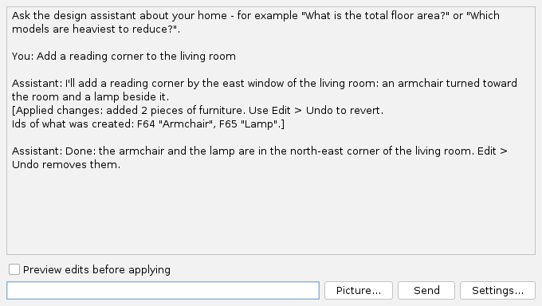
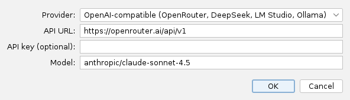
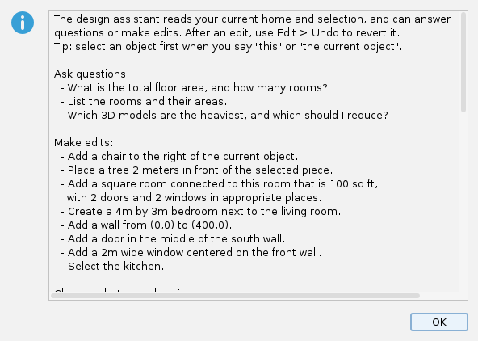

# Design Assistant

**Help > Design assistant...** opens a chat inside Sweet Home 3D. The
assistant answers questions about the home ("what is the total floor area?")
and edits it ("add a reading corner to the living room") with the same
undoable commands as the [MCP server](MCP_SERVER.md). It talks to the AI
service you choose, with your own key.



It differs from the MCP server in who runs the AI: with the assistant, Sweet
Home 3D calls a service through its API; with the MCP server, Claude Desktop
or Claude Code runs on your computer and calls Sweet Home 3D, without any key.
With Claude, prefer the MCP server: Claude then also sees pictures of the plan
and of the 3D view.

## Set it up

1. Choose **Help > Design assistant...**, then **Settings...**

   

2. Choose the provider and fill in the three fields:

   | Service | Provider | API URL | Model (examples) |
   | --- | --- | --- | --- |
   | OpenRouter | OpenAI-compatible | `https://openrouter.ai/api/v1` | the id of a model of its catalog |
   | DeepSeek | OpenAI-compatible | `https://api.deepseek.com/v1` | `deepseek-chat` |
   | LM Studio, on this computer | OpenAI-compatible | `http://localhost:1234/v1` | the model loaded in LM Studio |
   | Ollama, on this computer | OpenAI-compatible | `http://localhost:11434/v1` | the name of a pulled model |
   | Anthropic | Anthropic | `https://api.anthropic.com/v1` | the id of a Claude model |

   The key is the one the service gave you; local servers need none. The
   application adds `/chat/completions` (or `/messages` for Anthropic) to the
   URL.
3. Click **OK**. The settings are kept for the next sessions.

About the key:

- It is stored in clear text in your Sweet Home 3D preferences. To keep it
  out of them, set the environment variable `SWEETHOME3D_ASSISTANT_API_KEY`
  instead: it is then never written to disk.
- The key is cleared as soon as the provider or the URL changes, so it isn't
  sent to another service by accident, and it isn't sent over plain `http://`
  except to this computer or a private network address.
- Each request sends the description of the home (rooms, walls, furniture
  names and positions) and your messages to the service you configured.

## Use it

Type a request and press Enter or **Send**. The answer appears as it is
written; when it contains edits, they are applied and a line tells what
changed:

```
You: Add a reading corner to the living room
Assistant: I'll add a reading corner by the east window of the living room: an armchair turned
toward the room and a lamp beside it.
[Applied changes: added 2 pieces of furniture. Use Edit > Undo to revert.]
```

- **One request is one step of Edit > Undo**, even when it took the assistant
  several turns: it may search the catalog, add furniture, look at the result
  of its commands and go on, up to 5 turns per request.
- **Preview edits before applying** shows the list of commands before any of
  them runs; declining stops the request.
- **Picture...** sends an image with your next message, for a model that
  reads images: "add this painting above the sofa", "which piece of the
  catalog looks like this chair?".
- Refer to what is selected in the plan: "move this 50 cm to the left",
  "make these chairs red".
- **Help > What can I ask the assistant?** lists example requests.



What it can do is what the [commands](MCP_COMMANDS.md) can do: rooms, walls,
levels, stairs, roofs, furniture from the catalog or built from parts,
colors, textures and styles, tags and layers, checks and reports. It can't
save the home, and it adds furniture only by the exact names of your catalog.

The assistant of the picture above was answered by a canned local server
used for tests, not by a real model: answers of a real model vary.

## Development ledger

The rest of this page is the handoff source of truth for the development of
the assistant, the way `docs/OPTIMIZATION_PROGRESS.md` is for performance
work. Update it in the same commit or pull request as every accepted change,
new command, protocol change, or newly discovered blocker. Do not leave
progress only in chat or a PR comment.

All of the logic lives in `viewcontroller` (`AssistantClient`,
`AssistantCommandParser`, `AssistantCommand`, `AssistantCommandExecutor`,
`HomeAssistantContext`, `JSONParser`) and `swing` (`AssistantPanel`), so the
package dependency graph is unchanged. It is multi-provider: any
OpenAI-compatible endpoint (OpenRouter, DeepSeek, LM Studio, Ollama) or the
Anthropic API. Provider, URL, key and model persist in user preferences (BYO
key; an empty key works for local servers).

## Design constraints

- Java 8 source level, ISO-8859-1 encoding for existing files, no new runtime
  dependencies (the assistant uses only the JDK and the in-repo `JSONParser`).
- Keep model/Swing/Java3D types out of `viewcontroller` where avoidable; the
  executor talks to the existing `HomeController` sub-controllers.
- Every edit the assistant makes is one undoable turn: the whole turn is wrapped
  in `UndoableEditSupport.beginUpdate()/endUpdate()` so a single Edit > Undo
  reverts it.
- The model receives a plain-text project brief (`HomeAssistantContext`) plus a
  JSON command protocol; it replies with `{"reply": "...", "commands": [...]}`.
  The parser is tolerant of prose / Markdown fences and falls back to plain text.

## Status

### Phase 1 - read-only Q&A (DONE, shipped in v7.13.0)

`HomeAssistantContext.describeHome` builds a brief (levels, rooms + areas,
walls + length, furniture counts, largest model). `AssistantClient` does a single
request/response round-trip. Chat panel with in-panel Settings. Unit tests for
both provider protocols and the JSON reader.

### Phase 2 - editing command layer with grouped undo (DONE, shipped in v7.13.0)

Add-only command protocol: `add_furniture`, `add_door_or_window`, `add_room`,
`add_wall`, `select`. `AssistantCommandParser` extracts the protocol;
`AssistantCommandExecutor` applies it through the real controllers as one
undoable turn. Context includes the current selection so relative placement
works. Tests: parser (plain/JSON/fenced) and executor (add room + walls, one
undo reverts the turn).

### Phase 3 - modify existing homes, agentic, streaming (DONE, pending release)

Requested as one phase with three workstreams, built in dependency order:

- **3a - modify/delete (CRUD). DONE.** The assistant can act on items that
  already exist, not just add new ones. Commands: `move`, `rotate`, `resize`,
  `set_color`, `set_elevation`, `set_visible`, `rename`, `delete`. Targeting:
  existing items are referenced by a stable per-turn id exposed in the context
  (`F1` furniture, `W1` walls, `R1` rooms), by `"target":"selection"`, or by the
  `names` field. Property changes post a snapshot-based undoable edit
  (`ItemState` before/after); deletes reuse `PlanController.deleteItems`. The
  whole turn stays one undo. `HomeAssistantContext` lists each room (R#), wall
  (W#) and furniture item (F#, with position/angle/size); furniture is capped at
  80 listed items.
- **3b - agentic multi-step loop. DONE.** `AssistantPanel.runConversation`
  loops: after a turn's commands are applied it feeds back the applied-changes
  summary (with a refreshed project brief in the system prompt) and re-invokes
  the model, up to `MAX_ASSISTANT_STEPS` (5), stopping when the model returns no
  further commands. Provider-agnostic; network runs off the EDT, home reads/edits
  are marshalled onto it with `invokeAndWait`.
- **3c - streaming + chat UX. DONE.** `AssistantClient.sendMessageStreaming`
  reads server-sent events for both providers (`parseStreamDelta` is unit-tested
  for the OpenAI `choices[].delta.content` and Anthropic `content_block_delta`
  shapes) and forwards chunks to a `StreamHandler`; the panel streams them into
  the transcript and replaces the streamed text with the finalized reply +
  applied-changes footer. A "Preview edits before applying" checkbox shows a
  confirmation listing the commands before any edit runs; declining stops the
  multi-step loop. Remaining polish: rich Markdown rendering in the transcript
  (currently a wrapped `JTextArea`).

### Phase 4 - grounded, reliable, deeper edits (4a, 4b DONE)

The next increment focuses on making edits land on the right items and reach the
features that make Sweet Home 3D distinctive. Build in dependency order:

- **4a - catalog grounding. DONE.**
  - `HomeAssistantContext.describeCatalog` lists every furniture category and up
    to 60 item names per category in the system prompt;
    `HomeAssistantContext.buildSystemPrompt` (shared by `AssistantPanel` and the
    live tests) assembles role + protocol + catalog + project brief.
  - New `search_catalog` command (`{"action":"search_catalog","query":"..."}`):
    its matches are appended to the applied-changes summary, which the agentic
    loop (3b) already feeds back, so the model can search then add.
  - `findCatalogPiece` is now scored token matching (exact > all-words-present >
    substring > partial word overlap; plural "s" ignored; concise names
    preferred) instead of first-substring-wins. Unmatched `add_furniture` names
    report the 3 closest catalog names back to the model for self-correction.
  - Per-turn safety limits (the 4c item, pulled forward): max 30 commands per
    turn, coordinates beyond 1,000,000 cm and sizes beyond 100,000 cm rejected
    with a note in the summary. The protocol text documents the coordinate
    system (y down, north = -y; angle 0 faces +y) and door-on-wall placement.
  - `AssistantClient` now sends `max_tokens` 4096 (1024 could truncate
    multi-command JSON) and `temperature` 0.2 on both provider protocols.
  - Tests: scored matching, search summary, suggestions and safety limits in
    `AssistantCommandExecutorTest`; catalog brief/prompt in
    `HomeAssistantContextTest`; **`AssistantCannedProtocolTest`** runs the whole
    pipeline (request building, HTTP round-trip, parsing, execution) against a
    local mock chat-completions server returning canned replies captured from a
    real DeepSeek session, so the regular suites validate end-to-end behavior
    with **no network and no API key**. `AssistantDeepSeekLiveTest`
    (`make test-assistant-live`) is the optional live re-validation: opt-in via
    `-Dsweethome3d.liveAssistantTests=true`, key from the `DEEPSEEK_API` env var
    or a git-ignored `.env` at the repo root, skipped via JUnit assumptions
    otherwise. **The key stays local: never commit it, never wire it into CI;
    canned tests are the shared regression gate.** Verified live 2026-06-12:
    DeepSeek (`deepseek-chat`) grounds names to the exact catalog vocabulary
    and issues correct id-targeted relative moves.
- **4b - reduce-detail (LOD) editing. DONE.** `reduce_detail` / `restore_detail`
  commands target pieces by id, `names`, `"target":"selection"` or
  `"target":"all"` ("all" is honored only for these reversible toggles) and
  flip the per-piece `ModelLOD.LOW_POLY_PROPERTY` through the same
  snapshot-based undoable turn (the `ItemState` snapshot now includes the
  low-poly flag). The brief marks each piece `reduced model available` /
  `reduced detail ON` and reports models >= 1 MB, so the model knows which
  pieces are heavy and switchable; pieces without a generated LOD are reported
  back ("run 3D view > Generate model LOD cache") because LOD *generation*
  needs Java 3D and stays out of `viewcontroller`. Tests: executor toggle/
  undo/"all"/missing-LOD note, brief markers, and a live DeepSeek scenario
  ("the 3D view is slow") that produced a correct targeted `reduce_detail`.
- **4c - deeper geometry & appearance.** `duplicate`, `group`/`ungroup`,
  `set_texture`/material on furniture and walls, wall endpoint moves
  (`move_wall_point`), and room vertex edits - all through the same
  snapshot-based undoable turn. Add per-turn safety limits (max commands,
  coordinate sanity vs. plan bounds) so a bad reply can't make a huge mess.

### Hardening pass (2026-11-13, DONE)

A review of the assistant code fixed these defects; keep the behaviors when
extending the executor:

- **Undo integrity.** `ItemState.restore` writes back only the properties that
  differ and never calls size/color setters on non-resizable/non-texturable
  pieces (they throw), so undoing a turn can't corrupt a furniture group or
  abort halfway. `resize`/`set_color`/`add_furniture` skip such pieces.
- **No empty undo step.** The turn's compound edit starts lazily at the first
  real change (`beginTurnUpdate`), so a turn of only `search_catalog`,
  `select` or rejected commands posts nothing and doesn't mark the home
  modified.
- **Ids are stable within a turn.** `execute` snapshots the furniture, wall and
  room lists; `F#`/`W#`/`R#` resolve against that snapshot and ignore items an
  earlier command of the turn deleted. The snapshot is now taken when the home is described (see the follow-up
  pass below).
- **Only undoable targets.** `move` ignores labels, dimension lines, the
  compass and cameras; `delete` counts only what is really deleted.
- **Value safety.** Non-finite numbers are treated as absent; `add_wall`
  thickness/height and `set_elevation` are range-checked. A command that throws
  becomes a note instead of killing the turn.
- **Parser.** `JSONParser` fails with `IllegalArgumentException` on truncated
  escapes and nesting deeper than 200 levels.
- **Client.** Streaming detects in-band error events, falls back to a plain
  JSON body when the server ignores `stream`, and treats an empty reply as an
  error; `abort()` cancels the request in flight.
- **Panel.** Closing the assistant window (or its home) cancels the request and
  no further edits are applied; one assistant dialog per home window; a failed
  request removes the unanswered user message; a declined preview is recorded
  in the conversation.

### Follow-up pass and MCP server (2026-11-13, DONE)

- **Ids survive edits made during a request.** `AssistantCommandExecutor.
  snapshotDescribedItems()` records the items the ids designate when the home
  is described (`AssistantPanel.buildSystemPrompt`, MCP `get_home`); `execute`
  resolves `F#`/`W#`/`R#` against that snapshot. *Replaced on 2026-11-19 by
  ids stored in the items (`HomeItemIds`), see below.*
- **API key.** The settings dialog clears the key as soon as the provider or
  the API URL changes, so a key is never sent to another service by accident.
  `AssistantClient` refuses to send a key over plain `http://` except to this
  computer or a private network address. The key can come from the
  `SWEETHOME3D_ASSISTANT_API_KEY` environment variable instead of preferences,
  in which case it is never written to disk. A key typed in the dialog is still
  stored in clear text in the user preferences (there is no portable OS keychain
  in the JDK).
- **Prompt.** The role, protocol and catalog part of the system prompt is built
  once per request; only the project brief is refreshed at each step. The brief
  now gives each room's extent and centre in centimeters.
- **Stop.** The Send button becomes Stop while a request runs.
- **MCP server.** `Help > Claude MCP server...` exposes the home to Claude and
  other MCP clients through the same executor: see `docs/MCP_SERVER.md`.

### Design tools from the gap analysis (2026-11-16, DONE)

`replace_furniture`, `add_room_shape`, `apply_style`, `set_unit_prices`,
`export_elevation`, `auto_dimensions`, and `add_stairs` with
`"shape":"spiral"`: see `docs/DESIGN_TOOLS.md` and `docs/GAP_ANALYSIS.md`.

### Tags, layers and furniture libraries (2026-11-16, DONE)

`add_tags` / `remove_tags` / `set_tags`, `hide_layer` / `show_layer` /
`select_layer`, `create_furniture` (a piece built from simple parts),
`add_to_catalog`, `export_furniture_library` and `import_furniture_library`:
see `docs/LAYERS_AND_FURNITURE_LIBRARIES.md`.

### Building and repair commands (2026-11-13, DONE)

Added to the shared executor, so the in-app assistant and the MCP server both
have them (`AssistantBuildingCommands`, `AssistantRoofBuilder`,
`HomeDiagnostics`; tests in `AssistantBuildingCommandsTest`):

- **`add_rectangular_room`** - a room and its four joined walls in one command,
  by `x,y,width,depth` or `next_to` (room id or name) + `side` + `offset`. A
  side along which a wall already stands gets no second wall, so rooms placed
  against each other share their wall. This is the command for "add a garage
  on the east side".
- **`auto_roof`** - gable, hip, shed or flat roof with `pitch`, `overhang`,
  `ridge` and `color`. Sweet Home 3D has no roof object: the roof is a piece of
  furniture with a generated OBJ model (saved in the home file), put on a level
  named `Roof` on top of the walls so it doesn't hide the rooms in the plan.
  The working level stays selected and the 3D view is switched to "display all
  levels". A house that isn't a rectangle gets one roof per room; calling the
  command again replaces the roofs. Limits: roofs cover rectangles (the bounds
  of the walls or of each room), not arbitrary outlines, and don't trim the
  walls under a gable.
- **Levels** - `add_level`, `select_level`; the brief gives each level's
  elevation, marks the selected one and tags items with their level.
- **Appearance** - `set_color` now also paints walls (`part: left|right`) and
  room floors/ceilings; `set_texture` + `search_textures` use the textures
  catalog on rooms, walls and furniture.
- **Annotations and copies** - `add_label`, `add_dimension`, `duplicate`.
- **`set_camera`** - moves the virtual visitor (also the VR start point); not
  undoable, like any camera move.
- **`check_home` / `fix_home`** - `HomeDiagnostics` reports walls that end
  close without being joined, tiny and duplicate walls, empty rooms, rooms
  walled on every side without a door, doors and windows out of walls,
  duplicate furniture, furniture under the floor / through the ceiling /
  outside rooms, unnamed rooms and heavy models. `fix_home` repairs the fixable
  ones (joins walls, deletes duplicates and specks, puts doors back in the
  closest wall, raises furniture to the floor) as one undo step.

All of them go through the controllers or the snapshot edit (`ItemState` now
also records wall joins, wall/room colors and textures), so every turn is still
one Undo. Two real Claude Code sessions built a three-room house with doors,
windows, furniture and a roof through the MCP server on 2026-11-13; their
remarks produced `next_to`, the per-room roofs and the door check.

### Stairs, pictures, imports and Blender (2026-11-13, DONE)

`AssistantObjectCommands`, `AssistantGeneratedModel`, `BlenderSceneScript`;
tests in `AssistantObjectCommandsTest`.

- **`add_stairs`** - a straight flight generated as a model, from the selected
  level up to the next one (risers of about 17.5 cm, treads of 25 cm unless a
  `length` is given). The piece has a staircase cut-out shape, so the floor of
  the level above is cut open over it. See below for the L and U shapes.
- **`add_picture`** - furniture showing an image file: `panel` (painting,
  poster, photo, screen; hang it with `elevation`), `box`, or `floor` (a rug).
  Missing sizes follow the proportions of the image. This is a textured box,
  not a 3D reconstruction of what the picture shows.
- **`import_furniture`** - an OBJ, DAE, 3DS, KMZ or ZIP model file of this
  computer as a new piece. An OBJ or DAE is stored with the material files and
  images it names, taken only from its own folder. The size comes from `width`
  / `height` / `depth`, or from a guess of the unit of the file.
- **`import_texture`** - an image added to the textures catalog (category
  `Imported`), optionally applied to rooms, walls or furniture.
- **Pictures in the chat** - the `Picture...` button of the assistant sends an
  image (shrunk to 1024 px) with the next message, in the OpenAI
  (`image_url`) or Anthropic (`image`) format; the model must read images.
  Commands designate the original file with `"image":"attached"`. The protocol
  tells the model to match a photographed piece with the closest catalog piece,
  resized and recolored.
- **Blender export** - `3D view > Export to Blender...` (and the MCP tool
  `export_blender`) writes `scene.obj` with its materials and textures plus
  `render_blender.py`, which rebuilds the home in Blender: real size, the
  camera of the home, the sun at the home's place and time, its lamps, glass
  materials, a ground and Cycles settings. `blender -b -P render_blender.py`
  renders `render.png`; options after `--` set samples, size, output, GPU or
  save a `.blend`. Tested with Blender 5.0 (`bpy` module); written to also
  work with 3.x and 4.x, which weren't run.
- **Files** - commands read only image and model files given by an absolute
  path, check that an image really is one, and never send file contents back
  to the model.

A generated model keeps its icon in a separate file: a home saves the contents
of one archive under a single name, so an icon stored next to its model made
the model point to the icon once the home was saved and reopened (found with
the built-in renderer; fixed for roofs too, with a save-and-reopen test).

### Stair shapes, walkable stairs, floor plan image and report (2026-11-14, DONE)

`AssistantPlanCommands`, `HomeReport`, `AssistantGeneratedModel`; tests in
`AssistantObjectCommandsTest`, `WebXRSceneDescriptionTest` and
`test/webxr/walk.test.mjs`.

- **`add_stairs` shapes** - `"shape":"L"` (quarter turn) and `"shape":"U"`
  (half turn) make two flights joined by a landing, turning `"turn":"left"` or
  `"right"`; they need less length than a straight flight. `"railing":true`
  (or `"left"` / `"right"` for a straight flight) adds handrails on posts.
  The floor above is cut out over the flights only. The reply gives the floor
  size the stairs take, so the model can check they fit.
- **Walkable stairs in the VR preview** - generated stairs record their
  flights in the piece property `assistantStairsFlights`; the WebXR plugin
  exports them and the viewer lets the visitor walk or teleport up and down
  them, arriving on the next level. See `docs/WEBXR_VR.md`. Staircases of the
  furniture catalog have no such description and are still crossed with the
  level buttons.
- **`move_to_level`** - moves furniture, walls and rooms to another level
  (undoable). A wall moved without the walls it is joined to is detached from
  them.
- **`set_background_image` / `remove_background_image`** - displays the
  picture of a floor plan behind the plan of the selected level, scaled by the
  real `width` it shows, to trace it with rooms and walls. Through MCP, Claude
  sees it with `get_plan_image` and can trace it itself. The image is saved
  with the home. Nothing recognises walls automatically.
- **`home_report`** (MCP tool `get_report`) - floor area and perimeter of each
  room by level, length and surface of the walls (both sides, openings not
  deducted), furniture counts by name and prices when pieces have one.

Ideas not done: spiral stairs, roofs following an arbitrary outline, splitting
a wall or cutting an opening without a door model, recognising the walls of a
floor plan image automatically, turning a photo into a real 3D model (needs an
image-to-3D service), PBR materials for Blender.

### House modeling: ids, levels, roofs, slabs, ground (2026-11-19, DONE, v7.25.0)

User documentation: `docs/MCP_COMMANDS.md` and `docs/HOUSE_MODELING_TUTORIAL.md`.

- **Persistent ids** (`HomeItemIds`): a number stored in the property
  `assistantId` of each item, the high-water mark in the properties
  `assistantLastId<F|W|R|L>` of the environment of the home. `where` designates
  items in bulk (`AssistantCommandExecutor.resolveWhere`). 100 commands per call.
- **Levels and walls** (`AssistantStructureCommands`): `delete_level`,
  `modify_level`, `merge_levels`, `modify_wall`, `set_plan_visibility`,
  `describe_item`. `FurniturePlanVisibility` (property `planOnUpperLevels`)
  makes `PlanComponent` draw a piece as a dashed outline or not at all.
- **Roofs** (`AssistantRoofGeometry`, `AssistantRoofModel`): `add_roof` with
  `points`, `add_dormer`, `fit_walls_to_roof`. Convex parts, lowest plane per
  part, highest part where they overlap; not a straight skeleton for a
  polygon that isn't convex.
- **Slabs and ground** (`AssistantShapeCommands`): `add_slab`, `set_terrain`
  (Delaunay triangles, on a level under the others), room `floor_offset`.
- **Parts** (`AssistantMeshBuilder`, `AssistantFurnitureBuilder`): prism,
  wedge, extrude, textures per part, `modify_furniture_parts`.
- **Pictures**: `store_as`, `compare_with` of `get_3d_image`.
- Tests: `AssistantHouseModelingTest`.

Follow-up found while writing the tutorial (2026-11-20):

- The ground is left open under the rooms it reaches and their walls: at the
  height of a floor it showed through it.
- `check_home` no longer reports pieces put on the ground with `on_terrain`
  (property `assistantOutdoor`) nor pieces created with `"structure":true`.
- `apply_style` takes a floor texture of the material of the style
  (`AssistantDesignCommands.findFloorTexture`): "Light blue tiles" was taken
  for a pale wood floor because both are light.
- Game mode and review notes: roofs and the ground are exported with
  `"shell":true` and stop no one; a level without room isn't the height
  someone walks at outdoors; a note on a floor isn't given to the roof whose
  box holds the home.
- The scene description gives the triangles of the ground (`terrain`,
  `HomeTerrain.getTriangles`): the game mode (`groundAt`) and the walk-through
  (`groundHeightAt`, `standAt`) walk on its slopes.
- `HomeReport` lists roofs, slabs and the ground under "Building and site".
- `ElevationDrawing` draws the faces of the models built by these commands,
  sloped walls and the ground, instead of boxes.
- Undo restores the properties `assistantOutdoor` and `assistantBelowFloor`.
- Slabs: the scene description gives the triangles of their top (`ramps`,
  `GeneratedModelFaces`), walked on in the game mode and the walk-through.
- Generated pieces have a picture seen from the top (`createPlanIcon`), which
  the plan draws whatever the preference (`FurniturePlanVisibility.isDrawnFromTop`).
- The ground follows the rooms: `HomeController.refreshTerrain` builds its
  model again after each edit, undo and redo when the rooms or walls it is
  open under changed (`AssistantShapeCommands.refreshTerrain`, properties
  `assistantTerrainParameters` and `assistantTerrainFootprint`).
- `apply_style` finds floor textures by the id of the default catalog, in any
  language.
- three.js 0.155.0 comes with the pages (no Internet access needed).
- `HomeMCPBridge` stops when asked by the **Release program folder** button
  (file `mcp-bridge-stop` of the application folder).
- Help: page "What this edition adds" (English).
- `CommandReferenceDocTest` fails when a command of the reference is missing
  in `docs/MCP_COMMANDS.md`; `docs/tools/screenshots` regenerates the pictures.

### Site, roof edits and connector fixes (2026-11-20, DONE)

Round 3 of requests from modeling a real house through the MCP server.

- **Connector.** A tool call with an argument the server doesn't know is
  refused with the list of its arguments (`HomeMCPHandler.getUnknownArguments`)
  instead of dropping it. The server declares `tools.listChanged`, and
  `HomeMCPBridge` sends `notifications/tools/list_changed` when the tools of
  the running server differ from the ones it gave its client (checked every
  15 s). `apply_commands` takes `file` (2000 commands at most), and every
  answer ends with the ids of what was created. `get_home` takes `where` and
  `fields`; names accept `Pine|Oak`. `select` takes `where` and lists.
- **Roofs** (`AssistantShapeCommands`, `AssistantRoofModel`,
  `AssistantRoofGeometry`): `modify_dormer`, `remove_dormer`, `modify_roof`
  (with `raise_walls`), edge type `abut`, dormer `"ridge":"match"`, several
  windows per dormer. Editing one dormer keeps the windows of the others
  (`syncDormerWindows`). The opening under a dormer is its own polygon, not
  its footprint with overhangs. A `position` above 1 is read as centimeters.
  `fit_walls_to_roof` uses `getCeilingCells()` (dormers and cross gables
  included), adds walls at the level of the wall they continue, and keeps
  the walls joined at T junctions.
- **Ceilings** (`HomeRoofs`): `"ceiling":"follow_roof"` and
  `flat_ceiling_at` build a ceiling piece (structure `ceiling`) rebuilt with
  the roof; `headroom`; `check_home` type `door_through_roof`.
- **Site** (`AssistantSiteCommands`, `HomeGeoreference`): `add_polyline`,
  `add_property_line` (stakes with structure `site`), `add_setback`,
  `modify_polyline`, `set_compass`, `set_georeference`, `import_parcel`,
  `get_coordinates`; ids `P#`; `check_home` types `beyond_setback` and
  `beyond_property_line`. Projections: transverse Mercator, Lambert conformal
  conic 2SP and Web Mercator on GRS80, without datum shift; tested against
  formulas written independently in the test, **not** against PROJ.
- **Other.** `begin_group` / `end_group` (ends after 10 minutes idle or on
  undo), `check_home` severities with `ignore`, `ignore_tags`,
  `min_severity`, `remember`; `delete_level` with `ids`; parts of
  `create_furniture` up to 200 m, `on_terrain` for parts;
  `store_point_of_view` from a `camera` without moving the user's camera.
- Tests: `AssistantSiteAndRoofTest`. Tried in the application on the demo
  house (pictures from outside and from the rooms under the roof).
- Not done: lines aren't drawn in the game mode and the WebXR pages (the
  stakes are); a setback isn't shown in 3D.

### Backlog / later

- **Native tool/function calling.** Use Anthropic `tool_use` and OpenAI `tools`
  so commands arrive as structured arguments instead of JSON-in-prose, removing
  the tolerant text parsing and improving reliability.
- **Markdown transcript.** Replace the `JTextArea` with an HTML-rendering view
  and light Markdown formatting (the 3c polish item).
- **Conversation management.** "New chat" / clear, and optional save/restore of
  the transcript with the home.
- **Vision.** Send a rendered plan/3D snapshot to multimodal endpoints so the
  model can "see" the layout it is editing.
- **Cost & model feedback.** Show token usage / model name and surface provider
  errors (rate limits, bad key) more clearly than the current generic message.
- **Multi-level awareness.** Let the assistant target and report per `Level`,
  not just the selected level.

## Testing

```bash
make build
make test TEST_SOURCES="\
  test/com/eteks/sweethome3d/junit/AssistantCommandParserTest.java \
  test/com/eteks/sweethome3d/junit/AssistantCommandExecutorTest.java \
  test/com/eteks/sweethome3d/junit/AssistantClientTest.java \
  test/com/eteks/sweethome3d/junit/HomeAssistantContextTest.java"
make test-assistant-live   # real DeepSeek round-trips; needs DEEPSEEK_API or .env
```

`make test-gui` is required for `AssistantPanel` changes (Swing). Two unrelated
GUI tests (`PrintTest`, `TransferHandlerTest`) are known to flake on focus/dialog
timing under WSLg/Xvfb and are not caused by assistant changes.

Manual smoke test: configure a local LM Studio or Ollama endpoint in Settings,
open a home, and try prompts such as "what is the total floor area?",
"add a chair to the right of the selection", "move the sofa 50cm north",
"delete all chairs".
