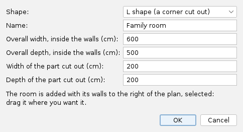
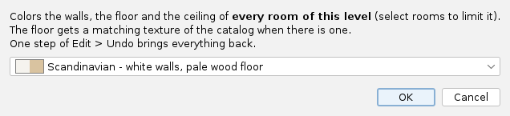
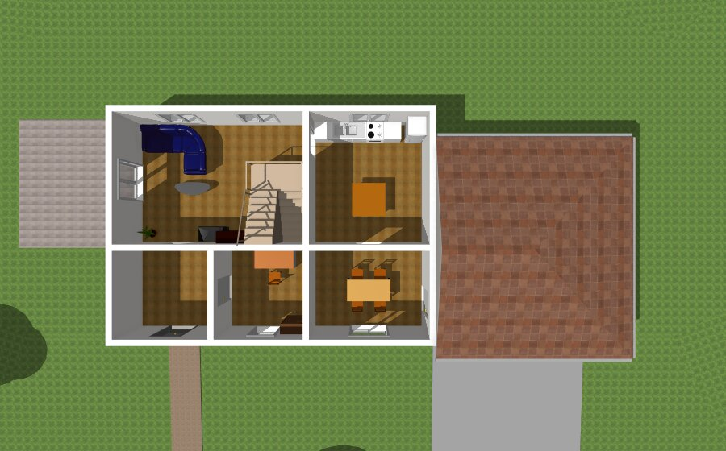
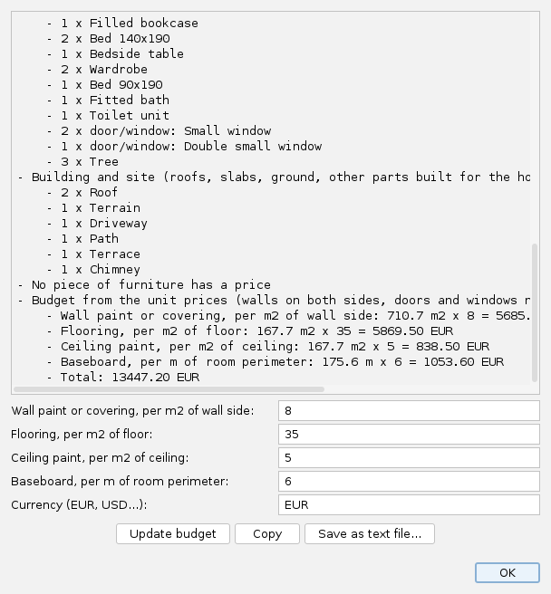
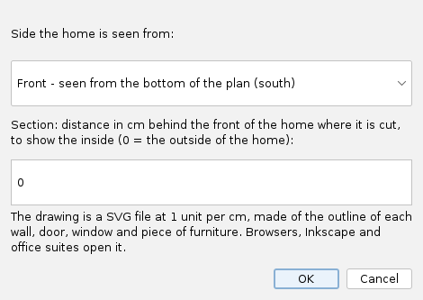
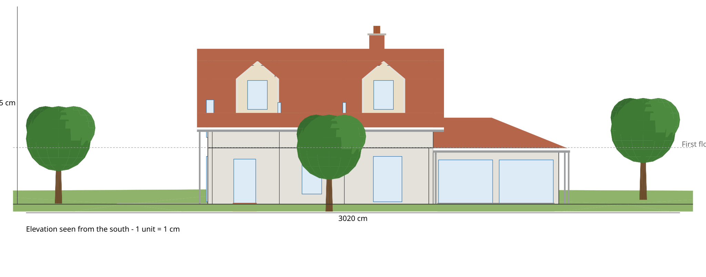

# Design Tools: Replace, Room Shapes, Styles, Report, Web Page

Tools added after comparing with similar programs (`docs/GAP_ANALYSIS.md`).
Most are also commands of the design assistant and of the MCP server
([Command reference](MCP_COMMANDS.md)), and each is one step of **Edit > Undo**.

| Tool | Menu |
| --- | --- |
| [Replace furniture in place](#replace-furniture-in-place) | **Furniture > Replace by the piece selected in catalog** |
| [Room shapes](#room-shapes) | **Plan > Add room from shape...** |
| [Decoration styles](#decoration-styles) | **Plan > Apply style to rooms...** |
| [Home report and budget](#home-report) | **Plan > Home report and budget...** |
| [Versions of a home](#versions-of-a-home) | **File > Versions...** |
| [Elevation drawings](#elevation-drawings) | **Plan > Export elevation drawing...** |
| [3D web page to share](#3d-web-page-to-share) | **Tools > Export 3D web page...** |

## Replace furniture in place

Select the pieces to replace in the plan or the furniture list, select the
one piece that replaces them in the catalog, then **Furniture > Replace by
the piece selected in catalog**. The new piece takes the place, the angle,
the elevation, the level, the visibility and the tags of the old one.

`{"action":"replace_furniture","ids":["F3"],"name":"<exact catalog name>"}`
(`"keep_size":true` keeps the size of the old piece).

## Room shapes

**Plan > Add room from shape...** adds a rectangle, L, T or U shaped room with
its walls from a few sizes, to the right of the plan and selected, ready to
be dragged in place.

`{"action":"add_room_shape","shape":"L","name":"Living","x":0,"y":0,"width":600,"depth":500,"cut_width":250,"cut_depth":200}`

`width` and `depth` are the bounding box inside the walls. L cuts the top
right corner out; T cuts both bottom corners, leaving a leg of
`width - 2 x cut_width`; U cuts a notch in the middle of the top side. Walls
that already stand along a side aren't added twice.

## Decoration styles

**Plan > Apply style to rooms...** colors the floor, the ceiling and the wall
sides facing the selected rooms (or every room of the level): Scandinavian,
Modern, Industrial, Traditional, Coastal, Mid-century, Minimalist, Dark,
Earthy, Mediterranean. The floor gets a texture of the catalog when one is of
the material of the style - a wooden floor for a style with a wood floor -
and its plain color otherwise. The other side of a wall shared with a room
that isn't styled is left alone.

The ground floor of the demo house in the Scandinavian style:

`{"action":"apply_style","style":"Coastal","ids":["R1","R2"]}`
(`"textures":false` for plain colors; `list_styles` lists them).

## Home report

**Plan > Home report and budget...** shows the floor areas and
perimeters by room and level, the wall lengths and surfaces, the furniture
counts and prices, with **Copy** and **Save as text file...**. Roofs, slabs,
the ground and the other parts built for the house are listed apart from the
furniture, under *Building and site*.

### Budget

At the bottom of the report window, give unit prices - wall paint or covering
per m2 of wall side, flooring per m2, ceiling paint per m2, baseboard per m -
and a currency, then **Update budget**: the report ends with the cost of each
and a total that includes the furniture that has a price. The prices are
saved with the home. Wall surfaces count both sides of every wall and don't
deduct doors and windows, so the paint line is an upper bound.

`{"action":"set_unit_prices","paint":8,"flooring":35,"baseboard":6,"currency":"EUR"}`
(a negative value removes a price).

## Versions of a home

**File > Versions...** keeps named copies of the home in a folder beside its
file (`My home.sh3d.versions`). **Save a version...** stores the home as it is
now, without changing the file you work on. **Compare with now** tells what
changed since a version (levels, rooms, floor area, walls, furniture added and
removed). **Open in a new window** shows a version; to come back to it, save
it there under the name of the home. Versions are full copies: delete the
ones you no longer need.

## Elevation drawings

**Plan > Export elevation drawing...** writes a SVG drawing (1 unit = 1 cm) of
the home seen from its front, back, right or left side, with its overall width
and height and the floors. A **section** distance cuts the home that far
behind its front and leaves out what stands before the cut, which shows the
inside. It is a schematic drawing: each wall, door, window and piece of
catalog furniture is the rectangle it fills seen from that side, not the
projection of its 3D model - a home made of large imported models comes out
as boxes. What the house modeling commands build is drawn with its real
shape: roofs and their dormers, slabs, pieces made of parts, walls cut to the
slope of a roof, and the ground around the home.

The demo house seen from the south:

`{"action":"export_elevation","side":"south","path":"/home/me/front.svg","section":0}`

## 3D web page to share

**Tools > Export 3D web page...** writes a folder (`<home>-3d-web`) with the
same walk-through and game mode as the preview. Browsers refuse to load a 3D
scene from a page opened from the disk, so the folder comes with its own way
to be seen, with **no web server to install**:

| On | Do |
| --- | --- |
| This computer, right away | **View it now** at the end of the export, or later **Tools > View 3D web page folder...** |
| Any Windows computer | Double-click **View in browser (Windows).bat** in the folder |
| Any Mac | Double-click **View in browser (macOS).command** (the first time: right-click > Open) |
| Linux, or a Mac from the Terminal | `sh view-in-browser.sh` in the folder |

A launcher starts a tiny web server with what the computer already has -
PowerShell under Windows, Python 3, Ruby or PHP under macOS and Linux - opens
the browser at the address it prints, and stops when its window is closed. It
shows this folder only, to this computer only, and installs nothing. So the
folder can be copied on a USB key or sent as a zip, and seen by someone who
has neither Sweet Home 3D nor a web site.

To share it as a link instead, put the folder on any static web host (GitHub
Pages, Netlify, your own server); with https, a headset gets the **Enter VR**
button. Anyone with the address sees the whole home. `README.txt` in the
folder says all this.

Things that may need a click: Windows may warn before running a `.bat` that
came from the Internet or from a zip (More info > Run anyway); a Mac asks
once to confirm a downloaded `.command`, and a file copied through Windows
may lose its permission to run - then use `sh view-in-browser.sh`.

The 360 degree panorama (`docs/VIEW_3D_NAVIGATION.md`) needs none of this:
its `index.html` contains the picture and opens with a double click.

## Implementation

- `viewcontroller/AssistantDesignCommands` - `replace_furniture`,
  `add_room_shape` (`getShapePoints`), `apply_style` (`getStyles`).
- `swing/HomeDesignToolsView` - the dialogs, which run those commands.
- `WebXRPreviewPlugin.exportWebPage` - the web page export; `viewFolder`
  serves a folder with the server of the application;
  `tools/WebFolderLaunchers` writes the launchers (`WebFolderLaunchersTest`).
- `HomeReport` unit prices (`setUnitPrice`, stored as home properties),
  `HomeVersions`, `ElevationDrawing.createSVG`.
- `AssistantDesignCommandsTest`.
