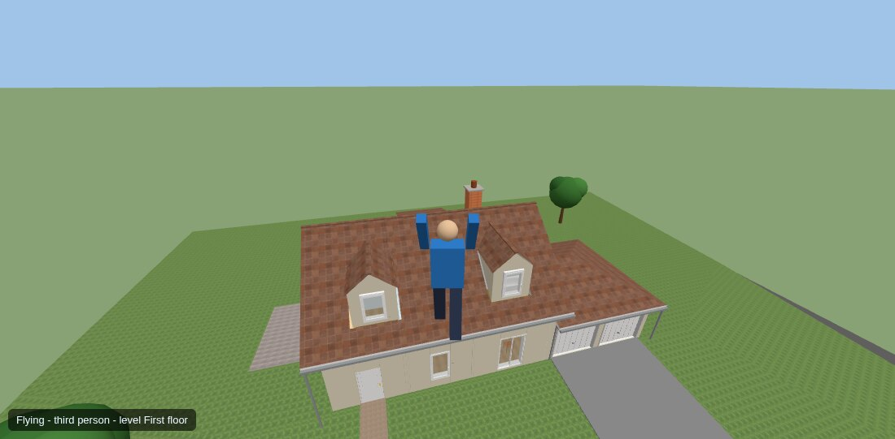
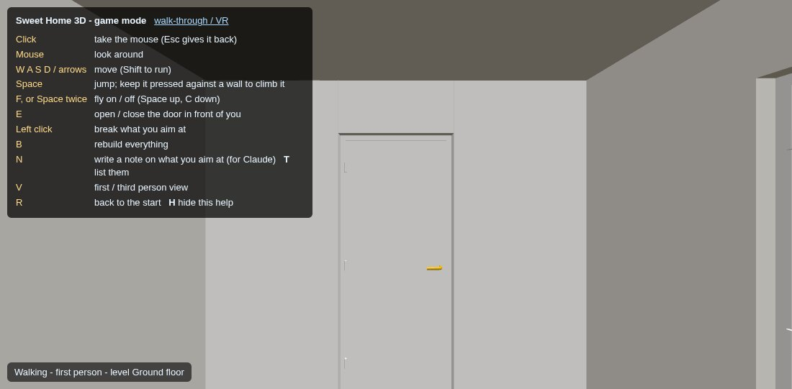
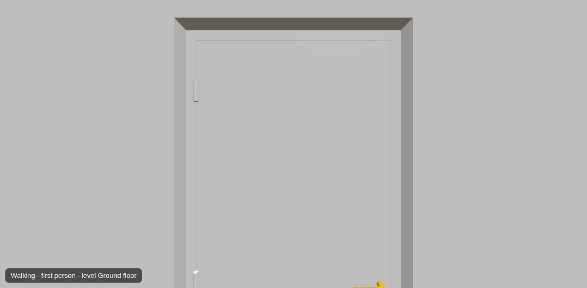
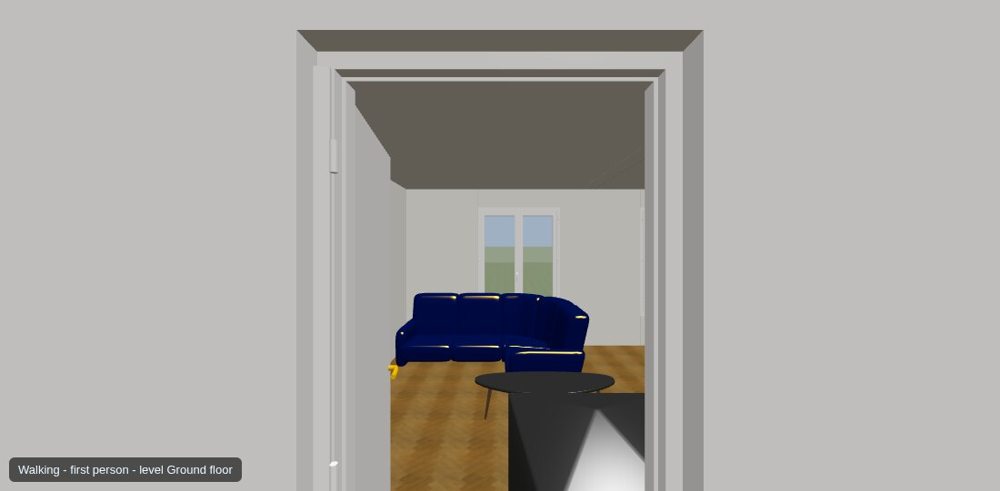
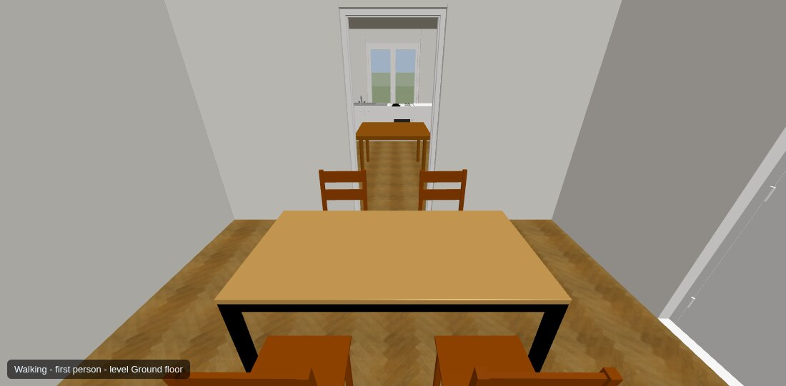
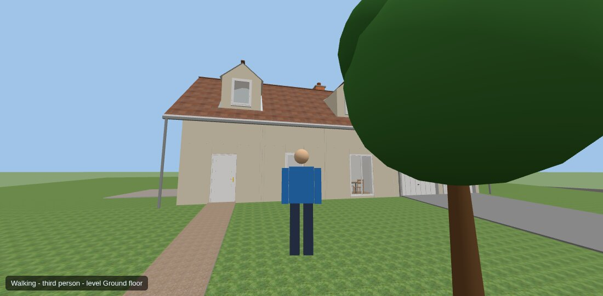
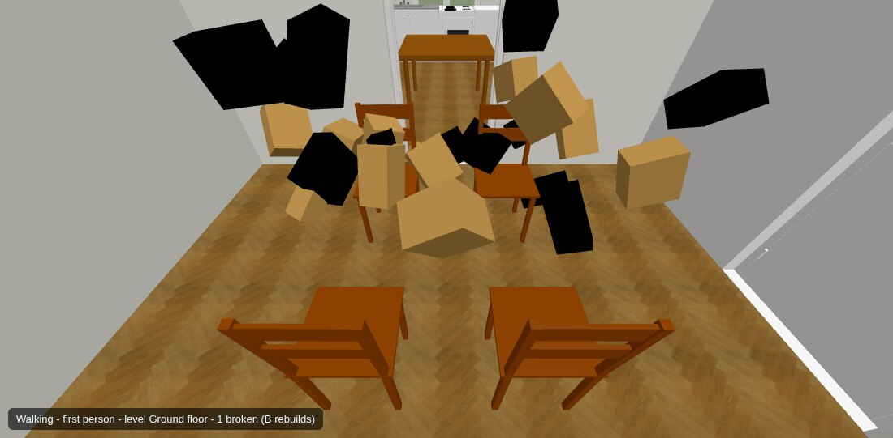

# Game Mode

**Tools > Game mode...** opens the home in the browser of the computer and lets
you move in it as in a video game: walk, run, jump, climb, fly, in first or
third person, open the doors, and break things - for the time of the game
only. Nothing is changed in the home.

It uses the same export as the WebXR preview (`docs/WEBXR_VR.md`), with the
same reduction of heavy homes, and the two pages link to each other. It is
made for a keyboard and a mouse; in a headset, use the walk-through.

## Controls

| Control | Action |
| --- | --- |
| Click | Take the mouse to look around (Esc gives it back) |
| Mouse | Look |
| W A S D / arrows | Move; Shift to run |
| Space | Jump (about 1.1 m) |
| Space kept pressed while pushing against a wall or a piece of furniture | Climb it, up to its top |
| F, or Space twice | Fly on / off; then Space goes up and C down |
| E | Open / close the door in front of you |
| Left click | Break what the cross aims at |
| B | Rebuild everything, and close the doors |
| N | Write a note on what the cross aims at, for Claude (`docs/REVIEW_NOTES.md`); T lists the notes |
| V | First / third person view |
| R | Back to the start (where the virtual visitor stands in the home) |
| H | Hide / show the help |

| The page when it opens | A closed door |
| --- | --- |
|  |  |

| The door opened with E | First person view |
| --- | --- |
|  |  |

| Third person view (V) | A table broken with a click |
| --- | --- |
|  |  |

The game starts where the virtual visitor stands in the home: place him in
the plan first (**3D view > Virtual visit**, then drag him), or ask Claude to
"put the visitor in the hall".

## What the world is made of

- **Walls stop you**, on their real height: you can climb one and walk on its
  top, or fly over it. Each door and window cuts its hole in its wall.
- **Doors are closed** until you open them with E; a door isn't closed on
  someone standing in it. When the model of the door names its leaf and its
  hinge (the doors of the default catalog do), only the leaf turns, on its
  hinge; otherwise the whole door turns around one of its ends.
- **Windows** are seen through, as their glass is in the home, and stop you
  until you break them.
- **Furniture** stops you and carries you: what is lower than 45 cm is walked
  onto, the rest is jumped or climbed onto. A piece is the box of its size,
  so you stand on the box of a chair, not on its seat.
- **Floors** are where rooms are drawn: an upper level carries you over its
  rooms, and you fall from its edge. Floors are also ceilings: a jump or a
  flight stops under them. The ground goes on around the home.
- **Stairs** made by `add_stairs` are climbed step by step (spiral ones too),
  and catalog staircases as one flight, as in the walk-through.
- **Breaking** takes away one item: a piece of furniture, a door, a window,
  stairs, or a whole wall with its doors and windows. It bursts into pieces
  that fall and fade, and it no longer stops anyone. Rooms (floors and
  ceilings) and the ground can't be broken. **B** puts everything back, and
  so does reloading the page.

## Limits

- Not tried on Windows nor with a real mouse: it was played by a script in
  headless Chrome (keyboard events and direct calls), which checked that walls
  stop the player, a door opens with E and is walked through, a wall is
  climbed, flight starts with Space twice, a table breaks and is walked
  through, and B rebuilds - on a small test home and on the 435-piece
  reference home (24,565 parts drawn as 1,925 meshes; 0.2 ms per physics step).
- The collisions use boxes: a round table is a square one, an L shaped sofa
  fills its whole rectangle, and round walls are a few straight ones without
  their doors.
- Sloping ceilings, roofs and the underside of stairs don't stop anyone.
- The ground built by `set_terrain` is drawn but not walked on: outdoors the
  player stays at the height of the lowest floor, above or under its slopes.
  Roofs built by `add_roof` and that ground stop no one.
- A wall breaks as a whole, from end to end.
- The three.js library is loaded from unpkg.com, as for the walk-through.

## Implementation

`pluginsrc/com/eteks/sweethome3d/plugin/webxr/`:

- `webxr-game-physics.js` - the world built from `scene.json` (walls cut by
  their openings, door and window panels, furniture boxes, floors, stairs)
  and the player: `createWorld`, `step`, `groundAt`, `ceilingAt`, `collide`,
  `findDoor`, `toggleDoor`, `breakObject`, `rebuild`. No three.js: tested with
  Node by `make test-webxr-walk` (`test/webxr/game.test.mjs`).
- `webxr-game.js` / `webxr-game.html` - the page: one group of meshes per item
  of the home (its parts merged by material), door hinges, the avatar, the
  camera of both views, aiming and debris.
- `WebXRSceneDescription` - `furniture`, `rooms`, wall `height`, the `door`
  flag of openings, and a `key` per item; `WebXRPreviewPlugin` names the
  shapes of the exported model `piece_<key>_...` and `wall_<key>_...`, which
  is how the page knows what a shape belongs to.
- `WebXRPreviewPlugin.GameModeAction` - the menu item.
