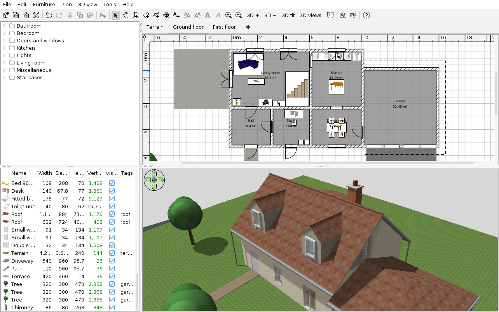

# Getting Started

This page takes you from the download to a first home, and shows where the
additions of this edition are in the menus. For how to draw walls, place
furniture and print, the help of Sweet Home 3D (**Help > Sweet Home 3D help**)
and <https://www.sweethome3d.com/userGuide.jsp> apply unchanged.

## Install

Download the file for your system from the
[releases page](https://github.com/mjcipriano/sweethome3d/releases/latest):

| System | File | How to run |
| --- | --- | --- |
| Windows 64-bit | `SweetHome3D-<version>-windows-x64.zip` | Unzip it where you want, open the `Sweet Home 3D` folder, double-click `Sweet Home 3D.exe` |
| Linux 64-bit | `SweetHome3D-<version>-linux-x64.tar.gz` | `tar xzf SweetHome3D-<version>-linux-x64.tar.gz`, then `"Sweet Home 3D/bin/Sweet Home 3D"` |
| macOS (Intel) | `SweetHome3D-<version>-macos-x64.tar.gz` | Extract it, then open `Sweet Home 3D.app`; the first time, right-click it and choose **Open** |
| Any system with Java 8 or later | `SweetHome3D-<version>.jar` | `java -jar SweetHome3D-<version>.jar` |

The three packages contain their own Java runtime. They aren't signed:
Windows shows "Windows protected your PC" (choose **More info > Run anyway**)
and macOS asks to confirm the first time.

To update, extract the new version in a new folder and delete the old one.
Your preferences, your catalog additions and the MCP token are kept in the
application folder of your account, not in the program folder:

| System | Application folder |
| --- | --- |
| Windows | `%APPDATA%\eTeks\Sweet Home 3D` |
| macOS | `~/Library/Application Support/eTeks/Sweet Home 3D` |
| Linux | `~/.eteks/sweethome3d` |

If you connected Claude to an older version, connect it again from the new
one ([MCP server](MCP_SERVER.md#how-the-connection-works)), and quit Claude
before deleting the old folder.

## The window

| Part | What it is |
| --- | --- |
| Top left | The furniture catalog, by category |
| Bottom left | The furniture of the home, with its sizes, its tags and whether it is visible |
| Top right | The plan, with one tab per level |
| Bottom right | The 3D view |
| Tool bar | The usual tools, then **3D +**, **3D −** and **3D fit** to zoom the 3D view |

## A first home in five minutes

1. **File > New from demo...** opens a furnished example to explore, or
   start from the empty home.
2. **Plan > Add room from shape...** adds a rectangle, L, T or U shaped room
   with its walls. Drag it where you want.
3. Drag furniture from the catalog into the plan, or select a piece in the
   catalog and choose **Furniture > Add to home**.
4. **Plan > Levels > Add level** adds a floor; **Plan > Add room dimensions** writes
   the size of every room.
5. **Plan > Apply style to rooms...** colors the floors and walls.
6. Click in the 3D view and press a key from `1` to `9` to see the house from
   each side and corner (`2` front, `8` back, `5` top), or use **3D views** in
   the tool bar; the mouse wheel zooms, `Q` and `E` move sideways.
7. **File > Save**, then **File > Versions...** to keep named copies as you go.

Or let an AI do it: connect Claude ([MCP server](MCP_SERVER.md)) or open
**Tools > Design assistant...** ([Design assistant](AI_ASSISTANT.md)) and ask
for "a living room of 6 by 4 meters with a sofa and a TV".

## Where the additions are

In the application, **Help > Sweet Home 3D help** has a page *What this
edition adds* with the same list (in English).

| Menu | Item | Guide |
| --- | --- | --- |
| **File** | Versions... (save, compare, restore) | [Design tools](DESIGN_TOOLS.md#versions-of-a-home) |
| | Export > Export to SVG, CSV and OBJ format | The plan, the furniture list and the 3D model |
| | Export > Export elevation drawing..., Export elevation picture... | [Design tools](DESIGN_TOOLS.md#elevation-drawings) |
| | Export > Export 360° panorama... | [3D view navigation](VIEW_3D_NAVIGATION.md#360-degree-panorama) |
| | Export > Export to Blender... | Writes the model and a Blender script for a high quality render |
| | Export > Export 3D web page... | [Design tools](DESIGN_TOOLS.md#3d-web-page-to-share) |
| **Furniture** | Replace by the piece selected in catalog | [Design tools](DESIGN_TOOLS.md#replace-furniture-in-place) |
| | Align and distribute | The alignments of furniture, in one submenu |
| | Open / Close the selected doors and windows | [Menus for the commands](DESIGN_TOOLS.md#menus-for-the-commands) |
| | Furnish the selected room... | [Menus for the commands](DESIGN_TOOLS.md#menus-for-the-commands) |
| | Import | Furniture, textures and their libraries |
| | Tags (also by right click), Layers and tags... | [Tags and layers](LAYERS_AND_FURNITURE_LIBRARIES.md) |
| **Plan** | Modify | Walls, rooms, lines, dimensions and texts, in one submenu |
| | Add room from shape... | [Design tools](DESIGN_TOOLS.md#room-shapes) |
| | Apply style to rooms... | [Design tools](DESIGN_TOOLS.md#decoration-styles) |
| | Add room dimensions | [3D view navigation](VIEW_3D_NAVIGATION.md#room-dimensions-in-one-step) |
| | Garden, Electrical and plumbing symbols, Measure the selection | [Menus for the commands](DESIGN_TOOLS.md#menus-for-the-commands) |
| **3D view** | Standard views (keys 1 to 9, **3D views** in the tool bar), Zoom in 3D view, Zoom out 3D view, Show whole home in 3D view | [3D view navigation](VIEW_3D_NAVIGATION.md) |
| | Hide walls in front of the camera (doll house) | [3D view navigation](VIEW_3D_NAVIGATION.md#doll-house-display) |
| | Sun at the date and time of the camera, Date and time of the sun... | [Menus for the commands](DESIGN_TOOLS.md#menus-for-the-commands) |
| | Use OpenGL renderer, OpenGL renderer quality | [OpenGL renderer](OPENGL_RENDERER.md) |
| | Show full detail, Reduce detail of heavy models automatically, Generate model LOD cache | [Performance](PERFORMANCE.md) |
| **Tools** | Design assistant..., What can I ask the assistant? | [Design assistant](AI_ASSISTANT.md) |
| | Claude MCP server... | [MCP server](MCP_SERVER.md) |
| | Check the plan..., Schedules, Framing estimate... | [Menus for the commands](DESIGN_TOOLS.md#menus-for-the-commands) |
| | Home report and budget... | [Design tools](DESIGN_TOOLS.md#home-report) |
| | WebXR Preview... | [Walking through a home in VR](WEBXR_VR.md) |
| | Game mode... | [Game mode](GAME_MODE.md) |
| | Review notes... | [Review notes](REVIEW_NOTES.md) |
| | View 3D web page folder... | [Design tools](DESIGN_TOOLS.md#3d-web-page-to-share) |
| **Help** | 3D rendering information... | The graphics card and the renderer in use |

## Next

- Let Claude work in your home: [Connecting Claude](MCP_SERVER.md).
- Build a complete house with roofs and a garden:
  [House modeling tutorial](HOUSE_MODELING_TUTORIAL.md).
- Visit it: [Game mode](GAME_MODE.md), [VR](WEBXR_VR.md).
