# House Modeling Tutorial

This tutorial builds a whole house through the [MCP server](MCP_SERVER.md):
two floors, a garage, roofs with dormers, a chimney, a sloped garden, a
driveway and a terrace. It uses only the real levels of the house - no helper
level for a roof, a slab or a lawn.

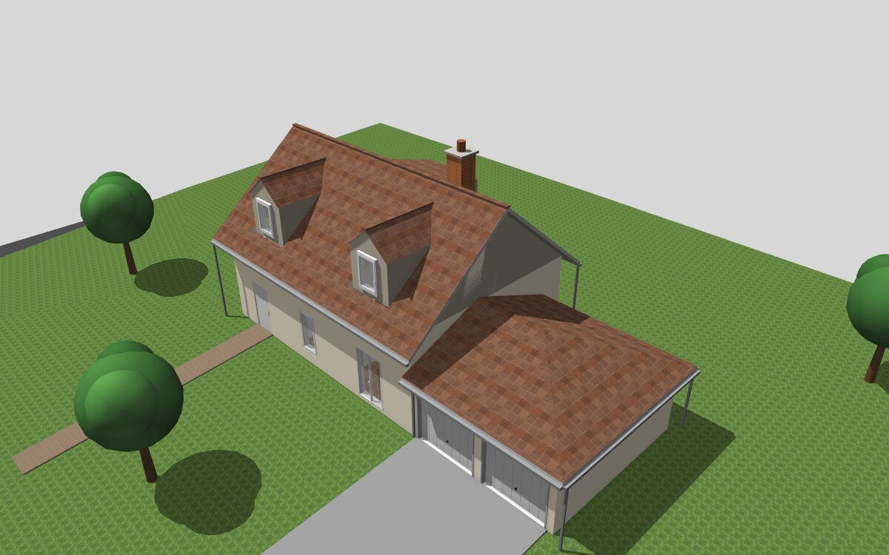

Each step shows what you could ask Claude, the commands that do it, and the
result. The commands are in [`examples/demo-house`](examples/demo-house), one
file per step, exactly as they were run to make the pictures of this page.

## Before you start

1. Open Sweet Home 3D with a new, empty home.
2. Choose **Tools > Claude MCP server...** and **Start server**
   ([Connecting Claude](MCP_SERVER.md#set-it-up)).

Then either talk to Claude - the requests in *italics* below - or replay the
command files without Claude:

```bash
cd docs/examples/demo-house
python3 replay.py            # every step
python3 replay.py 01 02      # only the first two
```

`replay.py` reads the port and the token of the server in the Sweet Home 3D
application folder and sends each file as one `apply_commands` call. Each
step is one step of **Edit > Undo**.

A reminder of the conventions ([Command reference](MCP_COMMANDS.md#conventions)):
centimeters, `x` to the right, `y` **downward** (north is `-y`), heights above
the floor of the level.

## 1. The ground floor

*"Draw a ground floor: a living room of 6 x 4.2 m, a kitchen at its east, a
hall, a study and a dining room at the south, and a double garage at the east
of the kitchen. Walls 20 cm thick."*

[`01-ground-floor.json`](examples/demo-house/01-ground-floor.json):

```json
[{"action":"add_rectangular_room","name":"Living room","x":0,"y":0,"width":600,"depth":420,"thickness":20,"height":260},
 {"action":"add_rectangular_room","name":"Kitchen","next_to":"Living room","side":"east","width":380,"depth":420,"thickness":20,"height":260},
 {"action":"add_rectangular_room","name":"Hall","next_to":"Living room","side":"south","width":300,"depth":280,"thickness":20,"height":260},
 {"action":"add_rectangular_room","name":"Study","next_to":"Hall","side":"east","width":280,"depth":280,"thickness":20,"height":260},
 {"action":"add_rectangular_room","name":"Dining room","next_to":"Study","side":"east","width":380,"depth":280,"thickness":20,"height":260},
 {"action":"add_rectangular_room","name":"Garage","next_to":"Kitchen","side":"east","offset":140,"width":560,"depth":580,"thickness":20,"height":260,"floor_color":"#9A9A9A"}]
```

`add_rectangular_room` draws a room and its walls. `next_to` puts a room
against another one and uses the wall that already stands between them:

```
Applied changes: added 6 rooms and 18 walls.
The new room shares 1 existing wall (no wall was added on that side).
```

Then the doors and windows
([`02-openings.json`](examples/demo-house/02-openings.json)). Each one is
given a point on the center line of its wall and the direction of the wall
as its angle - 0 for a wall along `x`, 90 for a wall along `y`:

```json
{"action":"add_door_or_window","name":"Front door","x":150,"y":730,"angle":0}
{"action":"add_door_or_window","name":"Door","x":310,"y":580,"angle":90}
{"action":"add_door_or_window","name":"Garage door","x":1170,"y":730,"angle":0}
```

The names are names of the catalog, found with the `search_catalog` tool
(`{"query":"window","doors_and_windows":true}`).

| `get_plan_image` | `get_3d_image` `{"view":"south_east","target":"building"}` |
| --- | --- |
| 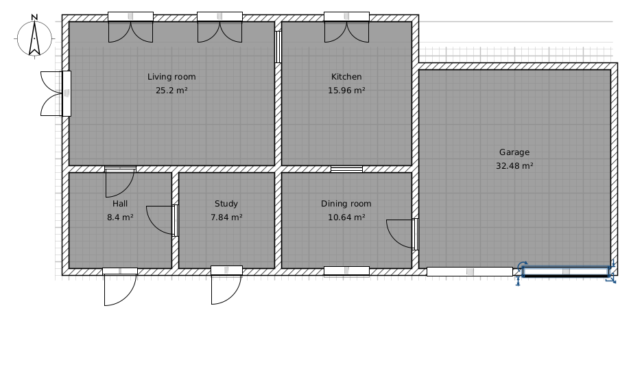 | 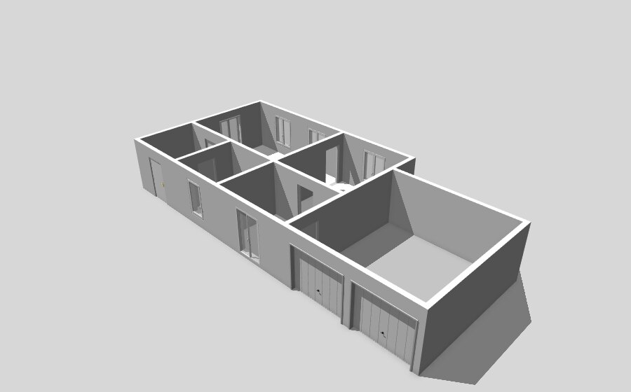 |

## 2. The first floor and the stairs

*"Add a first floor with three bedrooms, a landing, an office and a bathroom,
and U-shaped stairs with a handrail in the living room."*

[`03-first-floor.json`](examples/demo-house/03-first-floor.json):

```json
[{"action":"add_level","name":"First floor","elevation":262,"height":250},
 {"action":"modify_level","id":"L1","new_name":"Ground floor","height":250},
 {"action":"add_rectangular_room","name":"Bedroom 1","x":0,"y":0,"width":280,"depth":420,"thickness":20,"height":250},
 {"action":"add_rectangular_room","name":"Landing","next_to":"Bedroom 1","side":"east","width":300,"depth":420,"thickness":20,"height":250},
 ...
 {"action":"select_level","name":"Ground floor"},
 {"action":"add_stairs","x":505,"y":287,"angle":0,"width":90,"shape":"U","turn":"left","railing":true}]
```

- `add_level` adds a level above the others **and selects it**: what follows
  goes to the new level. Without `elevation` it stands on the walls of the
  level under it, at the default wall height of your preferences (250 cm
  with metric units, 8 feet otherwise): giving it keeps the house the same
  on every computer.
- A home without level gets its first level when a second one is added; it is
  `L1`, renamed here.
- `add_stairs` goes from the selected level up to the next one, so the ground
  floor is selected again before it. The floor above is cut open:

```
Added U-shaped stairs of 15 steps with a handrail, 90 cm wide, taking 180 x 265 cm on the floor,
climbing 262 cm to the level "First floor", whose floor is cut out above them.
```

The answer gives the floor size the stairs take: check that they fit before
placing furniture. A straight flight of the same height takes 375 cm.

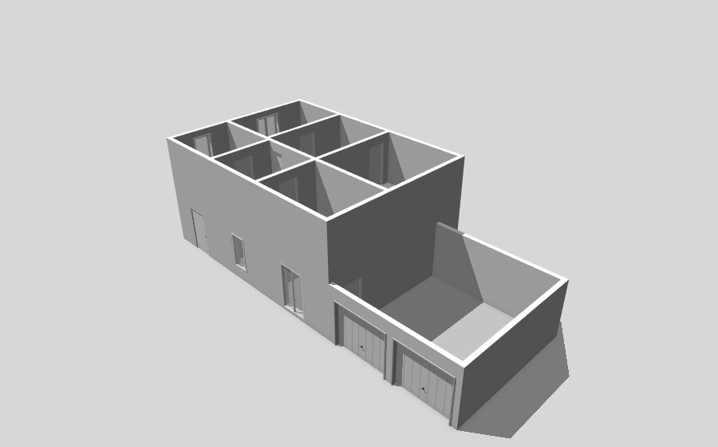

## 3. Furniture, style and outside walls

*"Furnish the rooms, decorate the ground floor in a Scandinavian style and
the first floor in a coastal one, and paint the outside walls cream."*

[`04-furniture.json`](examples/demo-house/04-furniture.json), in part:

```json
{"action":"select_level","name":"Ground floor"}
{"action":"add_furniture","name":"Corner sofa","x":130,"y":95,"angle":0}
{"action":"add_furniture","name":"TV unit","x":262,"y":390,"angle":180}
{"action":"apply_style","style":"Scandinavian","where":{"level":"Ground floor","type":"rooms","bbox":[-20,-20,1010,740]}}
{"action":"apply_style","style":"Coastal","where":{"level":"First floor","type":"rooms"}}
{"action":"set_color","ids":["W1","W5","W6","W4","W9","W10","W12","W14","W15","W16","W17"],"part":"left","color":"#E9DFC8"}
{"action":"set_color","ids":["W19","W22","W23","W26","W27","W30","W31","W33","W34","W35"],"part":"left","color":"#E9DFC8"}
```

- At angle 0 the front of a piece faces `+y`: a sofa against the north wall
  keeps angle 0, a TV unit against the south wall is turned by 180.
- `where` designates items in bulk: here the rooms of a level, and for the
  ground floor only those inside a box, which leaves the garage out.
- `set_color` with `"part":"left"` colors one side of each wall. The left side
  is at the left of someone walking from the start of the wall to its end;
  `add_rectangular_room` draws its walls clockwise, so the left side of an
  outside wall is its outside. The ids are those `get_home` lists for the
  outside walls of the two floors.

To look at a floor, ask for the top view of the selected level only:

`get_3d_image` `{"view":"top","levels":"selected","level":"Ground floor","target":"building"}`

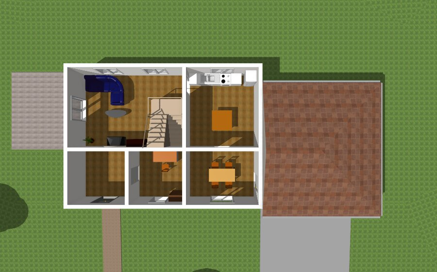

## 4. The roofs

*"Cover the house with a gable roof at 40 degrees with red tiles and gutters,
its eaves 120 cm above the first floor. Give the garage a hip roof at 22
degrees that leans against the house."*

[`05-roofs.json`](examples/demo-house/05-roofs.json):

```json
[{"action":"add_roof","level":"First floor","points":[[-20,-20],[1020,-20],[1020,740],[-20,740]],
  "eave_height":120,"pitch":40,"overhang":50,"type":"gable",
  "texture":"Red tiles","texture_scale":2,"fascia_color":"#FFFFFF","gable_color":"#E9DFC8","gutters":true,"ridge_cap":true},
 {"action":"add_roof","level":"Ground floor","points":[[1020,120],[1600,120],[1600,740],[1020,740]],
  "eave_height":260,"pitch":22,"overhang":40,
  "edges":[{"type":"hip"},{"type":"hip"},{"type":"hip"},{"type":"gable","overhang":0}],
  "texture":"Red tiles","texture_scale":2,"fascia_color":"#FFFFFF","gutters":true},
 {"action":"modify_room","where":{"level":"First floor","type":"rooms"},"ceiling_visible":false}]
```

- A roof stands **on the level of the rooms it covers**: the main roof on the
  first floor, the roof of the garage on the ground floor. No level is added.
- `points` are the outside corners of the walls, `eave_height` the height of
  the eaves above the floor of that level. With the eaves at 120 cm, the
  first floor is under the slopes, like an attic with knee walls.
- `"type":"gable"` puts the gables at the short ends. `edges` chooses for
  each edge instead: the fourth edge of the garage roof, along the house, is
  a vertical end without overhang.
- The rooms under the slopes lose their flat ceiling with
  `"ceiling_visible":false`. `"ceiling":"follow_roof"` gives them a ceiling
  under the slopes instead ([Command reference](MCP_COMMANDS.md#ceilings-under-a-roof)).

The answer names each roof and what to do next:

```
Added the roof F51 "Roof": 2 eaves and 2 gables or vertical ends, eaves at 120 cm and top at 453.86 cm
above the floor of the level "First floor", 1140 x 884 cm with its overhangs; ...
close the walls under its gables with {"action":"fit_walls_to_roof","roof":"F51"}.
```

At this point the walls of the first floor are still 250 cm high and go
through the roof:

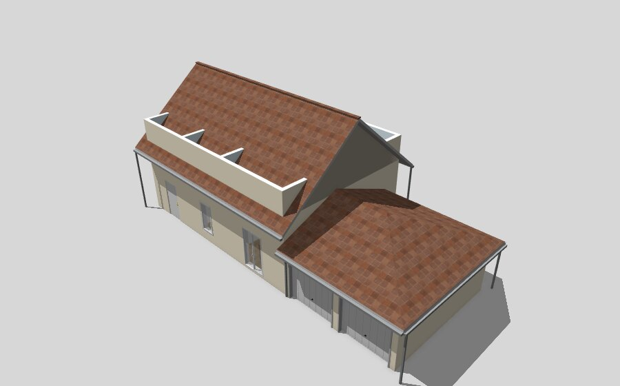

## 5. Walls under the roof, and dormers

*"Cut the walls of the first floor to the roof, and add two gable dormers on
the south slope and a wide shed dormer on the north one."*

[`06-dormers-walls.json`](examples/demo-house/06-dormers-walls.json):

```json
[{"action":"fit_walls_to_roof","roof":"F51","all":true},
 {"action":"add_dormer","roof":"F51","side":"south","position":0.22,"width":180,"height":150,"type":"gable","window":"Small window"},
 {"action":"add_dormer","roof":"F51","side":"south","position":0.78,"width":180,"height":150,"type":"gable","window":"Small window"},
 {"action":"add_dormer","roof":"F51","side":"north","position":0.5,"width":260,"height":150,"type":"shed","window":"Double small window"}]
```

- `F51` is the id the previous answer gave to the roof. Ids never change, so
  it can be used in any later call.
- `fit_walls_to_roof` gives each wall the height of the underside of the
  roof. `"all":true` includes the inside walls. A wall under the ridge is cut
  in two walls that slope up to it.
- `position` goes from 0, the west end of a north or south side, to 1.

```
Fitted 17 walls to the underside of the roof F51 (...): 12 walls have a sloped top, 4 walls were cut
where the slope changes, as under the peak of a gable (4 walls added).
```

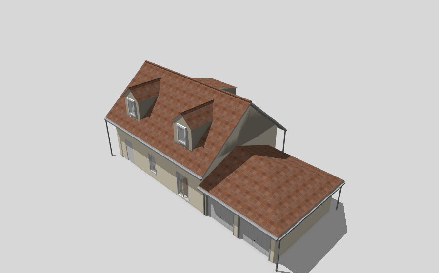

### A roof against a taller wall, gutters and downspouts

A one-story roof often runs into the wall of a taller part of the house. Three
ways stop it there; the first two keep its shape.

| What you have | Command | Result |
| --- | --- | --- |
| An edge of the roof runs along the tall wall | `{"action":"modify_roof","roof":"F52","edge":{"index":4,"type":"clip"}}` | The roof is the one a hip at that edge gives, and it stops at the vertical plane of the edge: no overhang, fascia, soffit, gutter nor downspout there. Its top doesn't move |
| The roof was drawn over the taller part | `{"action":"modify_roof","roof":"F52","clip_to_walls":["W52","W78"]}` | The roof is cut at the face of each wall, and its slopes keep their planes. `"clip_to_rooms":["R11"]` cuts it around a room and its walls. `"clip":"taller_walls"` finds the rooms most of whose walls rise through the roof. `"clip":false` removes the cut |
| The roof should lean on the wall | `"type":"abut"` | A lean-to rising toward the wall: the shape changes |

`clip_to_walls` removes what is behind each wall, seen from the middle of the
roof, however far; `"clip_depth":N` limits it to N cm. `"clip":"taller_walls"`
is a guess from the heights of the walls: the answer names the rooms it used.
With an attic whose walls weren't fitted to the roof yet, it would take the
attic for a taller part, so fit the walls first or name the rooms.

Gutters are chosen for the whole roof, for an edge, or for spans of an edge,
and `set_gutters` changes them without changing the shape of the roof:

```json
[{"action":"set_gutters","roof":"F52","gutters":true,
  "edges":[{"index":2,"gutter":false},
           {"index":3,"gutter_spans":[[0,320],[700,1447]]}],
  "downspouts":[{"edge":3,"at":120},{"edge":1,"at":40}]}]
```

- Edges are numbered from 1: the edge 1 goes from the first point of the roof
  to the second one. `describe_item` on the roof lists them with their type,
  their gutters and what walls cut.
- `gutter_spans` are distances in cm from the start of the edge.
  `"gutter_spans":null` gives the edge its whole gutter back.
- `"downspouts":[...]` puts a downspout at each given place and nowhere else.
  With `true`, one stands at the start of each gutter longer than 1 m.
- `"fascia":false` on an edge draws its band in the color of the roof.

When the points or the edges of a roof change, its dormers stay on their edge,
at the same point of the plan. A dormer whose edge is no longer an eave isn't
built, and the answer says so instead of moving it to another edge:
`modify_dormer` with `"side"` or `"edge"` moves it.

The answer of `modify_roof`, `add_dormer`, `modify_dormer` and `remove_dormer`
names the walls the change left above the roof, with the command that fits
them:

```
3 walls now rise above this roof: W12, W14, W15. Fit them with
{"action":"fit_walls_to_roof","roof":"F51","ids":["W12","W14","W15"]}
```

A key that an edge, a dormer, a dormer window or a downspout doesn't have is
reported and dropped, as the unknown keys of a command are, and a value that
is out of range is reported with the value used in its place:
`the setback -18 of the dormer 1 was changed to 0: a dormer can't stand in front of its edge`.

## 6. The site

*"The plot slopes down toward the street at the south. Add a lawn, a sloped
driveway to the garage, a pebble path to the front door, a paved terrace at
the west, three trees and a brick chimney."*

[`07-site.json`](examples/demo-house/07-site.json):

```json
{"action":"set_terrain","texture":"Grass",
 "points":[[-1400,-1200,60],[300,-1200,70],[2800,-1200,60],
           [-400,-300,0],[1900,-300,0],[-400,760,0],[1900,760,0],
           [-1400,300,10],[2800,300,10],
           [-1400,2400,-140],[700,2400,-140],[2800,2400,-140]]}
```

The ground goes through points of known height: 0 around the house, 60 to 70
cm at the north, 140 cm under the house at the street. It goes to a level of
its own under the others, named `Terrain` - the only level the house needs
besides its floors - and is left open under the rooms.

```json
{"action":"add_slab","name":"Driveway","points":[[1040,740],[1580,740],[1580,1700],[1040,1700]],
 "top_at":[[1040,760,4],[1580,760,4],[1310,1700,-76]],"thickness":14,"color":"#8C8C8C"}
{"action":"add_slab","name":"Terrace","points":[[-440,-20],[-20,-20],[-20,440],[-440,440]],
 "top":4,"thickness":14,"texture":"Paving stone"}
```

A slab is flat with `top`, or tilted through three points with `top_at`. The
driveway follows the ground, 4 cm above it: it is at 4 cm where the slope
starts (`y` 760) and at -76 cm at `y` 1700, where the ground is at -80.

```json
{"action":"create_furniture","name":"Tree","x":-700,"y":900,"tags":["garden"],
 "parts":[{"shape":"cylinder","z":0,"diameter":34,"height":230,"top_scale":0.6,"color":"#6B4A2B"},
          {"shape":"sphere","z":170,"diameter":300,"color":"#3F7A35"},
          {"shape":"sphere","x":70,"y":40,"z":270,"diameter":200,"color":"#4C8B3F"},
          {"shape":"sphere","x":-60,"y":-30,"z":290,"diameter":180,"color":"#356B2E"}]}
{"action":"duplicate","where":{"name":"Tree"},"dx":1250,"dy":520,"count":1}
{"action":"set_elevation","where":{"tag":"garden"},"on_terrain":true}
```

The catalog has no tree: `create_furniture` makes one from a trunk and three
spheres. `duplicate` copies it, tags included, and `on_terrain` puts every
piece tagged `garden` on the ground at its place.

```json
{"action":"select_level","name":"First floor"}
{"action":"create_furniture","name":"Chimney","x":760,"y":250,"elevation":300,"structure":true,
 "parts":[{"shape":"box","z":0,"width":70,"depth":70,"height":220,"texture":"Small red bricks"},
          {"shape":"box","z":220,"width":86,"depth":86,"height":8,"color":"#B8B4AC"},
          {"shape":"cylinder","z":228,"diameter":30,"height":35,"color":"#A0522D"}]}
```

The chimney is a piece of the first floor, 300 cm above its floor, with a
brick texture on its shaft. `"structure":true` tells `check_home` that it is
a part of the building.

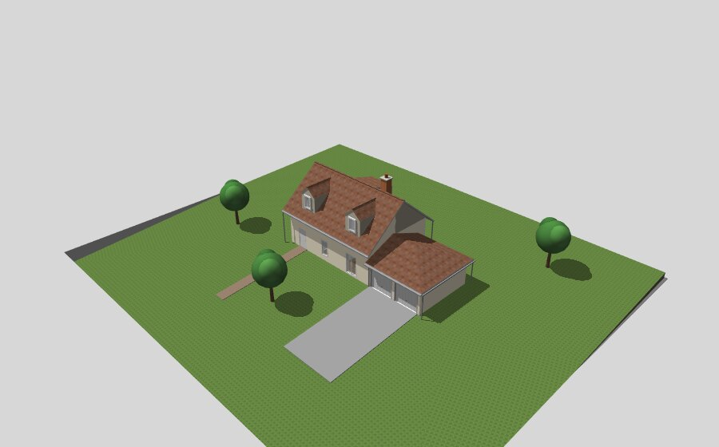

## 7. Check and keep a view

*"Check the plan and fix what you can. Keep a view from the street."*

[`08-check.json`](examples/demo-house/08-check.json):

```json
[{"action":"fix_home"},
 {"action":"check_home"},
 {"action":"set_camera","view":"south_east","ids":["R1","R6"]},
 {"action":"store_point_of_view","name":"Street side"}]
```

```
Fixed 4 issues.
Home check: no issue found.
Stored the point of view "Street side" (aerial view at x 2025, y 1595, height 1133 cm, ...).
```

The four issues were walls that met without being joined, where rooms share
walls. The stored point of view is in **3D view > Go to
point of view** and can be drawn again after changes with
`get_3d_image` `{"point_of_view":"Street side"}`.

The plans stay readable: the roofs are dashed outlines, the ground isn't
drawn at the levels above it.

| Ground floor | First floor |
| --- | --- |
| 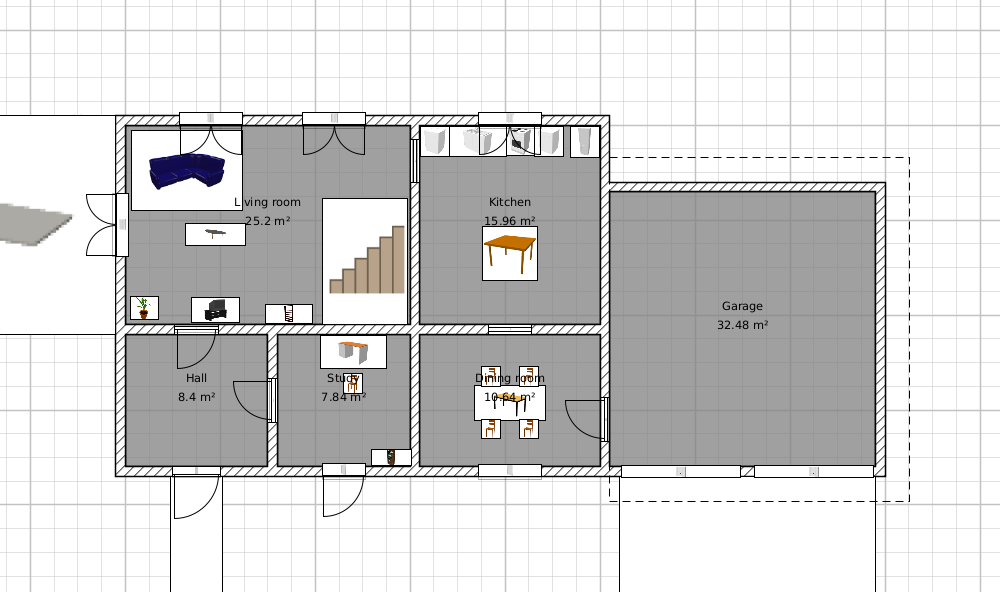 | 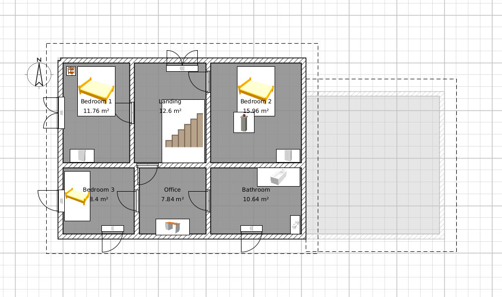 |

The same house from the garden side, `{"view":"north_west","target":"building"}`:

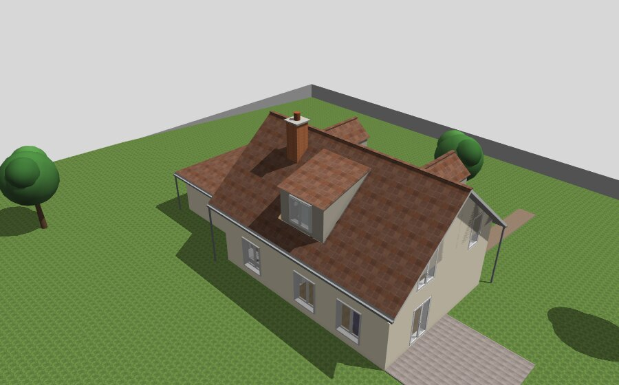

Save the home with **File > Save**: the tools can't.

## Going further

| To | Do |
| --- | --- |
| Change the pitch, the eaves or the covering of a roof | `modify_roof`, which keeps its dormers ([Command reference](MCP_COMMANDS.md#changing-a-roof)) |
| Move, widen or remove one dormer, or give it two windows | `modify_dormer`, `remove_dormer` ([Command reference](MCP_COMMANDS.md#dormers)) |
| Add a cross gable | `add_dormer` with `"setback":0` and `"ridge":"match"`, then `fit_walls_to_roof` |
| Know the headroom under the slopes | `headroom` |
| Draw the lot, its setbacks and its stakes, from a survey if you have one | `add_property_line`, `add_setback`, `import_parcel` ([Command reference](MCP_COMMANDS.md#site-lot-lines-setbacks-and-georeference)) |
| Keep a checkpoint, compare with it, come back to it | `save_version`, `compare_versions`, `restore_version` ([MCP server](MCP_SERVER.md#versions-and-saving)) |
| Fence the lot, plant a hedge, lay a path | `add_fence`, `add_hedge`, `add_path`, `add_planting_bed` ([Command reference](MCP_COMMANDS.md#garden)) |
| Furnish the rooms as a starting point | `furnish_room` ([Command reference](MCP_COMMANDS.md#furnishing-a-room-by-itself)) |
| See the sun on a day and at an hour | `set_sun` with `"follow":true` ([Command reference](MCP_COMMANDS.md#lights-sun-doors-and-materials)) |
| Get an elevation with dimensions, or the home as PDF or OBJ | `get_elevation_image`, `export_home` ([MCP server](MCP_SERVER.md#exports)) |
| List doors and windows, add outlets, estimate framing | `schedule`, `add_symbols`, `framing_estimate` ([Command reference](MCP_COMMANDS.md#schedules-symbols-and-framing)) |
| Undo a house built in many calls at once | `begin_group` ... `end_group` ([Command reference](MCP_COMMANDS.md#undo-groups)) |
| Give a wall a brick base | `modify_wall` with a `baseboard` 90 cm high and a brick texture ([Command reference](MCP_COMMANDS.md#rooms-and-walls)) |
| Raise or sink the floor of a room | `modify_room` with `floor_offset` |
| Compare with photos of the real house | `get_3d_image` with `compare_with` ([Pictures](MCP_SERVER.md#comparing-with-a-photo)) |
| Walk in the house | **Tools > Game mode...** or **Tools > WebXR Preview...** ([Game mode](GAME_MODE.md), [VR](WEBXR_VR.md)) |
| Clean up levels left by earlier attempts | `delete_level`, `merge_levels` ([Command reference](MCP_COMMANDS.md#levels-and-stairs)) |

## Limits to know

- **Roofs of non-convex houses.** `add_roof` covers an L, T or U shaped
  polygon with its largest rectangles and shows the highest roof where they
  overlap: wings meet in valleys. This isn't a straight skeleton of the whole
  polygon. A polygon with corners that aren't square may get parts that meet
  with a step; the answer says so, and one roof per wing is better.
- **The ground and rooms.** The ground is open under the rooms it reaches,
  and follows them when rooms and walls are added, moved or deleted.
- **Slabs at or under the height 0** are hidden by the flat ground of the 3D
  view where no terrain replaces it.
- **Roofs in the plan** can't be clicked: select them in the furniture list.
- **Walls under a roof** aren't fitted again by themselves: run
  `fit_walls_to_roof` again after `modify_roof`, `add_dormer`,
  `modify_dormer` or `remove_dormer`. Ceilings that follow the roof are
  built again by themselves.
- **Lot lines and georeference** are for placing a house on its lot, within
  about a meter. They aren't a survey.
- **In the game mode and the walk-through**, the visitor walks on the slopes
  of the ground and of slabs. Roofs stop no one, and neither does the edge of
  a slab higher than a step: the visitor passes under it.
