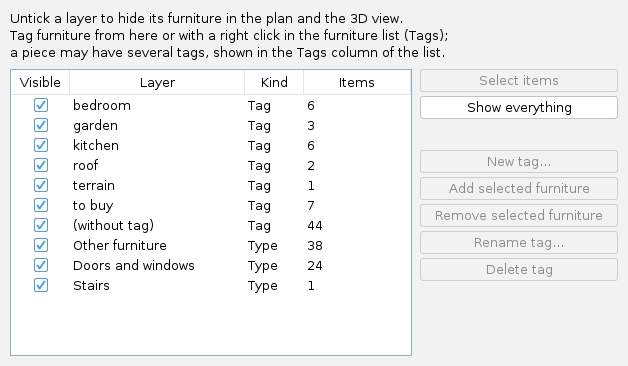

# Tags, Layers and AI-made Furniture

Two additions of this fork that work together: tags to organise the furniture
of a home in layers you show and hide at once, and commands that let the
design assistant or Claude (through the MCP server) create furniture and
furniture libraries.

## Tags and layers

A piece of furniture, a door or a window can carry any number of **tags**
("kitchen", "to buy", "phase 2", "electrical"...). A **layer** is the set of
the pieces that have a tag, or that are of a type:

| Layer by type | Pieces |
| --- | --- |
| Doors and windows | doors and windows |
| Lights | light sources |
| Stairs | staircases of the catalog and stairs made by `add_stairs` |
| Groups | groups of furniture |
| Other furniture | everything else |

### In the application

- **Right click in the furniture list or in the plan > Tags**: a box per tag of
  the home, ticked when every selected piece has it (and "2 of 5" when only
  some have it). Choosing a tag gives it to the whole selection, choosing a
  ticked one removes it. **New tag...** creates tags (several separated by
  commas), **Remove all tags** clears the selection. The same menu is in the
  **Furniture** menu.
- **Tags column** of the furniture list: appears as soon as a tag is used.
  Click its header to sort the list by tags; show or hide it with **Furniture >
  Display column > Tags**. The furniture list export (CSV) includes it, and
  **Other properties...** in **Modify furniture** edits it as text.
- **Furniture > Layers and tags...** opens a window that stays beside the home:
  one row per tag, one for the pieces without tag, one per type in use. Untick
  a row to hide its furniture in the plan and the 3D view, tick it to show it
  again. **Select items** selects the pieces of the chosen rows, **Show
  everything** makes all furniture visible, and the other buttons create,
  fill, rename and delete tags.



Roofs and the ground built by the house modeling commands are tagged `roof`
and `terrain`: untick these rows to look into the house or to hide the garden.

Every change is one step of **Edit > Undo**. Tags are saved in the home file
(as the property `tags` of each piece, a text separated by commas), and so is
whether a piece is hidden.

Hiding a layer sets the *Visible* box of its pieces: a piece that belongs to
two layers follows the layer changed last. Walls, rooms, dimensions and labels
have no such box in Sweet Home 3D and can't be tagged; whole floors are hidden
with **Plan > Make level unviewable**.

### From the assistant or Claude

```json
{"action":"add_tags","ids":["F1","F2"],"tags":["kitchen","to buy"]}
{"action":"remove_tags","target":"selection","tags":["to buy"]}
{"action":"set_tags","type":"lights","tags":["electrical"]}
{"action":"hide_layer","tag":"to buy"}
{"action":"show_layer","type":"doors_and_windows"}
{"action":"select_layer","tag":"untagged"}
```

`type` is `furniture`, `doors_and_windows`, `lights`, `stairs` or `groups`;
`with_tag` restricts a tagging command to the pieces that already have a tag.
The description of the home (`get_home`) lists the layers with their counts
and the tags of each piece, so requests like "hide everything I still have to
buy" or "tag all the lights of the first floor" work.

## Furniture made by the AI

Three ways to get a piece that is in no catalog, from the simplest:

1. **From parts** - `create_furniture` builds the model from boxes, cylinders,
   cones, spheres, prisms, wedges and bars along a path
   ([Command reference](MCP_COMMANDS.md#furniture-made-from-parts)). No file
   is needed, so it works from Claude Desktop too:

   ```json
   {"action":"create_furniture","name":"Oak table","x":200,"y":300,
    "catalog":"My furniture","tags":["custom"],
    "parts":[
     {"shape":"box","x":0,"y":0,"z":71,"width":120,"depth":70,"height":4,"color":"#B08050"},
     {"shape":"cylinder","x":-52,"y":-28,"z":0,"diameter":6,"height":71,"top_scale":0.6,"color":"#604020"},
     {"shape":"cylinder","x":52,"y":-28,"z":0,"diameter":6,"height":71,"top_scale":0.6,"color":"#604020"},
     {"shape":"cylinder","x":-52,"y":28,"z":0,"diameter":6,"height":71,"top_scale":0.6,"color":"#604020"},
     {"shape":"cylinder","x":52,"y":28,"z":0,"diameter":6,"height":71,"top_scale":0.6,"color":"#604020"}]}
   ```

   Parts are in centimeters in the frame of the piece: `x` to its right, `y`
   toward its front, `z` up; `x`,`y` are the centre of a part and `z` its
   bottom. Per part: `rotation` (degrees around the vertical), `axis` `x`/`y`
   to lay a cylinder or a cone down, `diameter`, `top_scale` (0 to 1) to taper
   it, `color` or `texture`. At most 150 parts. The piece gets an icon drawn
   from its parts, and keeps its parts: `modify_furniture_parts` changes some
   of them later.
2. **From a model file** - `import_furniture` reads a GLB, glTF, OBJ, DAE, 3DS,
   KMZ or ZIP file. Claude Code can write an OBJ file itself (or run a script
   that generates one) and import it, which allows any shape. See
   [Importing 3D models](#importing-3d-models-gltf-glb).
3. **From a picture** - `add_picture` makes a painting, a poster or a rug from
   an image; Claude can also look at a photo and rebuild the object from parts.

A workflow that works well through the MCP connector: ask for the piece
("make a mid-century sideboard, 160 cm wide, walnut with brass legs"), let
Claude call `create_furniture`, look at the result with `get_3d_image`, and
correct it (`undo`, then a new `create_furniture`) until it is right.

### Keeping furniture and making libraries

- `"catalog":"<category>"` in `create_furniture`, or
  `{"action":"add_to_catalog","ids":["F3"],"category":"My furniture"}` for
  pieces already in the home (imported or created), saves them in your
  furniture catalog: they appear in the catalog tree and can be added to any
  home by name. `"place":false` builds a piece for the catalog only.
- `{"action":"export_furniture_library","path":"/home/me/sideboards.sh3f","name":"Sideboards","tag":"sideboards"}`
  writes a **furniture library file** from pieces of the home (`ids`,
  `"target":"selection"` or a `tag`), or from a category of the catalog
  (`"category":"My furniture"`). The file is the standard `.sh3f` format: it
  can be shared, opened by a double click or with **Furniture > Import
  furniture library...**, and edited with the Furniture Library Editor.
  `"install":true` installs it at once, `"replace":true` overwrites the file.
- `{"action":"import_furniture_library","path":"/home/me/sideboards.sh3f"}`
  installs a library in the catalog.

So "build me a library of ten garden pieces" is: ten `create_furniture`
commands tagged `garden`, a look at each, then one
`export_furniture_library` with `"tag":"garden"`.

Limits: doors and windows can't be saved in the catalog or in a library this
way yet (they would lose what makes them cut walls), and groups must be
ungrouped first. These commands read and write only the files whose path
is given, and need **Allow changes to this home** on the MCP server.

## Importing 3D models (glTF, GLB)

`import_furniture` reads the glTF and GLB files that Sketchfab and most free
3D libraries offer, without a conversion in Blender:

```json
{"action":"import_furniture","path":"C:/models/camry.glb","name":"Camry",
 "x":1250,"y":-300,"angle":90,"length":492,"front":"-y",
 "materials":{"carpaint":"#285A6B"},"target_triangles":200000,
 "source":"https://sketchfab.com/3d-models/...","author":"A. Maker","license":"CC BY 4.0"}
```

| Option | Effect |
| --- | --- |
| `length` | The longest side of the model on the floor, in cm. `width`, `depth` or `height` size it by one side instead. A glTF or GLB file is in meters, so without any of them the piece has the size written in the file. Other formats have no unit: the unit is guessed from the size, as before |
| `front` | The side of the model that is its front: `+y` (its front already, the default), `-y` (its back), `+x` (its right) or `-x` (its left), in the axes of the plan for a piece that isn't turned. That side is turned to the front of the piece. In a glTF file, +Z is the front |
| `materials` | `{"<material name>":"#RRGGBB"}`: a color for each material whose name is or contains the name given, in place of its color and of its image. The names are in the answer |
| `target_triangles` | Simplifies the model to that count of triangles at most |
| `triangle_budget` | The answer warns when the piece has more triangles than this, 300,000 by default |
| `keep_helpers` | `true` keeps the helper shapes that are otherwise left out |
| `source`, `author`, `license` | Where the model comes from. They are stored with the piece, travel with the home, and `describe_item` shows them |
| `level`, `elevation`, `on_terrain`, `offset` | As in `add_furniture` |

**Where the piece stands.** Without `elevation`, the piece stands on the floor
of the room at `x`,`y` and goes on the level of that room, even when another
level is selected. Outdoors it stands on the terrain built by `set_terrain`,
on the level of the building whose floor is the closest to the ground there.
The answer says which.

**Helper shapes.** Three kinds of shapes are left out of a glTF or GLB file,
and the answer names each with its count of triangles:

- a flat plane under the model, at least a third as wide as the model (a
  ground or a shadow);
- a sphere around the model without image, at least 40 % as large as it;
- the shapes without material, when the other shapes have one.

**What is read.** Triangles, strips and fans of the nodes of the default scene
with their transformations; the base color and its image (PNG or JPEG, in the
file, embedded or beside it); transparency of blended materials; metal and
roughness factors, shown as the shininess of the material; the offset, the
scale and the rotation of an image (`KHR_texture_transform`); a color that
tints an image, applied to the pixels of the image when the model is imported
in the application (the answer says so, or says that it wasn't applied where
images can't be changed). The extensions `KHR_materials_*` (clearcoat,
transmission, sheen...) change how a material shines and are left aside. The model is
converted to an OBJ file with its materials and its images, stored with the
home: the 3D view, the photos and every export show it.

**What isn't read**, and is told in the answer when a file uses it:

- Draco and meshopt compression (the import fails: export the model again
  without mesh compression);
- images at KTX2 or WebP format, and the images of roughness, metal, normals,
  occlusion and emission;
- vertex colors and a second set of texture coordinates;
- animations, skins and morph targets (the model is in its rest pose), points
  and lines, sparse accessors.

**Simplification.** `target_triangles` merges the vertices that fall in the
same cell of a grid, with the smallest cells that reach the count asked. The
vertex that replaces the ones of a cell is put where it's the closest to the
planes of the triangles they belonged to, which keeps edges and corners better
than their average and doesn't shrink the model. Details thinner than a cell
and the exact place of an image on the surface are lost. It is written in Java
in `AssistantModelImporter` and needs no native library. Measured on a model of
1.2 million triangles built for the measure (one shape, with an image): 0.5 s
to bring it to 189,000 triangles and 0.5 s to 18,000, on top of 0.3 s to read
the file, with a Java heap of 1 GB. At a sixth of the triangles the shape keeps
its reliefs; at a sixtieth it shows facets. The meshoptimizer
library behind **3D view > Generate model LOD cache** isn't used here: it
works on models loaded by Java 3D.

For OBJ files, `target_triangles`, `materials` and `"keep_helpers":false` make
the file go through the same conversion; without them an OBJ file is loaded as
it is, as before. For DAE, 3DS and KMZ files, `length`, `front`, `source`,
`author`, `license` and the place of the piece apply; `set_material` recolors
their materials.

### Looking at a model before importing it

The MCP tool `preview_model` draws a model file, or a piece of the catalog,
alone on a plain ground, without adding it to any home and without touching
the undo history:

```json
{"path":"C:/models/camry.glb","length":492,"front":"-y","materials":{"carpaint":"#285A6B"}}
```

It takes the options of `import_furniture` for a file (`length`, `width`,
`depth`, `height`, `front`, `materials`, `target_triangles`, `keep_helpers`),
or `name` with `width`, `depth`, `height`, `color` and `materials` for a
catalog piece. `views` chooses up to 4 views among `front_left`,
`front_right`, `front`, `back`, `side`, `left` and `top` (default:
`front_left`, `front`, `side`, `top`), and `size` the width of each in pixels.
The answer gives the size of the piece in cm, its count of triangles (model
files at GLB, glTF or OBJ format), the names of its materials, what was left
out, and one picture with the views. The view `front` shows the side that
will be the front of the piece.

## Finding models online

With **Allow web services** ticked in **Tools > Claude MCP server...**, three
commands search libraries of 3D models and import what they find. Without it,
they do nothing and say so.

```json
{"action":"find_model","query":"sedan car","license":["cc0","by"],"max_triangles":300000}
```

lists the models that can be downloaded, 8 by default and 24 at most, one per
line:

```
sketchfab:<uid>  "<name of the model>" by <author> (<page of the author>),
  license CC BY (attribution required), 70258 triangles, download glb 29.4 MB / gltf 27.5 MB,
  page https://sketchfab.com/3d-models/..., preview https://media.sketchfab.com/...
polyhaven:ArmChair_01  "Arm Chair 01" by <author>, license CC0 (nothing required), 5626 triangles, ...
```

| Key | Meaning |
| --- | --- |
| `query` | The words of the search (required) |
| `library` | `sketchfab`, `polyhaven` or `all` (default) |
| `license` | One or several of `cc0`, `by`, `by-sa`, `by-nd`, `by-nc`, `by-nc-sa`, `by-nc-nd` |
| `max_triangles` | Leaves out the models with more triangles |
| `count` | How many models per library |

The preview is the address of a picture, not a picture in the answer. The
models of Poly Haven are all CC0; its list is fetched once and searched in the
application, by the words of the names, the tags and the categories.

```json
{"action":"import_model","source":"sketchfab:78f76d386a4341b0b71745bdc50fd5ab",
 "length":520,"front":"-y","materials":{"carpaint":"#285A6B"},"target_triangles":200000,"x":300,"y":800}
```

downloads the model and imports it with the options of `import_furniture`.
`source` is what `find_model` gave, or the https address of a `.glb`, `.gltf`,
`.obj` or `.zip` file. The page of the model, its author and its license are
recorded with the piece. A download is 150 MB at most, and the files of an
archive 400 MB once extracted. For Poly Haven, `"resolution":"1k|2k|4k"`
chooses the size of the images (1k by default), and only the data of the model
and the images of its colors are downloaded.

**The Sketchfab token.** Sketchfab gives its files to signed-in accounts only.
The user copies the API token of their account from
<https://sketchfab.com/settings/password> and gives it once, as `"token"` in
`import_model` or with:

```json
{"action":"set_model_token","library":"sketchfab","token":"..."}
```

- It is kept in `model-library-tokens.properties`, in the folder of the
  preferences of Sweet Home 3D, readable by its owner only. It isn't in the
  home, in its versions, nor in any answer.
- It is sent to `api.sketchfab.com` only, with the request for the links of a
  download. The file itself comes from an address signed for that download,
  asked without the token.
- `{"action":"set_model_token","library":"sketchfab","remove":true}` forgets it.
- A token typed in a conversation stays in that conversation: the user can
  renew it on the same page of Sketchfab afterwards.

**Credits.**

```json
{"action":"model_credits"}
```

lists the pieces whose model has an author, a license or a source, one line
per model, with what each license requires: attribution, no commercial use
(NC), no modified version (ND), the same license for modified versions (SA).
`export_home` writes the same list in a text file beside what it exports
(`house-CREDITS.txt` beside `house.obj`, or `<home>-CREDITS.txt` in the folder
given for a web page or a panorama) when the home has such pieces. Recoloring
or simplifying a model whose license has ND is a modified version: the answer
of `import_model` warns about it.

What the commands send is listed by `web_sources`. Other libraries can be
added in `AssistantOnlineModels` with its `Library` interface (search, and
download in a folder).

## Implementation

- `viewcontroller/HomeItemTags` - tags (property `tags`), types, layers, and
  the undoable changes of tags and visibility; `HomeController.changeFurnitureTags`,
  `renameFurnitureTag` and `setFurnitureVisible` expose them to views.
  `SweetHome3D.getFurnitureAdditionalProperties` always declares the property,
  which gives the column of the furniture list.
- `swing/FurnitureLayersView` - the Tags menu and the layers window.
- `viewcontroller/AssistantLayerCommands` - the tag and layer commands.
- `viewcontroller/AssistantFurnitureBuilder` - parts to OBJ model and icon
  (faces turned outward, drawn without AWT).
- `viewcontroller/AssistantLibraryCommands` - `create_furniture`,
  `add_to_catalog`, `export_furniture_library` (`writeLibrary`),
  `import_furniture_library`.
- `AssistantLayersAndLibraryTest` covers all of it, including reading the
  written library back with `DefaultFurnitureCatalog` and saving a home.
