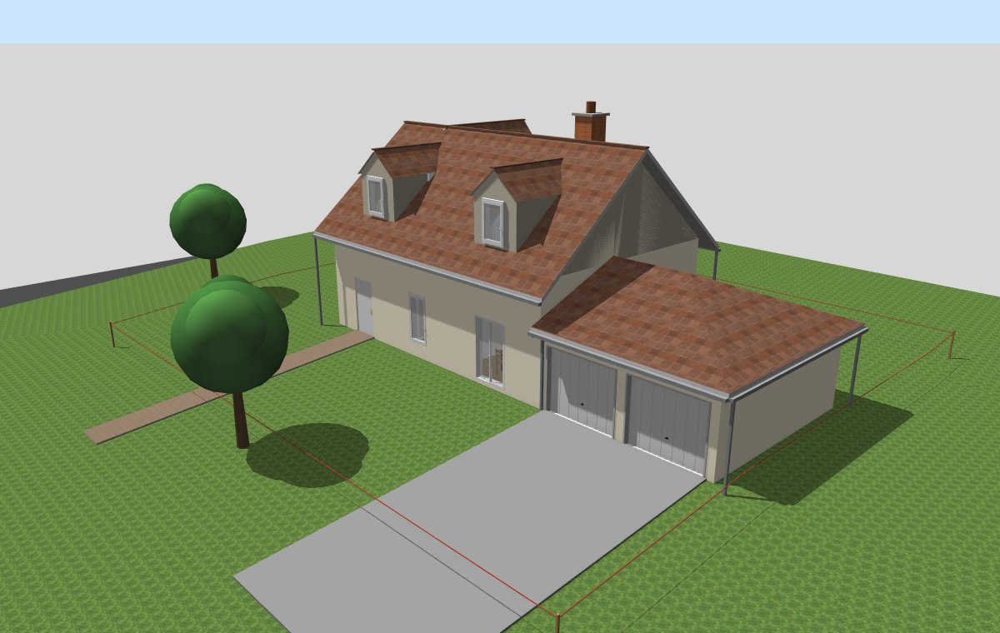
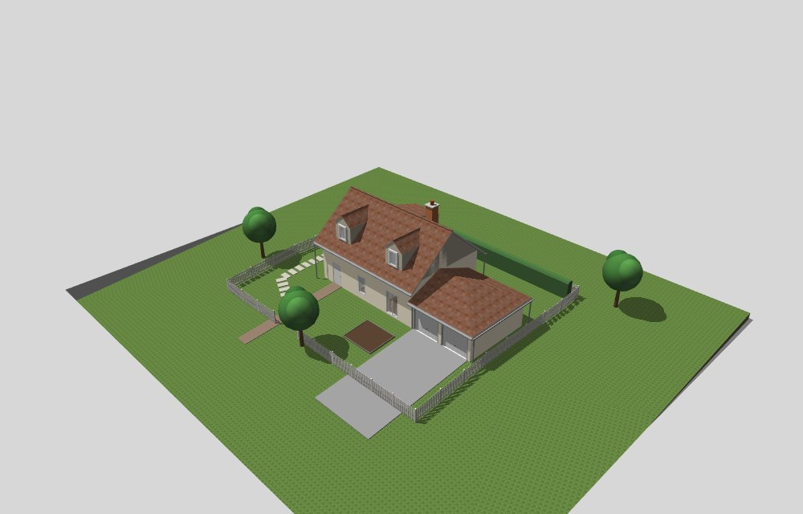

# Command Reference

The commands that edit a home. Claude sends them through the `apply_commands`
tool of the [MCP server](MCP_SERVER.md), and the built-in
[design assistant](AI_ASSISTANT.md) uses the same ones. You normally don't
write them yourself: you ask in plain words and the AI chooses the commands.
This page is for understanding what it can do, for checking what it did, and
for writing prompts that name a command.

The text Claude receives is produced by
`HomeAssistantContext.getCommandReference()`; this page follows it.

- [Conventions](#conventions)
- [Designating items](#designating-items)
- [Rooms and walls](#rooms-and-walls)
- [Levels and stairs](#levels-and-stairs)
- [Doors, windows and furniture](#doors-windows-and-furniture)
- [Changing items](#changing-items)
- [Colors, textures and styles](#colors-textures-and-styles)
- [Roofs](#roofs)
- [Slabs and ground](#slabs-and-ground)
- [Site: lot lines, setbacks and georeference](#site-lot-lines-setbacks-and-georeference)
- [Furniture made from parts](#furniture-made-from-parts)
- [Pictures, models and libraries](#pictures-models-and-libraries)
- [Tags and layers](#tags-and-layers)
- [Labels and dimensions](#labels-and-dimensions)
- [Arranging and measuring](#arranging-and-measuring)
- [Garden](#garden)
- [Furnishing a room by itself](#furnishing-a-room-by-itself)
- [Lights, sun, doors and materials](#lights-sun-doors-and-materials)
- [Camera](#camera)
- [Checks, reports and exports](#checks-reports-and-exports)
- [Schedules, symbols and framing](#schedules-symbols-and-framing)
- [Undo groups](#undo-groups)

## Conventions

A call is a list of commands, each an object with an `action`:

```json
{"commands": [
  {"action": "add_rectangular_room", "name": "Study", "x": 0, "y": 0, "width": 400, "depth": 300},
  {"action": "add_furniture", "name": "Desk", "x": 200, "y": 40}
]}
```

- **One call is one step of Edit > Undo**, whatever the number of commands.
  [Undo groups](#undo-groups) make one step of several calls.
- At most **100 commands** per call. A longer list goes in a file: the
  `apply_commands` tool takes `{"file":"<absolute path>"}` in place of
  `commands`, a JSON file holding the list (or an object with `commands`), up
  to 2000 commands, applied as one step of undo.
- Lengths and coordinates are in **centimeters**. `x` grows to the right of
  the plan and `y` **downward**: north is `-y`, south is `+y`.
- Angles are in degrees, clockwise. At angle 0 the front of a piece faces
  `+y` (the bottom of the plan).
- Heights (`elevation`, `eave_height`, `top`) are above the floor of the
  level of the item, unless said otherwise.
- A field left out keeps its default, or leaves the item unchanged.
- Colors are `"#RRGGBB"`.
- Coordinates beyond 1,000,000 cm and sizes beyond 100,000 cm are refused.
- The answer lists what was applied, what was ignored and why. It ends with
  `Ids of what was created:` and the id and name of every item the call
  added - walls of a room, windows of a dormer, stakes of a lot line - so no
  `get_home` is needed to find them. A command that fails doesn't stop the
  others.

## Designating items

Every item has an id: `F12` for furniture, doors and windows, `W3` for walls,
`R5` for rooms, `L2` for levels, `P1` for the lines of the plan. The id is given once and stored in the item
(property `assistantId`), saved with the home. It doesn't change when other
items are added or deleted, and it isn't given again after its item is
deleted. `get_home` lists the ids.

A command that changes items takes one of:

| Field | Designates |
| --- | --- |
| `"id":"F12"` | One item |
| `"ids":["F12","W3"]` | Several items |
| `"target":"selection"` | What is selected in the application |
| `"names":["Sofa"]` | Furniture by name |
| `"where":{...}` | Every item that matches all the criteria given |

The criteria of `where`:

| Criterion | Matches |
| --- | --- |
| `"level"` | The items of that level (a name or an id) |
| `"tag"` | The furniture with that tag |
| `"name"` | The items whose name contains this text; `"Pine\|Oak"` matches either |
| `"type"` | `furniture`, `doors_and_windows`, `lights`, `stairs`, `groups`, `all_furniture`, `walls`, `rooms` or `polylines`; several may be given |
| `"bbox":[x1,y1,x2,y2]` | The items inside that box |

```json
{"action":"move_to_level","where":{"level":"Old","type":"furniture"},"level":"L2"}
{"action":"delete","where":{"tag":"scaffold","bbox":[0,0,500,400]}}
{"action":"select","where":{"name":"Pine|Oak","bbox":[0,0,2000,1500]}}
```

`select` answers with the list of what it selected, with ids: with a `bbox`
it is the way to see what stands in an area. The `get_home` tool takes the
same `where`, and `"fields":["name","level","area"]` to list only these of
each item.

An empty `where` designates nothing. An id whose item was deleted is reported
as an error (`No item has the id R54...`), and the other commands of the call
are still applied.

## Rooms and walls

| Command | What it does |
| --- | --- |
| `add_rectangular_room` | A room **and** its walls. `x`,`y` = top left corner of the inside, `width`, `depth`. Or `"next_to":"R1"` (an id or a name) with `"side":"north\|south\|east\|west"` and `"offset"` to put it against a room. A wall that already stands along a side is used again. Options: `"walls":false`, `thickness`, `height`, `floor_color` |
| `add_room_shape` | An L, T or U shaped room with its walls: `shape`, `width`, `depth` (its bounding box), `cut_width`, `cut_depth`. See [Design tools](DESIGN_TOOLS.md#room-shapes) |
| `add_room` | A room from `points` `[[x,y],...]`, without walls. Options: `floor_color`, `"ceiling_visible":false`, `floor_offset` with `slab_thickness` (see [Slabs](#slabs-and-ground)) |
| `add_wall` | One wall: `x1`,`y1`,`x2`,`y2`, `thickness`, `height` |
| `modify_room` | Changes rooms: `name`, `points` (one room at a time), `ceiling_visible`, `floor_visible`, `area_visible`, `floor_offset`, `ceiling` and `flat_ceiling_at` (see [ceilings under a roof](#ceilings-under-a-roof)). The room may also be given by `"room":"<name>"` |
| `modify_wall` | Changes walls: `height`, `height_at_end` (a sloped top; 0 levels it), `thickness`, `arc_extent` in degrees (0 straightens it), `top_color`, `x1`...`y2`, `baseboard` |

```json
{"action":"add_rectangular_room","name":"Kitchen","next_to":"Living room","side":"east","width":380,"depth":420}
{"action":"modify_room","id":"R12","ceiling_visible":false,"name":"Bonus room"}
{"action":"modify_wall","id":"W4","baseboard":{"height":90,"thickness":2,"texture":"Small red bricks","side":"left"}}
```

Every room is drawn with a flat ceiling. Over a terrace or for a paved area
outdoors, hide it with `"ceiling_visible":false`: otherwise it shows as a
slab at the height of the level. Under a sloped roof, give the room a
[ceiling that follows the roof](#ceilings-under-a-roof).

A baseboard as high as needed, with a color or a texture, is how one wall
gets two finishes by height - a brick base under siding. `"baseboard":false`
removes it.

## Levels and stairs

| Command | What it does |
| --- | --- |
| `add_level` | Adds a level above the others and selects it: `name`, `elevation`, `height` |
| `select_level` | New items go to the selected level: `name` (a name or an id) |
| `modify_level` | `new_name`, `elevation`, `height`, `floor_thickness`, `viewable`, `elevation_index` |
| `delete_level` | Deletes an empty level, given by `name`, `id` or `ids` (several levels). One that isn't empty is refused with the list of what is on it, unless `"move_contents_to":"<level>"` or `"delete_contents":true` |
| `merge_levels` | Moves everything `from` a level `into` another one and deletes it. Furniture keeps its height above the ground |
| `move_to_level` | Moves furniture, walls or rooms to `level` |
| `add_stairs` | Stairs from the selected level to the next one, which they cut open: `x`, `y`, `angle`, `width`, `shape` (`straight`, `L`, `U`, `spiral`), `turn` (`left`, `right`), `railing` (`true`, `"left"`, `"right"`). Options: `length`, `tread`, `rise`, `color` |

A level is designated by its id, or by its name when no other level has it: a
name shared by several levels is refused, with their ids. Add the upper level
before the stairs; the answer gives the floor size the stairs take.

## Doors, windows and furniture

| Command | What it does |
| --- | --- |
| `add_furniture` | A catalog piece by its **exact** name: `name`, `x`, `y`, `angle`, `width`, `depth`, `elevation` |
| `add_door_or_window` | A catalog door or window: `name`, `x`, `y`, `angle`. Give a point of the center line of the wall and the direction of the wall as the angle |
| `replace_furniture` | Swaps pieces for another catalog piece at the same place, angle, level and tags: `name`, `"keep_size":true` |
| `duplicate` | Copies of furniture, each shifted by `dx`,`dy`: `count` |
| `search_catalog` | The best catalog matches for `query`, reported in the answer |

Furniture can only be added by a name of the catalog: the `search_catalog`
and `list_catalog` tools find one, and `get_catalog_image` shows it.

## Changing items

| Command | What it does |
| --- | --- |
| `move` | `dx`,`dy` (relative) or `x`,`y` (absolute) |
| `rotate` | `angle` (absolute) or `by` (added); `pitch` or `roll` tilts a piece, and both at 0 set it upright |
| `resize` | `width`, `depth`, `height` |
| `set_elevation` | `elevation` above the floor of the level (negative: under it), or `"on_terrain":true` to put the piece on the ground built by `set_terrain` |
| `set_visible` | `"visible":true\|false` |
| `rename` | `name` |
| `delete` | Deletes the items |
| `select` | Selects items in the application, by `ids`, `names` or `where`, and lists them |
| `set_plan_visibility` | How the plans of the levels above a piece show it: `"value":"draw\|outline\|hide"` |
| `describe_item` | Every property of one item, reported in the answer |
| `reduce_detail` / `restore_detail` | Shows the reduced model of heavy pieces in the 3D view, or the full one |

## Colors, textures and styles

| Command | What it does |
| --- | --- |
| `set_color` | `color` of furniture; of a wall (both sides, or `"part":"left"\|"right"`); of a room (its floor, or `"part":"ceiling"`) |
| `set_texture` | `texture` of rooms, walls and furniture, with `part` (`floor`, `ceiling`, `left`, `right`). Options: `scale` (2 = twice as large), `angle`, `offset_x`, `offset_y` |
| `search_textures` | The best texture matches for `query` |
| `apply_style` | Colors the floor, the ceiling and the facing wall sides of rooms in a named style; `"textures":false` keeps plain colors |
| `list_styles` | The styles |

Several catalog textures may share a name. `set_texture` takes the first one
and says so with the others; add `"category":"<category>"` or
`"catalog_id":"<id>"` to choose. The answer always names the texture applied.

The left side of a wall is at the left of someone walking from its start to
its end.

## Roofs

| Command | What it does |
| --- | --- |
| `add_roof` with `points` | One roof over any polygon, as one piece on a level |
| `add_dormer` | A dormer or a cross gable on a slope of such a roof, with its windows |
| `modify_dormer` | Changes one dormer; the others and their windows are kept |
| `remove_dormer` | Removes one dormer and its windows |
| `modify_roof` | Changes the pitch, the eaves, the overhang or one edge of such a roof |
| `fit_walls_to_roof` | Gives the walls under a roof the height of its underside |
| `headroom` | The height of the ceiling of the rooms under a roof |
| `auto_roof` | A simple roof over the walls of the selected level, on a level named `Roof` above them (the older command) |

```json
{"action":"add_roof","level":"First floor",
 "points":[[-20,-20],[1020,-20],[1020,740],[-20,740]],
 "eave_height":120,"pitch":40,"overhang":50,"type":"gable",
 "texture":"Red tiles","texture_scale":2,"gutters":true,"ridge_cap":true}
```

| Field of `add_roof` | Meaning |
| --- | --- |
| `points` | The outside corners of the walls it covers |
| `level` | The level it stands on (default: the selected one) |
| `eave_height` | Height of the top of these walls above the floor of the level |
| `pitch` | Slope in degrees |
| `overhang` | How far it goes beyond the walls |
| `type` | `hip`, `gable` (gables at the ends of each wing), `shed` (one slope rising from `low_side`) or `flat` |
| `edges` | Instead of `type`, one item per edge, the first from point 1 to point 2: `{"type":"hip"}` is an eave with a slope rising from it, `{"type":"gable"}` a vertical end, `{"type":"abut"}` an end against the wall of a taller part of the building: no overhang and no gable wall there. An edge may have its own `pitch` and `overhang` |
| `texture`, `texture_scale`, `texture_angle`, `color` | The covering |
| `gable_color`, `fascia`, `fascia_color`, `underside_color`, `soffit`, `ridge_cap` | The finish |
| `gutters`, `downspouts` | Gutters along the eaves, with their downspouts |
| `gable_walls` | The walls the roof draws under its gables, on by default |
| `thickness` | Thickness of the roof |

How the shape is computed: the polygon is covered by convex parts - itself if
it is convex, the largest rectangles in it if its corners are square. Over
each part a plane rises from each eave and the roof is the lowest of them.
Where parts overlap, the highest shows: the wings of an L, T or U shaped
house meet in valleys, and the ridge of a narrow wing ends in the slope of a
wider one. This equals a straight skeleton for a convex polygon only. A
polygon that is neither convex nor made of square corners is cut in parts
that may meet with a step; the answer says so, and one `add_roof` per wing
gives a better result.

### Dormers

```json
{"action":"add_dormer","roof":"F51","side":"south","offset":300,"width":240,"height":150,
 "type":"gable","window":"Small window","windows":2}
{"action":"add_dormer","roof":"F51","side":"north","offset":200,"width":300,"height":140,
 "setback":0,"ridge":"match","windows":[{"name":"Small window","width":90,"height":110}]}
{"action":"modify_dormer","roof":"F51","index":1,"width":260,"windows":3}
{"action":"remove_dormer","roof":"F51","index":2}
```

| Field of `add_dormer` | Meaning |
| --- | --- |
| `roof` | The id of the roof. It may be left out when the home has one roof |
| `side` | The eave the dormer looks over: `north`, `south`, `east`, `west`, or `"edge":N` |
| `offset` | Centimeters from the west or north end of that side (for an `edge`, from its start) to the **center** of the dormer |
| `position` | The same place as a fraction, from 0 to 1. A value above 1 is read as centimeters, and the answer says so |
| `width`, `height` | Its width and the height of its front wall |
| `type` | `gable`, `shed`, `hip` or `flat` |
| `setback` | How far its front wall stands back from the eave (default 40); 0 puts it in line with the wall of the house |
| `pitch` | The slope of its own roof |
| `ridge` | `"match"` raises its ridge to the top of the roof: a cross gable |
| `window` | The catalog window of its front wall |
| `windows` | A number, for that many `window` side by side, or a list where each item is a name or `{"name","width","height","sill"}` |

The opening a dormer cuts in the roof ends at its side walls, whatever the
width of the dormer. Its windows are doors and windows of the home; a dormer
without `window` and without a name in `windows` is built without window, and
the answer says so.

`modify_dormer` takes `index` (the dormers are numbered from 1, in the order
`describe_item` on the roof lists them) and any field of `add_dormer`.
`remove_dormer` takes `index`; the dormers after it are numbered again. Both
leave the other dormers alone: their windows keep their ids, their place and
the size you may have given them by hand. The windows of the changed dormer
move with it.

### Changing a roof

```json
{"action":"modify_roof","roof":"F51","pitch":35,"eave_height":140,"raise_walls":true}
{"action":"modify_roof","roof":"F52","edge":{"index":2,"type":"abut"}}
```

`modify_roof` changes a roof built by `add_roof` with `points` without
building it again: any field of `add_roof`, or `edge` (one edge) / `edges` (a
list), each with the `index` of the edge - the edge 1 goes from point 1 to
point 2 - and its `type`, `pitch` or `overhang`. Its dormers and their windows
are kept. `"raise_walls":true` moves the top of the walls under the roof by as
much as its eaves moved.

### Walls under a roof

`fit_walls_to_roof`: `roof` (its id). The outside walls under the roof get the
height of its underside; `"all":true` includes the inside walls, `ids`
chooses walls. The top of a wall is one straight line, so a wall is cut where
the roof changes above it: under a peak, and at the sides of a dormer or of a
cross gable, where the wall goes up to the roof of the dormer. The walls
added stay at the level of the wall they continue and joined to it, and the
answer gives their ids. Run it again after the roof or its dormers change.

### Ceilings under a roof

```json
{"action":"modify_room","id":"R7","ceiling":"follow_roof"}
{"action":"modify_room","id":"R9","ceiling":"follow_roof","flat_ceiling_at":260}
{"action":"headroom","ids":["R7","R9"]}
```

`"ceiling":"follow_roof"` (for `add_room` and `modify_room`) gives a room
under a roof built by `add_roof` a ceiling under its slopes, dormers
included, in place of the flat one. `"flat_ceiling_at":N` levels it at N cm
above the floor where the roof is higher: a cathedral ceiling with a flat
middle. `"ceiling":"flat"` gives back the flat ceiling of the level. The
ceiling is a piece of the home named after the room; it is built again when
the roof, its dormers or the room change, and isn't drawn in the plan.

`headroom` reports, for the rooms given by `ids` or for every room under a
roof, the lowest and the highest height of the ceiling and the floor area
at least 213 cm (7 ft) high. `describe_item` on a room gives the same.

In the plan, slabs and pieces made of parts are drawn seen from the top,
whatever the preference for furniture icons. A roof is a thin dashed outline at its own level and at the
levels above, and a click there doesn't select it (select it in the furniture
list). `set_plan_visibility` changes this.

## Slabs and ground

| Command | What it does |
| --- | --- |
| `add_slab` | A slab of any shape, as a piece of furniture: a driveway, a garage floor, a terrace, a ramp |
| `set_terrain` | The ground, through points of known height |

`add_slab`: `points`, `top` (height of its top above the floor of the level,
which may be negative), `thickness`, `color` or `texture` (with
`texture_scale`, `texture_angle`), `side_color`, `name`.
`"top_at":[[x,y,z],[x,y,z],[x,y,z]]` tilts its top through three points.

`add_room` and `modify_room` take `"floor_offset":N` with
`"slab_thickness":N`: a slab with the finish of the floor replaces the floor
of the room, which is hidden.

```json
{"action":"set_terrain","texture":"Grass",
 "points":[[-1400,-1200,60],[2800,-1200,60],[-400,760,0],[1900,760,0],[-1400,2400,-140],[2800,2400,-140]],
 "areas":[{"points":[[0,1030],[400,1030],[400,2500],[0,2500]],"color":"#77777A"}]}
```

`set_terrain`: `points` `[x,y,z]`, joined by triangles, or
`"grid":{"x","y","width","depth","heights":[[z,...],...]}`. `z` is in
centimeters, 0 being the floor of the level at the elevation 0. `texture` or
`color` for the whole, `areas` for parts with a finish of their own. Calling
it again replaces the ground.

- The 3D view of Sweet Home 3D draws a flat ground at the height 0, except
  over what stands on a level under it. The ground therefore goes to a level
  under the others (`Terrain`, added if needed) and is hidden in the plans of
  the other levels.
- The ground is left open under the rooms it reaches and under their walls,
  so the floors show. It is built again by itself when rooms or walls are
  added, moved or deleted, also by hand in the plan, and after undo.
- A slab whose top isn't above the height 0 is hidden by the flat ground
  where no terrain replaces it; the answer of `add_slab` says so.

## Site: lot lines, setbacks and georeference

| Command | What it does |
| --- | --- |
| `add_polyline` | A line drawn in the plan: an easement, a utility line, a fence line |
| `add_property_line` | The closed line of a lot, with its area |
| `add_setback` | The line buildings must keep behind, at a distance from a property line |
| `modify_polyline` | Changes a line: `points`, `color`, `thickness`, `dash`, `name` |
| `set_compass` | The north of the plan, the place and the look of the compass |
| `set_georeference` | The place of the plan on the Earth |
| `import_parcel` | Draws the lot lines of a survey from GeoJSON or Esri JSON |
| `get_coordinates` | The latitude, longitude and projected coordinates of points of the plan |

```json
{"action":"add_property_line","points":[[-600,-700],[1900,-700],[1900,1500],[-600,1500]],
 "label":"Lot 12","stakes":true}
{"action":"add_setback","from":"P1","distance":300}
{"action":"add_polyline","points":[[-600,900],[1900,900]],"name":"Sewer easement",
 "color":"#2060C0","dash":"dash_dot","thickness":2}
```

These are lines of the plan, not furniture: they get ids `P1`, `P2`..., are
listed by `get_home`, matched by `where` with `"type":"polylines"`, described
by `describe_item` and deleted by `delete`. They never count as furniture out
of a room.

- `add_polyline`: `points`, `color`, `thickness`, `dash` (`solid`, `dashed`,
  `dotted`, `dash_dot`), `"closed":true`, `name`, `level`, `arrows` (`start`,
  `end`, `both`), and `"elevation":N` to show it in the 3D view at that
  height. In a georeferenced home, `"geo":[[lon,lat],...]` replaces `points`.
- `add_property_line`: `points` and an optional `label`. The answer gives its
  length and its area in m2, sq ft and acres. `"stakes":true` adds stakes at
  its corners and a string between them in the 3D view, which follow the
  ground (`stake_height`, 90 cm by default).
- `add_setback`: `from` (the id of a property line), `distance`, and `side`
  (`inside` by default). The answer gives the area left to build on.

`check_home` reports the walls that stand beyond a setback line or a
property line, as errors.



### North and georeference

```json
{"action":"set_compass","north_direction":12,"latitude":33.95,"longitude":-84.55}
{"action":"set_georeference","lat":33.95,"lon":-84.55,"x":0,"y":0,"rotation":12}
{"action":"import_parcel","srs":"EPSG:2240","geojson":{"type":"Polygon","coordinates":[[[2180338,1437084],[2180420,1437084],[2180420,1437180],[2180338,1437180],[2180338,1437084]]]}}
{"action":"get_coordinates","points":[[0,0],[1000,0]],"srs":"EPSG:2240"}
```

- `set_compass`: `north_direction` is the angle in degrees, clockwise, from
  the top of the plan to the north. The sun of the 3D view and of photos
  follows it. Also `latitude`, `longitude`, `time_zone`, `x`, `y`,
  `diameter`, `"visible":false`.
- `set_georeference`: the point `x`,`y` of the plan is at `lat`,`lon`, and
  the true north is `rotation` degrees clockwise from the top of the plan.
  Or `"points":[{"lat","lon","x","y"},{...}]`, two points known both ways. It
  sets the compass to the true north and is stored with the home.
- `import_parcel`: `geojson` (a Polygon, MultiPolygon, Feature or
  FeatureCollection), or `esrijson` (with `rings`), or the `path` of such a
  file. `srs` is the system of its coordinates. The lot lines become property
  lines, placed by the georeference of the home; in a home without one, the
  middle of the parcel goes to `x`,`y` with the north at the top, and the
  home gets that georeference.
- `get_coordinates`: `points` of the plan, or `ids` of items, with an
  optional `srs` for projected coordinates beside latitude and longitude.

| `srs` | System |
| --- | --- |
| `EPSG:4326`, `EPSG:4269` | Longitude and latitude in degrees (the default) |
| `EPSG:3857` | Web Mercator, meters |
| `EPSG:326xx`, `EPSG:327xx`, `EPSG:269xx` | UTM zones, meters |
| `EPSG:2240`, `EPSG:2239` | Georgia West and East, US survey feet |
| `EPSG:26967`, `EPSG:26966` | Georgia West and East, meters |
| A PROJ text | `+proj=tmerc`, `utm`, `lcc`, `merc` or `longlat`, with `+lat_0`, `+lon_0`, `+k`, `+x_0`, `+y_0`, `+lat_1`, `+lat_2`, `+units=m\|ft\|us-ft` |

Coordinates are computed on the GRS80 ellipsoid, without datum shift: NAD83
and WGS84 are taken as equal, which is right within about a meter. A plan is
flat, so a lot is drawn at its true size around the georeferenced point; this
is for placing a house on its lot, not for surveying.

## Furniture made from parts

`create_furniture` builds a piece that is in no catalog.

```json
{"action":"create_furniture","name":"Chimney","x":760,"y":250,"elevation":300,"structure":true,
 "parts":[{"shape":"box","z":0,"width":70,"depth":70,"height":220,"texture":"Small red bricks"},
          {"shape":"box","z":220,"width":86,"depth":86,"height":8,"color":"#B8B4AC"},
          {"shape":"cylinder","z":228,"diameter":30,"height":35,"color":"#A0522D"}]}
```

Parts are in centimeters in the frame of the piece: `x` to its right, `y`
toward its front, `z` up. `x`,`y` are the **center** of a part and `z` its
**bottom**. At most 150 parts. A part and its coordinates may reach 200 m,
enough for a fence or a string along a lot; a part beyond that is refused
with its number and its size.

| Shape | Fields |
| --- | --- |
| `box` | `width`, `depth`, `height` |
| `cylinder`, `cone` | `diameter`, `height`, `top_scale` (0 to 1) to taper it, `"axis":"x"\|"y"` to lay it down |
| `sphere` | `diameter` |
| `prism` | A polygon `points` (relative to the `x`,`y` of the part) pushed up by `height` |
| `wedge` | A box cut in a slope: `high_side` (`back`, `front`, `left`, `right`), or `"ridge":"x"\|"y"` for a peak along its middle |
| `extrude` | A bar along a `path` of points `[x,y,z]` with a `width` and a `height`, or a `diameter`; `"closed":true` for a loop |

Any part takes `color`, or `texture` with `texture_scale` and
`texture_angle`, `rotation` (degrees around the vertical) and `yaw`, `pitch`,
`roll`.

Options of the piece: `x`, `y`, `angle`, `elevation`, `tags`,
`"catalog":"<category>"` to save it in the furniture catalog (`"place":false`
to save it without adding it to the home), and `"structure":true` for a part
of the building or of its site - a chimney, a post, a fence - which
`check_home` then doesn't report as furniture out of its room.
`"on_terrain":true` measures the `z` of each part, and of each point of the
`path` of an `extrude`, from the ground under it: stakes and a string line
that follow the slopes of the ground built by `set_terrain`.

`modify_furniture_parts` changes the parts of such a piece without building
it again: `set` (with an `index`, 1 = the first part), `add`, `remove`, or
`parts` to replace them all.

## Pictures, models and libraries

| Command | What it does |
| --- | --- |
| `add_picture` | Furniture showing an `image`: `"mode":"panel"` (a painting, a poster, a screen), `"box"` or `"floor"` (a rug). Missing sizes follow the proportions of the image |
| `import_furniture` | A 3D model file (OBJ, DAE, 3DS, KMZ, ZIP) as a new piece: `path`, `name`, `width` or `height` |
| `import_texture` | An `image` added to the textures catalog and applied to the ids given: `name`, `width` (the real size of what it shows), `part` |
| `set_background_image` | The picture of a floor plan behind the plan, to trace it: `image`, `width` (real width), `x`, `y`. `remove_background_image` removes it |
| `add_to_catalog` | Saves pieces of the home in the furniture catalog: `category` |
| `export_furniture_library` | Writes a `.sh3f` library from pieces or from a `category`: `path`, `name`, `"install":true`, `"replace":true` |
| `import_furniture_library` | Installs a `.sh3f` library: `path` |

Paths are absolute paths on the computer that runs Sweet Home 3D. See
[Tags, layers and furniture made by the AI](LAYERS_AND_FURNITURE_LIBRARIES.md).

## Tags and layers

| Command | What it does |
| --- | --- |
| `add_tags`, `remove_tags`, `set_tags` | Tags of furniture, doors and windows: `tags`. Instead of ids: `type` and / or `with_tag` |
| `hide_layer`, `show_layer`, `select_layer` | Every piece with a `tag`, or of a `type`; `"tag":"untagged"` = the pieces without tag |

## Labels and dimensions

| Command | What it does |
| --- | --- |
| `add_label` | `text`, `x`, `y` |
| `add_dimension` | A measurement line: `x1`,`y1`,`x2`,`y2`, `offset` |
| `auto_dimensions` | The dimension lines that give the size of every room of the level, or of `ids` |

## Arranging and measuring

| Command | What it does |
| --- | --- |
| `group` | Makes one piece of furniture of several, moved and rotated together |
| `ungroup` | Frees the pieces of a group |
| `align` | Puts an edge of furniture on the same line, or pushes furniture against a wall |
| `distribute` | Equal gaps between furniture along `x` or `y` |
| `mirror` | Flips furniture, walls, rooms and lines across a vertical or a horizontal line |
| `lock` / `unlock` | Furniture that stays in place, or moves again |
| `lock_base_plan` / `unlock_base_plan` | Locks the walls, rooms, doors and windows, as Plan > Lock base plan |
| `measure` | Distances, free space around a piece, what is at a point, a bounding box. Changes nothing |

```json
{"action":"group","ids":["F1","F2","F3"],"name":"Dining set"}
{"action":"ungroup","id":"F9"}
{"action":"align","ids":["F1","F2","F3"],"edge":"left"}
{"action":"align","ids":["F2","F3"],"edge":"front","to":"F1"}
{"action":"align","ids":["F4"],"wall":"W3"}
{"action":"distribute","ids":["F1","F2","F3","F4"],"axis":"x"}
{"action":"distribute","ids":["F1","F2","F3"],"axis":"y","spacing":20}
{"action":"mirror","ids":["F1","W2","R1"],"axis":"x","about":400}
{"action":"lock","ids":["F1"]}
{"action":"measure","from":"F1","to":"W3"}
{"action":"measure","clearance":"F1"}
{"action":"measure","at":[250,120]}
```

Furniture is designated as in the other commands: `id`, `ids`, `names`,
`where` or `"target":"selection"`. Each change is undone with the rest of
the call.

- `group`: 2 pieces at least, and an optional `name`. The answer gives the id
  of the group, which `move`, `rotate` and `delete` take as any piece. The
  pieces of a group have no id of their own while they are in it; `ungroup`
  gives them back the ids they had.
- `align`: `edge` is `left`, `right`, `top`, `bottom`, `center_x` or
  `center_y`, read on the bounding box of each piece in the plan, so turned
  pieces work. Without `to`, the pieces go to the outermost edge of the set
  (the center of the set for `center_x` and `center_y`). With `"to":"F1"`
  (a piece, a wall, a room or a line), they go to the edge of that item,
  which stays in place.
  `front` and `back` are the sides of the piece `to` (the first of `ids`
  without `to`): the other pieces slide until their own outline reaches the
  line of that side.
  `"wall":"W3"` without `edge` pushes each piece straight against the face
  of the wall on the side where it stands. Pieces are moved, never turned.
  It doesn't work with a round wall.
- `distribute`: `axis` is `x` (left to right) or `y` (top to bottom). With 3
  pieces at least, the two outermost ones stay and the others are spread
  with equal gaps between the bounding boxes. With `"spacing":N`, the first
  piece stays and each next one comes N cm after the previous. The answer
  gives the gap; a negative gap means the pieces overlap.
- `mirror`: `"axis":"x"` swaps left and right across the vertical line
  `x = about`; `"axis":"y"` swaps top and bottom across the horizontal line
  `y = about`. Without `about`, the line goes through the center of the
  bounding box of the items, so they flip in place. Furniture gets its
  position, its angle and its model mirrored; a round wall keeps its curve,
  and the colors of its two sides follow. Walls joined to a mirrored wall
  keep their common end. Dimension lines and labels are mirrored when they
  are in the selection (`"target":"selection"`), as they have no id.
  A door or a window mirrored without its wall may end out of it.
- `lock`: a locked piece can't be moved in the plan with the mouse, and
  `align`, `distribute` and `mirror` leave it in place and say so. `move`,
  `rotate` and `resize` still change it. Walls and rooms aren't locked one by
  one: `lock_base_plan` locks them all together.
- `measure` reports, in cm:
  - `"from"` and `"to"` (ids of furniture, walls, rooms or lines), or
    `"from_point":[x,y]` and `"to_point":[x,y]`: the shortest distance
    between the two outlines with the two nearest points, 0 when they overlap
    or touch, then the distance between the centers with `dx` and `dy`.
  - `"clearance":"F1"`: the free distance at the front, the back, the left
    and the right of a piece up to the nearest wall or piece of its level,
    with the id of what stands there, up to 1000 cm. The front of a piece is
    its side at the bottom of the plan when its angle is 0, and its left the
    side at the left then. Pieces that don't stand at the height of the
    measured piece (a rug, a ceiling light), doors, windows, hidden pieces
    and the slabs, grounds and roofs made by commands aren't counted.
  - `"at":[x,y]`: the rooms, the walls, the furniture and the lines that
    contain the point or come within `tolerance` cm of it (5 by default), on
    the selected level or on `level`, and the elevation of the floor of that
    level.
  - `ids` alone: the bounding box of the items, its size and its center.

## Garden

Fences, hedges, paths and planting beds are built as one piece of furniture each, where they are
drawn: `points` are points `[x,y]` of the plan in centimeters. They **follow the ground** built by
`set_terrain` when there is one (and stand at the height 0, or on the floor of a terrace, when there
is none), go to the selected level unless `level` names another one, and are flagged as a part of the
site: `check_home` doesn't report them as furniture out of a room, and they have the tag `garden`.
A line whose last point repeats the first one is closed, as with `"closed":true`.

| Command | What it does |
| --- | --- |
| `add_fence` | A fence along `points`: a post at each corner and every `post_spacing` cm (240) at most, the spans between two posts following the slope of the ground. `height` (120), `"style":"picket\|panel\|rail\|wire"` (picket), `color`, `"closed":true`, `name`. `"gate":{"at":N,"width":N}` leaves an opening `width` cm wide (100) centered `at` cm from the first point along the fence, between two taller posts |
| `add_hedge` | A hedge along `points`, mitred at its corners, with chamfered top edges: `height` (150), `width` (60), `color` (a dark green), `closed`, `name` |
| `add_path` | A paved strip along the center line `points`, mitred at its corners and laid on the ground: `width` (100), `thickness` (4), `color` or `texture` (with `texture_scale`, `texture_angle`), `"edging":true` for a curb on both sides (`edging_color`), `closed`, `name`. `"stepping_stones":{"length":40,"gap":20}` lays separate slabs of `length` x `width` cm instead |
| `add_planting_bed` | An area of soil over the polygon `points`: `thickness` (6), `color` (dark soil) or `texture`, `"border":{"height":10,"width":5,"color":"#RRGGBB"}` for an edging, `name`. `"plants":{"name":"Plant","spacing":80}` (or `"names":[...]`, or just a list of names) scatters catalog pieces inside it |
| `add_trees` / `scatter` | Catalog pieces put on the ground: `"names":[...]` (or `name`), in the polygon `"area":[[x,y],...]` or along the line `"along":[[x,y],...]`, every `spacing` cm (300) or `count` of them. `"min_distance_from_buildings"` (150), `"jitter":N` cm, `"rotate":false` |

```json
{"commands":[
  {"action":"add_fence","points":[[-800,-600],[1800,-600],[1800,1400],[-800,1400]],"closed":true,
   "style":"picket","height":110,"gate":{"at":1300,"width":120}},
  {"action":"add_hedge","points":[[-750,-550],[-750,1350]],"height":180,"width":70},
  {"action":"add_path","points":[[500,-600],[500,-200],[300,0]],"width":120,"texture":"Paving stone","edging":true},
  {"action":"add_planting_bed","points":[[900,900],[1700,900],[1700,1300],[900,1300]],
   "border":{"height":12},"plants":{"names":["Plant","Flowers"],"spacing":70}},
  {"action":"add_trees","area":[[-800,-600],[1800,-600],[1800,1400],[-800,1400]],"names":["Plant"],"count":8}
]}
```

The answer of each command gives the id of what it built, its length or its area, and its count of
posts, of stones or of plants with their ids.

- **Posts of a fence.** Each side of the line is cut in equal spans no longer than `post_spacing`, so
  a side of 5 m with the default spacing has 3 spans of 167 cm. A corner has one post, shared by its
  two sides. A gate is an opening only: no leaf is drawn in it.
- **On a slope.** Posts are upright and stand a little into the ground; rails, panels and wires go
  straight from a post to the next one, parallel to the ground between them. Hedges, paths and
  planting beds are cut every 50 cm (more on very long lines) and each part takes the height of the
  ground under it, across their width too. They aren't built again when `set_terrain` changes the
  ground: delete them and run the command again.
- **Plants and trees.** They are ordinary catalog pieces, each put at the height of the ground at
  its place and marked as standing outdoors. Their places come from a grid moved at random, but the
  same points always give the same places. `add_trees` and `scatter` skip the places in a room or
  closer than `min_distance_from_buildings` to a room or a wall of any level, and place 400 pieces at
  most at a time. The default catalog has no tree, only `Plant` and `Flowers`: add trees with
  `import_furniture` or a furniture library, and find their names with `search_catalog`.



## Furnishing a room by itself

| Command | What it does |
| --- | --- |
| `furnish_room` | Furnishes a room with pieces of the catalog placed by rules. `room` = its id or its name; `"type":"bedroom\|living_room\|dining_room\|kitchen\|office\|bathroom\|kids_room\|entry"`, guessed from the name of the room if missing; `"replace":true` deletes first the furniture that is in the room (not its doors and windows); `"max_items":N`; `"style":"<word>"` prefers the catalog pieces whose name has that word |
| `suggest_layout` | The same computation, reported without changing the home |

```json
{"commands":[{"action":"suggest_layout","room":"Bedroom"}]}
{"commands":[{"action":"furnish_room","room":"R3","type":"living_room","replace":true}]}
```

The answer lists each piece with its id, its name, its place, its angle and the wall it stands
against; then what was skipped and why (no catalog piece of that name, no free wall long enough, no
place that leaves a passage); then the free floor left. The whole is one step of Edit > Undo.

What is placed, in this order:

| Type | Pieces |
| --- | --- |
| `bedroom` | A bed in the middle of the longest free wall, rather one without window or door; a bedside table on each side; a wardrobe on another wall; a dresser or a chest |
| `kids_room` | A single bed along a corner with a bedside table; a desk under a window and its chair; a wardrobe; a bookcase |
| `living_room` | A sofa on the longest free wall; a TV unit on the opposite wall, in front of the sofa; a coffee table 40 cm in front of the sofa; an armchair at a right angle, turned to the table; a bookcase; a plant in a corner |
| `dining_room` | A table in the middle of the free floor, along the longest wall, with chairs on its long sides and at its ends, turned to it (8 at most); a sideboard; a plant |
| `kitchen` | A run of units from a corner along the walls: fridge, cabinet, cooker, cabinet, sink, dishwasher, cabinet; a table with 4 chairs if the room is larger than 12 m2 |
| `office` | A desk under a window, or on the longest free wall, and its chair; a bookcase; an armchair; a plant |
| `bathroom` | A bath along a corner (or a shower); a washbasin; a toilet in a corner; a clothes washer if the room is larger than 7 m2 |
| `entry` | A wardrobe; a chest; a stool; a plant |

The rules every piece follows:

- It stands **inside the room**, between the faces of its walls, 1 cm from the wall it has its back
  to. At the angle 0 the front of a piece faces the bottom of the plan; a piece against a wall faces
  away from it.
- It **overlaps nothing**: no other piece, placed before or already in the room.
- **Doors** keep free the zone their leaf needs: their width along the wall, and as deep (60 cm at
  least, 100 cm at most). A door is a door or a French window that starts at the floor.
- **Windows** keep free of pieces taller than 100 cm the 35 cm in front of them.
- A **passage of 60 cm** stays from each door to every piece: to its front, or to a side of a bed, a
  sofa or a table; a chair is reached from behind or from a side. A place that would close it is
  refused, and the next best place is tried.
- The same room always gets the same layout.

Limits to know:

- The layouts are tidy and usable, not designed: the pieces are the ones of the catalog at their
  catalog size, chosen by name (`bed`, `wardrobe`, `sofa`, `table`, `chair`, `desk`...) and not by
  style or by the size of the room. A large room gets the same few pieces as a small one, and a
  small room may get no bed at all. The names are looked for in English.
- Walls are found from the sides of the room: a room drawn without walls is furnished along its
  sides. Round walls and rooms with very oblique corners are handled roughly.
- Nothing is hung on walls or put on other pieces: no lamp, no TV on the TV unit, no upper cabinet,
  no curtain, no rug.
- The swing of a door is a rectangle in front of it on the side of the room, whatever the side it
  really opens to.

## Lights, sun, doors and materials

| Command | What it does |
| --- | --- |
| `set_light` | The power of lights, or turns them on and off |
| `set_sun` | The date and the time of the sun, and whether the 3D view is lit from it |
| `set_environment` | The sky, the flat ground, the light and the transparency of walls in the 3D view |
| `open_door` | Turns the leaves of doors and windows on their hinges |
| `list_materials` | The materials of the 3D model of a piece |
| `set_material` | Recolors one material of a model and leaves the others |

```json
{"action":"set_light","all":true,"power":60}
{"action":"set_sun","date":"2026-06-21","time":"17:30","follow":true}
{"action":"set_environment","sky_color":"#CCE4FC","walls_transparency":40}
{"action":"open_door","ids":["F1"],"angle":80}
{"action":"list_materials","id":"F21"}
{"action":"set_material","ids":["F21"],"material":"fabric","color":"#336699"}
```

- `set_light`: `power` from 0 to 100, or `"on":true|false`, for `ids`,
  `where` or `"all":true`. Without `power` it lists the lights. The ray
  tracer shows their light.
- `set_sun`: `date` (`YYYY-MM-DD`) and `time` (`HH:MM`, local time) at the
  latitude, longitude and time zone of the compass (`set_compass`). The ray
  tracer always uses them. With `"follow":true` the 3D view and the OpenGL
  pictures are lit and shadowed from where the sun is too, as with
  **3D view > Sun at the date and time of the camera**; at night the view is
  dimmed. The answer gives the height of the sun and its direction (within
  0.01 degree), sunrise, solar noon and sunset (within a minute), the length
  of shadows and the light the ground receives by clear sky. Without `date`
  or `time` it reports them. `"false_colors":true` replaces the colors of the
  3D view and of its pictures by the light each surface receives from the sun
  and the sky, from dark blue (0 lux) to red (120 000 lux); a number sets
  another maximum and `false` gives the colors back. See
  [How exact the sun is](VIEW_3D_NAVIGATION.md#how-exact-the-sun-is).
- `set_environment`: `sky_color`, `ground_color`, `light_color`,
  `walls_transparency` (0 opaque to 100), `all_levels_visible`,
  `sky_texture` and `ground_texture` (a texture name, or `false`). Without
  field it reports the current values.
- `open_door`: `angle` in degrees; a negative angle opens the other way,
  and 0 or `"open":false` closes. The two leaves of a double window turn in
  opposite directions. The box of the piece grows with what its leaves
  sweep, as when a model is modified in the furniture window, and comes back
  when it is closed. Only models made with hinges open - the doors and
  windows of the default catalog do, sliding ones and imported models
  without hinges don't, and the answer names them.
- `set_material`: `material` is a name given by `list_materials`, or a part
  of one (`"fabric"` matches `fabric_seat` and `fabric_back`). `color`,
  or `texture` (a texture name), and `shininess` from 0 to 100.
  `"reset":true` gives one material, or all of them without `material`,
  the look of the model again. A color given to the whole piece by
  `set_color` hides its materials, so `set_material` removes it.

## Camera

| Command | What it does |
| --- | --- |
| `set_camera` | Moves the camera of the user: a place (`x`, `y`, `height`, `look_at_x`, `look_at_y`, `mode` `visitor` or `aerial`), a `view` (`top`, `south`, `north_east`... of the home or of `ids`, or `inside` a room), or a stored `point_of_view` |
| `store_point_of_view` | Keeps the camera under a `name` in **3D view > Go to point of view**. With `"camera":{"x","y","height","look_at_x","look_at_y","look_at_height"}` or a `view`, it stores that point of view without moving the camera of the user |

The place of the virtual visitor is also where the VR walk-through and the
game mode start. Camera moves aren't undoable.

## Checks, reports and exports

| Command | What it does |
| --- | --- |
| `check_home` | Reports plan defects with ids: walls that don't meet, duplicates, rooms without door, doors out of walls, doors and windows above the underside of the roof, walls beyond a setback or a property line, furniture under the floor or out of rooms, heavy models |
| `fix_home` | Repairs the defects marked fixable; `"types":["wall_gap"]` limits it |
| `home_report` | Floor areas, wall lengths and surfaces, furniture counts and prices; roofs, slabs and the ground are listed apart |
| `set_unit_prices` | `paint`, `flooring`, `ceiling`, `baseboard`, `currency`: the report then ends with a budget |
| `export_elevation` | Writes a SVG elevation drawing: `side`, `path`, `section`. Roofs, slabs, pieces made of parts and the ground are drawn with their real shape, catalog furniture as boxes |

`check_home` doesn't report roofs, slabs, the ground, pieces put on the ground
with `on_terrain`, pieces created with `"structure":true`, or pieces given a
negative elevation on purpose.

Each issue is an `error`, a `warning` or an `info`, the most serious first.
Options, for the command and for the `check_home` tool:

| Option | Effect |
| --- | --- |
| `"min_severity":"warning"` | Leaves out the less serious issues (`info`, `warning` or `error`) |
| `"ignore":["F516","W3"]` | Leaves out the issues about these items |
| `"ignore_tags":["marker"]` | Leaves out the issues about the furniture with these tags |
| `"remember":true` | Keeps `ignore` and `ignore_tags` in the home for the next checks |
| `"forget":true` | Stops ignoring what was remembered |

The answer says how many issues were left out.

## Schedules, symbols and framing

### Schedules

A schedule is a table of the home, answered as text: a line of titles, then a
line per row, values separated by ` | `. Schedules change nothing unless
`tag_marks` or `labels` is given.

| Command | What it does |
| --- | --- |
| `door_schedule` | The doors grouped by name and size: mark, type, name, width, height, sill height, count, levels, ids |
| `window_schedule` | The same table for the windows |
| `room_schedule` | The rooms: id, name, level, area, perimeter, ceiling height, floor finish, net wall surface |
| `symbol_schedule` | The electrical and plumbing symbols counted by type, then by room and level, then by circuit |
| `schedule` | Any of them: `"type":"doors"`, `windows`, `doors_and_windows`, `furniture`, `symbols` or `rooms` |
| `export_schedule` | Writes the table of a schedule in a CSV file: `type`, `path`, `replace` |

Every schedule takes `"level":"<id or name>"` to keep one level.

```json
{"action":"door_schedule"}
{"action":"schedule","type":"doors_and_windows","level":"Ground floor","tag_marks":true,"labels":true}
{"action":"export_schedule","type":"rooms","path":"/home/me/house/rooms.csv","replace":true}
```

```
Door schedule (cm):
Mark | Type | Name | Width | Height | Sill height | Count | Levels | Ids
D1 | door | Door | 80 | 205 | 0 | 1 | Ground floor | F12
D2 | door | Door | 90 | 205 | 0 | 2 | Ground floor | F3 F7
Total: 3 doors of 2 types
```

- **Marks.** Doors get `D1`, `D2`..., windows `W1`, `W2`... The doors that
  have the same name, width and height share a mark. Marks are given in the
  order of the table: by name, then width, then height. They are computed
  again at each call, so adding a new kind of door may shift the marks that
  follow it.
- **Door or window.** A piece whose name contains "window" is a window, one
  whose name contains "door" or "gate" is a door; otherwise a piece that
  starts under 30 cm and is at least 150 cm high is a door.
- **Sill height** is the elevation of the piece above the floor of its level.
  Pieces that share a mark at different heights list them: `90 / 110`.
- `"tag_marks":true` writes the mark in the property `scheduleMark` of each
  door and window. `"labels":true` also writes it in the plan, in a label 25 cm
  in front of each piece; asking again replaces the labels written before.
  Both are undone by Edit > Undo.
- **Room schedule.** The ceiling height is the height under the ceiling of the
  level, or the lowest and the highest headroom (`120 to 310`) under a roof
  built by `add_roof`; it is empty for a room without ceiling. The floor
  finish is the name of the floor texture, else its color `#RRGGBB`, else
  `default`. The net wall surface is explained under
  [the report](#what-changed-in-home_report).
- **Furniture schedule.** Grouped by name and size, with the count, the
  levels, the sum of the prices and the ids. Doors, windows, symbols, roofs,
  slabs and the other parts of the building aren't listed.
- **CSV.** `export_schedule` writes the titles and the rows of the table, in
  UTF-8, values separated by commas, lines ended by CR LF. A value that
  contains a comma, a semicolon, a quote or a new line is written between
  quotes, its quotes doubled. `path` must be absolute, end with `.csv` and be
  in a folder that exists; an existing file is kept unless `"replace":true`.
  The remarks under a table (totals, counts by room and circuit) aren't
  written in the file.

### Electrical and plumbing symbols

```json
{"action":"add_symbol","type":"outlet","wall":"W3","offset":120,"circuit":"Kitchen 1"}
{"action":"add_symbol","type":"switch","wall":"W3","offset":20,"side":"right","height":105,"label":"S1"}
{"action":"add_symbol","type":"ceiling_light","x":250,"y":200}
{"action":"add_symbols","room":"R3","type":"outlet","spacing":360}
{"action":"symbol_schedule"}
{"action":"list_symbols"}
```

A symbol is a small piece of furniture. The plan draws it as on an electrical
or plumbing drawing (electrical in red, plumbing in blue); the 3D view shows
a small plate, box or fixture at its real height.

| Type | Is | Fixed | Default height (cm) |
| --- | --- | --- | --- |
| `outlet`, `double_outlet` | Electrical | on a wall | 30 |
| `switch`, `three_way_switch` | Electrical | on a wall | 110 |
| `wall_light` | Electrical | on a wall | 180 |
| `thermostat` | Electrical | on a wall | 150 |
| `data`, `tv` | Electrical | on a wall | 30 |
| `panel` | Electrical | on a wall | 150 |
| `ceiling_light`, `fan`, `smoke_detector` | Electrical | under the ceiling | the ceiling |
| `sink` | Plumbing (supplies and drain) | on a wall | 50 |
| `hose_bib` | Plumbing | on a wall | 45 |
| `toilet_rough`, `shower_drain`, `floor_drain` | Plumbing | on the floor | 0 |
| `water_heater` | Plumbing | on the floor | 0 |

| Field of `add_symbol` | Meaning |
| --- | --- |
| `type` | One of the types above |
| `wall`, `offset` | The wall and the distance in cm from its start point: the symbol stands against the face of the wall, turned to it. Without `offset`, the point of the wall the closest to `x`,`y`, or its middle if they aren't given |
| `side` | `left` or `right` of the wall, seen from its start to its end. Without it: the side of `x`,`y` if given, else the side where a room is, else the left one |
| `x`, `y`, `angle` | The place of the symbol when no `wall` is given; `level` chooses its level |
| `height` | For a wall symbol the height of its **center** above the floor; for a ceiling symbol the height of its top (by default the height of the wall, of the level or of the home); for a floor symbol the height of its bottom |
| `label` | A text that names the piece and is written beside it in the plan |
| `circuit` | The name of its circuit, counted by `symbol_schedule` |

- A symbol has the tag `electrical` or `plumbing`
  ([Tags and layers](#tags-and-layers)): `{"action":"hide_layer","tag":"electrical"}`
  and Furniture > Layers and tags show or hide them all. Its type is in its
  property `symbolType` and its circuit in `symbolCircuit`.
- `check_home` ignores symbols, `home_report` counts them on a line of their
  own, and the furniture schedule leaves them out.
- A symbol is moved, turned, renamed and deleted like any piece of furniture,
  with its `F#` id. It doesn't follow its wall when the wall moves.
- In the plan a wall symbol is drawn 16 cm wide and 12 cm deep (more for a
  panel or a sink) so that it can be read; its plate in 3D is smaller.
- `add_symbols` puts symbols along the straight walls that follow the sides
  of a room: on each wall side `ceil(length / spacing)` of them, evenly
  spaced (the default 360 cm leaves no point of a wall more than 180 cm from
  an outlet). A symbol that would stand in a door, or in a window that goes
  down to its height, moves 20 cm beside the opening, or is left out if
  there is no room. Wall sides shorter than 60 cm get none. The answer gives
  the count and the ids. It takes `height` and `circuit` like `add_symbol`.
- `list_symbols` gives the types of symbols.

### Framing estimate

`framing_estimate` counts the studs, plates and headers of straight walls
for a budget:

```json
{"action":"framing_estimate"}
{"action":"framing_estimate","ids":["W1","W2"],"stud_spacing":60.96,"stud":"2x6","plates":3,"header":"2x8","waste":0.1}
```

Estimates the lumber of walls framed in wood. **It is an estimate for a
budget, not a structural design**: sizes, spacing, headers and bracing are
decided by a building code or an engineer.

| Field | Default | Meaning |
| --- | --- | --- |
| `ids`, `where` | every wall | The walls to estimate; `level` keeps one level. Round walls are left out |
| `stud_spacing` | 40.64 (16 in) | The distance between studs in cm; 60.96 is 24 in |
| `stud` | `2x4` | The lumber of the studs and plates, like `2x6` |
| `plates` | 3 | The plates along each wall: one at the bottom, two at the top |
| `header` | `2x8` | The lumber of the headers, which are doubled |
| `waste` | 0.1 | The share added for waste |

How it counts:

- **Studs**: for each wall `ceil(length / stud_spacing) + 1`, plus 2 for each
  door or window in it (king and jack), plus 2 for each corner where two
  walls are joined. A stud is as long as its wall is high.
- **Plates**: `plates` x the length of the walls.
- **Headers**: one for each opening, as long as the opening is wide plus
  2 x 7.6 cm.
- **Sheathing and drywall**: the surface of the two sides of the walls,
  openings deducted, also given for one side and in sheets of 4 ft x 8 ft.
- Totals are given in pieces, meters, feet and board feet (1 in x 12 in x
  1 ft), then again with the waste, then wall by wall.

Not counted: blocking, cripple studs, sills under windows, bracing and
hardware. The lengths of the walls are the ones of their middle lines, so the
thickness of a wall is counted twice at a corner.

### Unit prices of a room or a wall

```json
{"action":"set_unit_prices","paint":8,"flooring":35,"ceiling":6,"baseboard":7,"currency":"EUR"}
{"action":"set_unit_prices","room":"R3","flooring":60,"paint":12}
{"action":"set_unit_prices","ids":["W3"],"paint":25,"side":"left"}
{"action":"set_unit_prices","room":"R3","clear":true}
```

`set_unit_prices` without a room or a wall still sets the prices of the whole
home. With `room` (an id or a name), `ids`, `where` or `"target":"selection"`
it gives rooms and walls a price of their own:

| Item | Prices | Applies to |
| --- | --- | --- |
| A room | `flooring`, `ceiling` (per m2 of its area), `baseboard` (per m of its perimeter), `paint` (per m2) | Its floor, its ceiling, its perimeter, and the wall sides that face it |
| A wall | `paint` (per m2) | Its two sides, or one of them with `"side":"left"` or `"right"` |

- The price of a wall side wins over the price of the room it faces, which
  wins over the price of the home.
- A negative price removes that price from the room or the wall.
  `"clear":true` removes all the prices of the items given; with no item, of
  every room and every wall. The prices of the home are kept.
- These changes are undone by Edit > Undo. They are stored in the properties
  `budgetUnitPrice.<key>` of the room or the wall and saved with the home.

### What changed in `home_report`

The report (also Tools > Home report and budget...) now deducts doors and windows:

```
- Level "Ground floor": floor 20.0 m2, 4 walls, 18.4 m long, 92.0 m2 of wall surface on both sides, 3.7 m2 of openings, 88.3 m2 net
    - Living: 20.0 m2, perimeter 18.0 m, walls 43.2 m2 net (1.8 m2 of openings deducted) [own prices: flooring 50.0]
- Total: floor 20.0 m2, walls 18.4 m long, 92.0 m2 of wall surface on both sides, 3.7 m2 of openings of doors and windows deducted, 88.3 m2 net
- Walls with their own price: W1: paint right 30.0
- Electrical and plumbing symbols: 9 (8 x outlet, 1 x switch); symbol_schedule lists them
- Budget from the unit prices (walls on both sides, openings of doors and windows deducted):
    - Wall paint or covering, per m2 of wall side: 44.9 m2 x 10.0 = 449.00 EUR
        - W1, right side, own price: 10.9 m2 x 30.0 = 327.00 EUR
        - Living (R1), own price: 32.5 m2 x 12.0 = 390.00 EUR
    - Flooring, per m2 of floor: no price for the whole home
        - Living (R1), own price: 20.0 m2 x 50.0 = 1000.00 EUR
```

- **Openings.** A door or a window is deducted from the wall of its level
  that contains its center. Its opening is its width by its height, clipped
  to the length and the height of the wall, and it is deducted on both sides
  of the wall. A door that stands in no wall deducts nothing.
- **Gross, openings, net.** Each level and the total give the three
  surfaces. The paint of the budget is now computed on the **net** surface,
  so a budget is lower than before for the same prices.
- **Rooms.** Each room gives the net surface of the wall sides that face it:
  the straight walls of its level that run along its sides, within their
  thickness. It is left out when no wall follows the room. A wall between two
  rooms counts one side for each.
- **Own prices.** Rooms and walls that have their own price are marked, and
  the budget gives a line for each under the line of the home, which then
  covers only what is left.
- **Symbols** are counted on their own line, not with the furniture.

Limits: round walls deduct their openings but aren't attributed to rooms; a
sloping wall is measured with its mean height; the baseboard is the whole
perimeter of the rooms, door widths included.

## Undo groups

```json
{"action":"begin_group"}
{"action":"end_group"}
```

One call of `apply_commands` is one step of undo. `begin_group` makes one
step of every call that follows, until `end_group`: a house built in ten
calls is then undone at once. The `undo` tool ends an open group and undoes
it, and a group left open ends by itself after 10 minutes without a command.
