# Connecting Claude to a Home (MCP server)

Sweet Home 3D can expose the home you are editing to Claude - Claude Desktop,
Claude Code, or any other [Model Context Protocol](https://modelcontextprotocol.io)
client running on the same computer. Claude can then describe the home, search
the furniture catalog, look at pictures of the plan and of the 3D view, and
edit the home with undoable commands. No API key is involved: the client talks
to Sweet Home 3D, not the other way round.

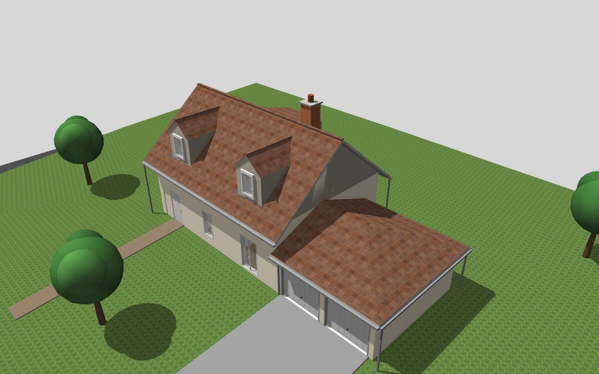

- [Set it up](#set-it-up)
- [What to ask](#what-to-ask)
- [Tools](#tools)
- [Ids and filters](#ids-and-filters)
- [Pictures](#pictures)
- [Security](#security)
- [When something goes wrong](#when-something-goes-wrong)
- [Implementation](#implementation)

Related pages: the [command reference](MCP_COMMANDS.md) lists every edit
command, and the [house modeling tutorial](HOUSE_MODELING_TUTORIAL.md) builds
the house above step by step.

## Set it up

1. Open a home and choose **Tools > Claude MCP server...**
2. Click **Start server**. The dialog shows `Running at http://127.0.0.1:47391/mcp`.

   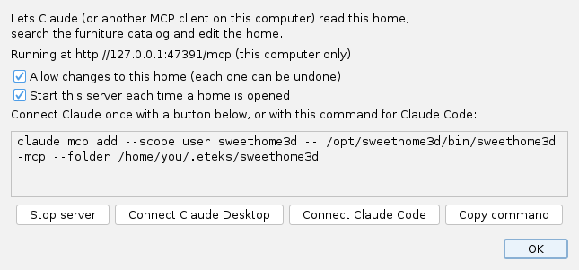

3. Connect Claude, once:
   - **Connect Claude Desktop** adds Sweet Home 3D to the servers of Claude
     Desktop (its `claude_desktop_config.json`, after asking; a copy of the
     previous file is kept beside it as `.before-sweethome3d`). Then quit
     Claude Desktop completely - from its icon near the clock too - and
     reopen it.
   - **Connect Claude Code** runs `claude mcp add --scope user sweethome3d ...`
     for you. If the `claude` command isn't found, click **Copy command** and
     run it in a terminal. Then start a new Claude Code session.
4. Ask Claude about the home: "what rooms does my home have?"

The two boxes of the dialog:

| Box | Effect |
| --- | --- |
| **Allow changes to this home** | Unticked, Claude can read the home and get pictures, but can't change anything nor write files |
| **Start this server each time a home is opened** | Skips steps 1 and 2 from then on. Otherwise the server stops when the home window is closed |

Claude doesn't need to be told anything else: on connection it receives the
instructions of the server, the list of tools and the reference of the edit
commands. If Claude is asked about the home while no server runs, the tools
answer that the server must be started.

Under Windows the place of the configuration file of Claude Desktop depends
on how it was installed (`%LOCALAPPDATA%\Claude-Data\claude_<id>`, the store
package folder, or `%APPDATA%\Claude`), so every one of these folders that
exists gets the entry.

### How the connection works

The buttons register a small program, the *bridge* (`sweethome3d-mcp` in the
packaged application, otherwise
`java -cp <jar> com.eteks.sweethome3d.swing.HomeMCPBridge`). Claude launches
it and talks to it on its standard input and output; the bridge forwards each
message to the server of the home, whose port and token it reads in the Sweet
Home 3D application folder. The registration therefore contains no token and
no port, and it stays valid from one session to the next.

It does contain the path of the application: **connect again after moving
Sweet Home 3D or installing a new version in another folder**. While Claude
runs, its bridge program keeps the application folder in use. Before
deleting or replacing that folder, quit Claude, or click **Release program
folder** in the dialog: the bridge programs stop within a few seconds, and
Claude shows Sweet Home 3D as disconnected until Claude is started again.

With several home windows, the bridge reaches the server started last. The
first server gets port 47391 and the next ones a free port shown in their
dialog; `-Dcom.eteks.sweethome3d.mcp.port=<port>` sets another fixed port.

Clients that take a URL can connect directly to `http://127.0.0.1:47391/mcp`
with the header `Authorization: Bearer <token>` (the token is in the file
`mcp-token`, see [Security](#security)):

```bash
claude mcp add --transport http sweethome3d http://127.0.0.1:47391/mcp \
  --header "Authorization: Bearer <token>"
```

## What to ask

Plain requests work; Claude chooses the tools.

| You ask | Claude uses |
| --- | --- |
| "What rooms does my home have, and how large are they?" | `get_home` |
| "Add a desk and an office chair to the study" | `search_catalog`, `apply_commands` |
| "Move the sofa 50 cm to the right" | `apply_commands` (`move`) |
| "Show me the kitchen" | `get_3d_image` with `"view":"inside"` |
| "Is anything wrong with the plan?" | `check_home`, then `fix_home` |
| "How much flooring do I need?" | `get_report` |
| "Add a hip roof with a dormer over the entrance" | `add_roof`, `add_dormer`, `get_3d_image` |
| "Make a walnut sideboard, 160 cm wide" | `create_furniture`, `get_3d_image` |
| "Here is a photo of the house: check the roof against it" | `get_3d_image` with `compare_with` |
| "Do my review notes" | `get_notes`, `apply_commands`, `update_note` |
| "Undo that" | `undo` |

Every `apply_commands` call is one step of **Edit > Undo** in the
application. Claude works better when it looks at what it did: ask it to
check its work with a picture.

## Tools

| Tool | What it does |
| --- | --- |
| `get_home` | Text description of the levels, rooms (area, extent, center), walls, furniture and selection, with ids. Optional filters `level`, `type`, `name`, `where` and `fields` |
| `list_catalog` | Categories and item names of the furniture catalog |
| `search_catalog` | Best catalog matches for a query (`doors_and_windows` to search doors and windows) |
| `search_textures` | Best texture matches, for the `set_texture` command |
| `get_catalog_image` | The pictures of up to 8 catalog pieces or textures, to choose between search results |
| `check_home` | Report of plan defects (unjoined walls, duplicates, rooms without door, doors out of walls or above the roof, walls beyond a setback...) and of [what shows in 3D](#checks-of-what-shows-in-3d) (roofs in rooms, walls over each other or above the roof, open two-story rooms, wall finishes) with ids, each an error, a warning or an info. Options `min_severity`, `ignore`, `ignore_tags`, `remember`, `forget` ([details](MCP_COMMANDS.md#checks-reports-and-exports)) |
| `get_report` | Floor areas and perimeters by room, wall lengths and surfaces, furniture counts and prices |
| `get_plan_image` | PNG picture of the 2D plan of a level, or of a part of it enlarged `layers` draws over one picture the ground colored by its `slope`, its `contours`, the crowns of the `trees` with their species and the `fences` colored by style; `legend`, `scale_bar` and `north_arrow` add them, and `annotate` draws marks that aren't kept in the home |
| `get_3d_image` | PNG picture of the home in 3D (see [Pictures](#pictures)) `exclude_tags`, `include_tags` and `hide_ids` leave items out of one picture (`"exclude_tags":["tree","shrub"]` shows a house past its trees), `"xray":true` draws the generated trees pale and seen through, `season` draws them in another season, `cutaway` leaves out what stands above a height, and `camera` also takes a place and angles `{"x","y","z","yaw","pitch","fov"}`. With `view` and `target`, the trees and the furniture the camera stands in or that are on its line to the target are left out and listed; `"occluders":"keep"` draws them. None of them changes the home `date` and `time` light one picture by the sun of that moment, and `"photo":"PH1"` draws it from where a photo was taken, beside the photo |
| `get_3d_info` | The camera, the stored points of view, the levels, the views and the renderers `get_3d_image` accepts |
| `help` | Every command of `apply_commands` by area with a line on each; `"command":"add_fence"` gives the syntax of one command and the commands related to it, `"search":"gate"` finds a word |
| `get_capabilities` | The version, what it has (styles of fences, types of gates, coordinate systems, formats) and its limits |
| `get_sun_study_image` | One picture of the home at several hours of a day, or at several dates of a year, with the shadows of the sun ([below](#sun-study)) |
| `sun_study` | Opens or closes your window **Sun and shadows**, plays its animations, and chooses the renderer and the shadows of the 3D view on screen ([below](#sun-study)) |
| `export_blender` | Writes the model and a Blender scene script in a folder, for a high quality render |
| `get_notes` | The review notes pinned to walls, furniture and rooms during a visit ([Review notes](REVIEW_NOTES.md)) |
| `update_note` | Marks a note done with a reply, or deletes it |
| `apply_commands` | Runs a list of edit commands as one undoable change and returns a summary with the ids of what was created ([Command reference](MCP_COMMANDS.md)). `"file":"<absolute path>"` runs the commands of a JSON file instead, up to 2000. A command that fails is named by its number and doesn't stop the others, unless `"stop_on_error":true` |
| `undo` / `redo` | Undoes or redoes the last change, or the last `steps` changes |
| `get_history` | The changes undo and redo would revert or apply again, yours and Claude's |
| `get_changes` | What you added, deleted or modified by hand since Claude last asked |
| `get_elevation_image` | A picture of one side of the building drawn square on, with its dimensions ([below](#elevations)) |
| `save_version`, `list_versions`, `compare_versions`, `restore_version` | Versions of the home ([below](#versions-and-saving)) |
| `save_home` | Saves the home in its file if you allowed it, or writes a copy in a new file |
| `list_homes`, `open_home`, `new_home`, `switch_home` | The homes open in the application, and which one Claude works on |
| `new_home` with `"scratch":true`, `close_home` | A scratch home to try things out, which doesn't take the connection over (see [Scratch homes](#scratch-homes)) |
| `inspect_room` | Six pictures of a room from its middle, looking up at its walls and its ceiling |
| `export_home` | Writes the home as PDF, SVG, OBJ, glTF (`glb`, in meters, with the georeference of the home), CSV, a 3D web page or a 360 degree panorama |
| `add_note` | Pins a review note to an item or a place |
| `start_visit` | Opens the game mode or the walk-through in your browser |

The tools don't reach the network unless you tick **Allow web services
(elevation, parcels, OpenStreetMap, aerial pictures)** in the dialog. With it,
`fetch_elevation`, `import_osm`, `import_parcels` with a `url` and
`set_basemap` ask the USGS, OpenStreetMap, a county parcel server or a map
server for data around the home: the corners of the area asked are sent to
that service, and nothing else of the home
([GIS files and web sources](MCP_COMMANDS.md#gis-files-and-web-sources)). The
box is unticked each time the application starts.

They write the file of the home only if
you tick **Allow saving this home in its file, and replacing files** in the
dialog; without it, saving stays your decision (**File > Save**) and Claude
can only keep versions and write copies in new files.

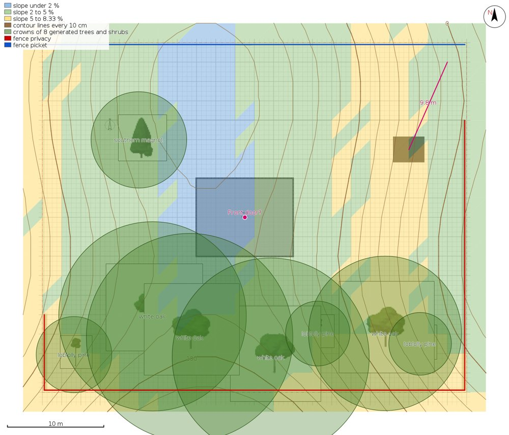

## Versions and saving

*"Save a version before you move the kitchen."* - *"What changed since this
morning?"* - *"Go back to the version before the new roof."*

| Tool | What it does |
| --- | --- |
| `save_version` | Saves a copy of the home with a `label` (or `name`) in the folder of versions beside its file, the one of **File > Versions...**. The home and its file don't change. The label is kept in the name of the file, up to 150 characters: commas and parentheses are kept, what a file name can't hold (`: / \ ? * " < > \|`) becomes a space, and the answer says when a label was shortened. The label given still designates the version |
| `list_versions` | The versions, the most recent first, numbered from 1 |
| `compare_versions` | From a `version` (its number or a part of its label) to the home now, or to another version (`with`): counts and areas, then the items added, removed, moved, resized or renamed, with their ids. `"picture":true` adds both states side by side It ends with what changed on the site: trees added, removed or changed, fences, and the earth moved |
| `restore_version` | Replaces the levels and the items of the home by the ones of a version, as **one change that undo reverts**. The state before it is saved as a version first (`"keep_current":false` skips that). The file of the home isn't written |
| `save_home` | Saves the home in its file: needs **Allow saving**. With `"copy_to":"<path>.sh3d"` it writes a copy in a new file instead, and the home keeps its file and its unsaved state |

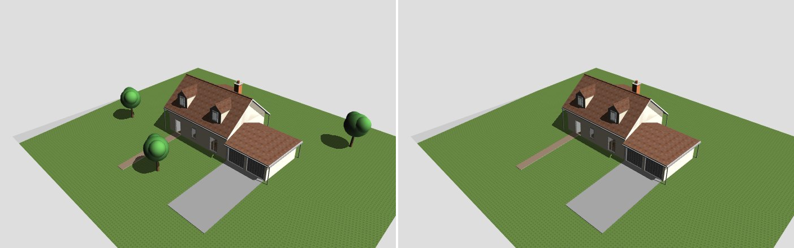

A home needs a file before it can have versions: save it once yourself.
Replacing a file that exists (`"replace":true`) needs **Allow saving** too.
To let Claude try something on a copy: `save_home` with `copy_to`, then
`open_home` on the copy.

`open_home`, `new_home` and `switch_home` open or choose a home in its own
window of Sweet Home 3D; from the next call Claude reads and edits that one,
with the same permissions. The home open before stays open. Ids belong to
their home, and start again at F1, W1, R1 in each home.

Three safeguards keep the commands meant for a home out of another one:

- When you close the window of the home Claude works on, the server of
  another open home takes its place. The first tool call Claude makes after
  that isn't run. Its answer says that the home changed, names the home the
  connection now reads and edits, and asks for `get_home` before any id is
  used. The same happens after Sweet Home 3D was started again. `list_homes`,
  `open_home`, `new_home`, `switch_home`, `help` and the catalog tools are
  answered as usual.
- The answer of `apply_commands` ends with the home it edited:
  `Home edited: "C:\...\house.sh3d".`
- `apply_commands` takes an optional `"home"`: a part of the file name of the
  home the commands are meant for, or `"unsaved"` for a home never saved. When
  the home of the connection is another one, nothing is run.

`get_changes` lists what you did by hand between two calls of Claude - a
wall you drew, a sofa you moved - with ids. When there are such changes, the
answers of `get_home`, `apply_commands`, `check_home`, `undo` and `redo` end
with a note that says so.

### Scratch homes

`new_home {"scratch":true}` creates an empty home in its own window to try
things out: a model to import, a roof to shape. Unlike `new_home`, it doesn't
take the connection over:

- The answer gives its name, `scratch-1`. The connection stays on your home.
- A call reaches the scratch home only when it names it:
  `{"home":"scratch-1", ...}` among the arguments of `apply_commands`,
  `get_home`, `get_3d_image`, `undo` or any other tool, except the ones that
  choose the home of the connection.
- Its ids are its own and start at F1, W1, R1.
- It's never saved, and closing it asks nothing. It's closed by
  `close_home {"home":"scratch-1"}`, when the session of the client ends, or
  after 30 minutes without a call (the system property
  `com.eteks.sweethome3d.mcp.scratchIdleMinutes` changes that delay).
  `save_home` with `copy_to` and `"home":"scratch-1"` keeps a copy.
- Four scratch homes at most are open at a time.
- When the server is set to start with each home, a scratch home doesn't
  start a server of its own, so the program launched by Claude keeps talking
  to your home.

On any tool, `"home"` may also be a part of the file name of the home the
call is meant for, as on `apply_commands`: nothing is run when the home of
the connection is another one.

## Exports

`export_home` takes a `format` and a `path`:

| Format | Writes |
| --- | --- |
| `pdf` | The pages of **File > Print to PDF**: plan, furniture list, 3D view |
| `svg` | The plan of the selected level |
| `obj` | The 3D model, with its `.mtl` file and its textures beside it |
| `csv` | The furniture list for a program: the `id`, `name`, `level`, `x`, `y`, `elevation`, `angle`, `width`, `depth`, `height`, `visible` and `tags` of each piece, lengths in cm and angles in degrees, the unit in the header (`x_cm`, `angle_deg`). `"units"` gives `m`, `mm`, `in` or `ft`; `"columns":[...]` chooses the columns, with `catalog_id`, `description`, `movable`, `door_or_window` and `created_by` too. The **Export to CSV format** menu item of the window writes the columns and the unit of its furniture list instead |
| `web_page` | A new folder with the 3D visit for a browser, in the folder `path` |
| `panorama` | A new folder with a 360 degree picture from the place of the virtual visitor and its page, in the folder `path` (`width` from 1024 to 8192) |

A file that exists is replaced only with `"replace":true`. Pictures are made
by `get_3d_image` and `get_plan_image`, elevation drawings in SVG by the
`export_elevation` command, schedules in CSV by `export_schedule`, and a
Blender scene by `export_blender`.

## Ids and filters

`get_home` gives every item an id: `F12` furniture, `W3` walls, `R5` rooms,
`L2` levels, `P1` lines of the plan (property lines, setbacks, easements).

```
- Levels (3), from the lowest:
    - L3 "Terrain" at -170 cm, height 169, floor thickness 1: 0 rooms, 0 walls, 1 piece of furniture
    - L1 "Ground floor" at 0 cm, height 250, floor thickness 12: 6 rooms, 18 walls, 41 pieces of furniture (selected: new items go here)
    - L2 "First floor" at 262 cm, height 250, floor thickness 12: 6 rooms, 21 walls, 21 pieces of furniture
- Rooms (12), total floor area 167.72 m2:
    - R1 Living room: 25.2 m2, x 0 to 600, y 0 to 420 cm, center (300, 210) [Ground floor]
    - R2 Kitchen: 15.96 m2, x 620 to 1000, y 0 to 420 cm, center (810, 210) [Ground floor]
```

An id belongs to its item for good: it is a number given once and stored in a
property of the item (`assistantId`), saved with the home. Deleting an item
doesn't change the ids of the others, and its id isn't given to another item
afterwards. Items added by a call get their id at the end of it, and the
answer of the commands that build something names it. The internal id of an
object (`HomeObject.getId()`, shown by `describe_item`) is accepted too.

`get_home` lists every room and wall but only the first 80 pieces of
furniture. Its filters return a part of a large home, with the same ids:

| Argument | Values |
| --- | --- |
| `level` | An id for one level, or a name for every level with it |
| `type` | `rooms`, `walls`, `furniture` (with doors and windows) or `doors_and_windows`, several separated by commas |
| `name` | Only the rooms and furniture whose name contains this text; `Pine\|Oak` for either |
| `where` | The same criteria as the commands: `{"level","tag","name","type","bbox":[x1,y1,x2,y2]}`. The answer is a flat list of the items that match them all |
| `fields` | With `where`, what to list of each item: `name`, `position`, `size`, `level`, `elevation`, `angle`, `tags`, `type`, `area`, `points`, `color`. The id is always given |

```json
{"where":{"bbox":[-600,800,1900,1500],"name":"Pine|Oak"},"fields":["name","position"]}
```

A filtered description lists up to 500 pieces. A level is listed with what it
holds, `EMPTY` if nothing, and a note when other levels share its name. A room
is followed by `ceiling hidden` or `floor hidden` when it isn't drawn in 3D,
and a tilted piece by its `pitch` or `roll`.

## Checks of what shows in 3D

`check_home` reports the defects of the plan (walls that don't meet,
duplicates, doors out of walls...) and the ones that only show
when you walk through the home in 3D. Each one names its items by id.

| Type | Severity | What is reported | `fix_home` |
| --- | --- | --- | --- |
| `roof_in_room` | error | A roof, its overhang, its gutters or its downspouts are inside the outline of a room, under its ceiling: the roof of a one-story wing in a two-story room, a porch roof that goes 20 cm into a foyer. The message gives the side of the room, how far the roof comes in, and the number of the edge of the roof to stop at the wall | Cuts the roof along the walls of the room, its shape kept (as `clip_to_rooms`). A room whose cut would unbuild a dormer is skipped and named |
| `overlapping_wall` | error | Two walls of a level drawn over each other for more than 10 cm, their middle lines within half a thickness, with their heights when they differ | Yes, when one covers 80 % of the other: the taller one is kept (the longer one at equal heights), put on the line of the other one if that one follows the axes of the plan and it doesn't, and made as long as both. Walls that share only a part of their length need a decision |
| `door_misaligned` | warning | A door or a window turned by more than 1 degree from its wall, or more than a quarter of the thickness of the wall away from its middle line and out of one of its faces | Yes: it's turned along the wall, and brought back on its middle line if it came out of a face |
| `wall_above_roof` | warning | A wall whose top passes the top of the roof it stands under by 2 to 120 cm, unless it's the wall of a taller part of the building | Yes: `fit_walls_to_roof` is run for exactly those walls |
| `open_two_story_room` | warning | A room higher than its level, on a side of its outline where the wall and the walls of the floors above stop under its ceiling. An overlook and the low walls inside the open space aren't reported | Yes: the wall is raised to the ceiling of the room |
| `ceiling_above_roof` | warning | The ceiling of a room, or a slab used as a ceiling, passes the roof that covers it: it shows from outside | No |
| `roof_at_ceiling` | info | A roof within 3 cm of a ceiling over a quarter of it or more: they show through each other | No |
| `wall_outside_finish_indoors` | warning | A side of a wall that faces a room indoors has an outside material | No |
| `wall_inside_finish_outdoors` | info | A side that faces the outside, or a room outdoors, has a color or a texture used in the rooms, in a home where most of the outside has a material of its own | No |
| `wall_side_unpainted` | info | A side that can be seen has no color and no texture, in a home where 30 % of the sides or more are painted | No |

How these are decided:

- **The ceiling of a room** is at the height given by its property
  `com.eteks.sweethome3d.ceilingHeight` (cm above its floor), otherwise at the
  top of its level if it shows its ceiling, otherwise at the lowest slab of
  `add_slab` above it. A room that hides its ceiling under nothing is taken
  as open to the roof and isn't checked.
- **A roof in a room or a ceiling above the roof.** Both are a roof lower
  than the ceiling inside the outline of the room. When the roof covers less
  than half of the room, it's a roof that comes in; otherwise it's the roof
  of the room, and the ceiling is the one out of its place.
- **A wall of a taller part of the building** isn't a wall above the roof.
  These are left out:
  - a wall that passes the roof by more than 120 cm, or that stands on a
    floor above it;
  - a wall that a wall of a level above continues;
  - a wall of a room whose ceiling is higher than the roof where they meet,
    when that roof doesn't cover the room 60 cm behind the wall, or when the
    ceiling is higher than the top of the whole roof: the two-story wall that
    a one-story roof runs into.
- **The roof a wall stands under** is the one over most of its length. A
  roof over less than 40 % of the part of the wall that roofs cover, as the
  overhang of a porch roof across the end of a garage wall, isn't compared
  with it.
- **What a side of a wall faces.** Three points 12 cm away from the face are
  looked for in the rooms of the level of the wall, then in the rooms of the
  other levels that stand in front of 50 cm of the height of the wall or
  more: the two-story room that a wall of the floor above looks into, or a
  garage whose floor is lower. A side that faces no room faces the outside if
  the other side of its wall faces a room; the walls that face no room at all
  (garden walls) are left out.
- **A room outdoors** counts as the outside: siding or brick is right on the
  sides that face it, and the paint of the rooms isn't. A room is outdoors
  when, in this order:
  1. its property `com.eteks.sweethome3d.outdoor` says so. `modify_room` sets
     it with `"outdoor":true` or `false`, and removes it with `null`;
  2. otherwise it is indoors if it has a ceiling (one that shows, a
     `ceiling_height`, a ceiling that follows a roof, a slab over it) or the
     floor of a room of a level above over it;
  3. it's outdoors if a roof covers it and leaves nowhere 150 cm to stand: a
     room drawn at the place of a bay roof or a porch roof;
  4. it's outdoors if a quarter of its outline or more is open: no wall of
     its level along the side, no other room of its level behind it, and no
     roof that comes down to less than 150 cm above the floor there (the
     eaves of an attic close its sides);
  5. it's outdoors if walls close it and none of the roofs of the home covers
     it (a courtyard);
  6. otherwise its name tells: porch, deck, patio, terrace, balcony, veranda,
     yard, garden, lawn, driveway, walkway, courtyard, carport, pergola.
- **The finish a room sees** on a side that has finishes by height
  (`left_finish`, `right_finish`) is the first one from the floor. The
  finish of the side itself is the one of its top, above a lower roof.
- **Sides that nobody sees** aren't reported and don't count as the outside
  of the home: a side with another wall less than 45 cm in front of it (the
  cavity between two walls drawn side by side), and a side that faces an
  attic or a crawl space, a room that shows neither floor nor ceiling.
- **A space without room between rooms**, as a closet under stairs that was
  drawn with its walls only, isn't the outside: from 25 cm in front of the
  side, rooms indoors are met within 3 m in two at least of the directions
  straight ahead, left and right. An unpainted side there is reported as
  facing such a space.
- **A low wall inside a two-story space** doesn't leave the room open: the
  room behind it is open to the same height, or, behind a closet or stairs
  drawn without a room, the first rooms met in two of those three directions
  are (the room itself counts where it turns around the closet).
- **An outside material** is a texture whose name or catalog id holds one of
  these words: siding, clapboard, weatherboard, cladding, brick, shingle,
  stucco, roughcast, render, facade, exterior, stone wall, log wall, bardage,
  crepi, brique (`HomeDefects.OUTSIDE_MATERIAL_WORDS`). Any other finish, a
  plain color included, is an inside one.

`check_home` also counts the items that cross another item, and lists them
level by level with `"crossings":true`:

- furniture that stands in a wall (over 8 % of its footprint) or in another
  piece (over 60 % of the smaller footprint, at the same height);
- doors and windows turned across their wall, or in another wall;
- walls that cross each other away from their ends;
- the roofs in rooms, the walls and the ceilings above the roof and the
  doors through the roof reported above.

A home of 150 walls, 30 rooms, 500 pieces and 3 roofs is checked in about
0.2 s, the list of crossings included.

## Pictures

### The plan

`get_plan_image` draws a level. With an `area` or a `target`, a part of the
plan is drawn enlarged, black on white, up to 6 times the default scale.

| Argument | Values |
| --- | --- |
| `level` | The name of the level to draw (default: the selected one) |
| `area` | `{"x","y","width","height"}` in centimeters |
| `target` | Ids (`R1`, `F3`...), or `building` for the walls without the garden |
| `max_size` | Largest side in pixels (default 1000, at most 2000) |

| `{"level":"Ground floor","target":"building"}` | `{"level":"First floor","target":"building"}` |
| --- | --- |
| 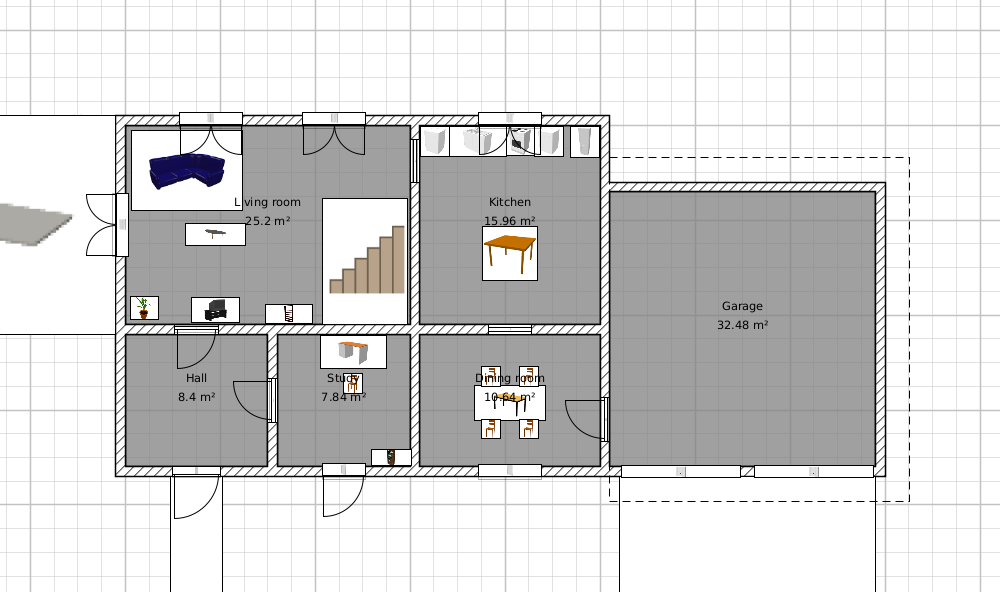 | 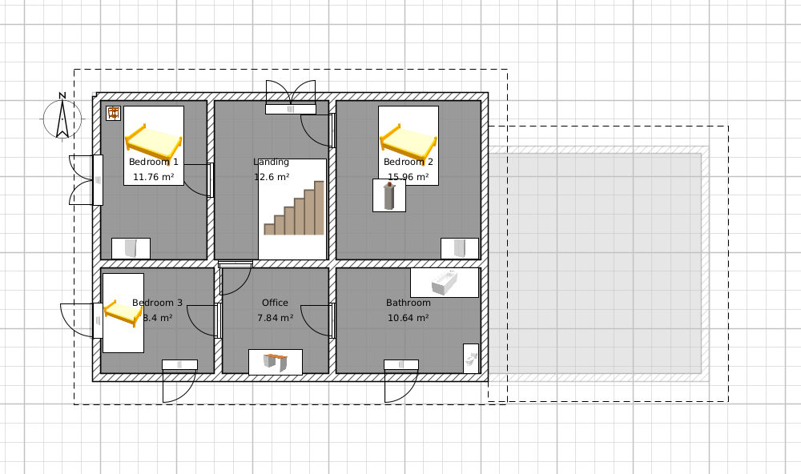 |

A roof is drawn as a dashed outline at its level and at the levels above, so
the rooms under it stay readable. `{"level":"Ground floor","target":"R2"}`
draws one room with what is around it:

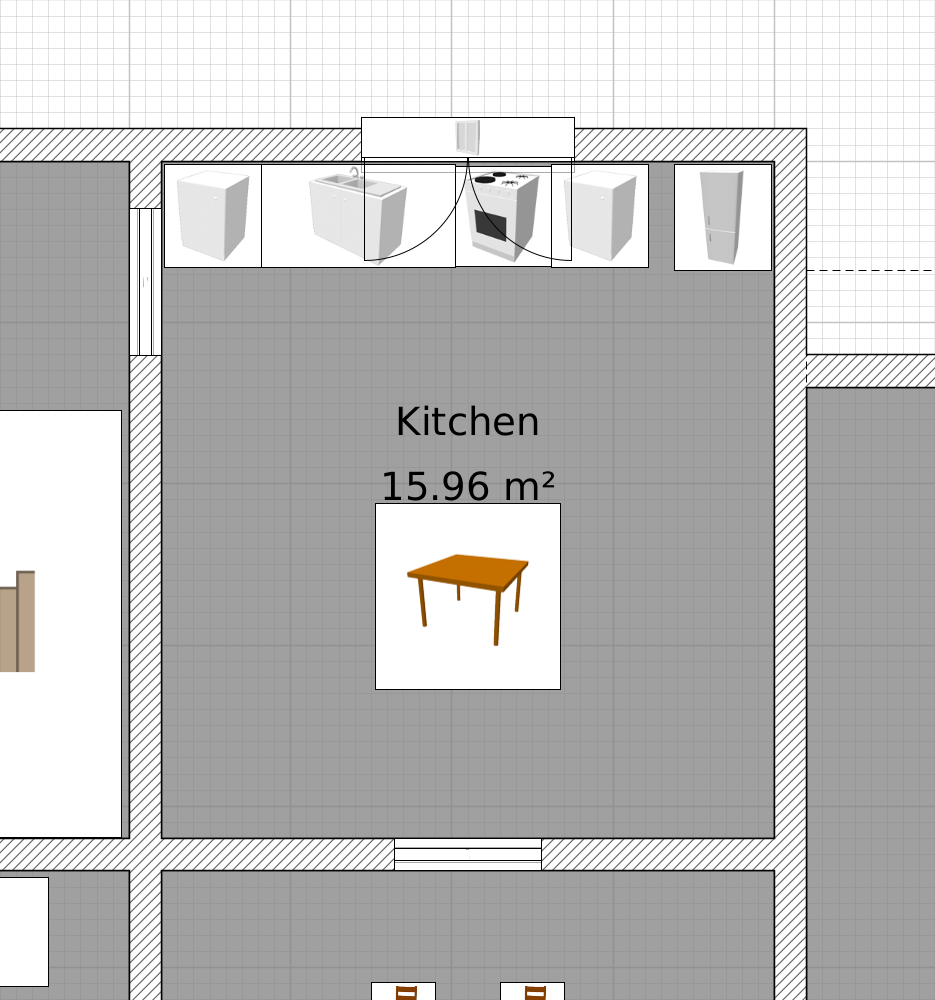

### The 3D view

`get_3d_image` draws the home from a view chosen for the picture: the camera
of the user doesn't move.

| `{"view":"south_east","target":"building"}` | `{"view":"top","levels":"selected","level":"Ground floor"}` |
| --- | --- |
| 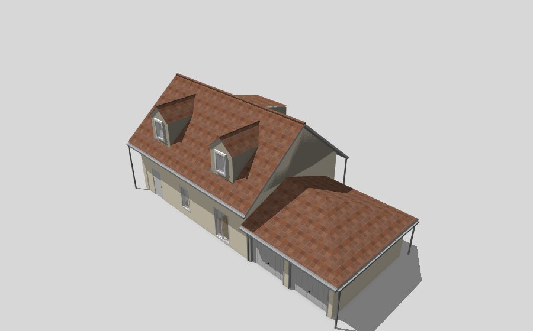 | 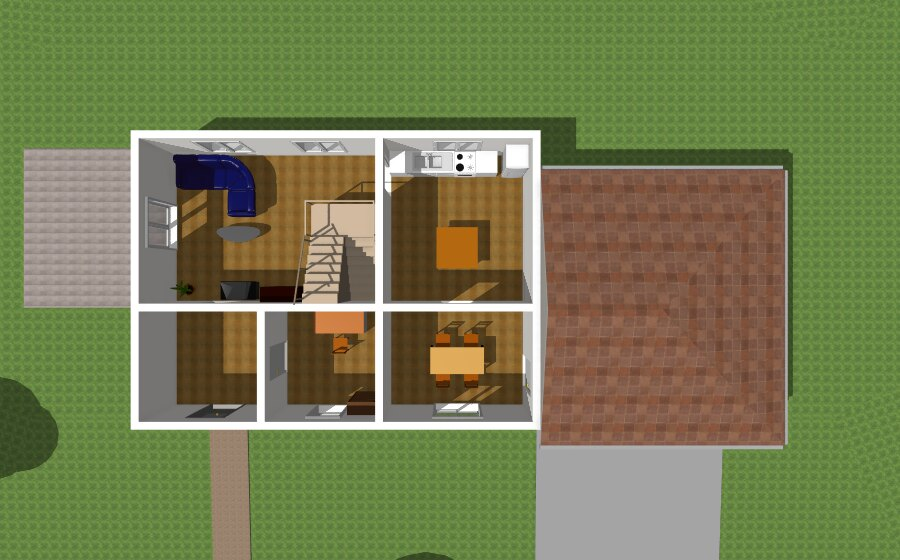 |

| `{"view":"inside","target":"R1"}` | `{"view":"inside","target":"R2"}` |
| --- | --- |
| 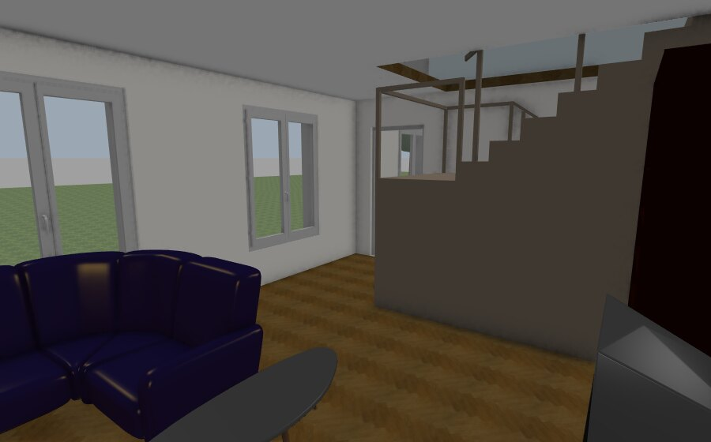 | 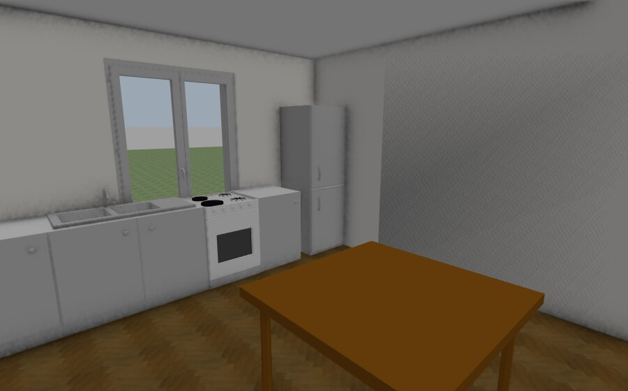 |

| Argument | Values |
| --- | --- |
| `view` | `current` (default, the camera of the home), `top`, `south`, `north`, `east`, `west`, `south_east`, `south_west`, `north_east`, `north_west` (the target entirely in sight from that side, south being the bottom of the plan), `inside` (standing in a corner of a room, or in the room of a piece, or in front of a wall) |
| `target` | With `view`: ids (`R1`, `F3`, `W2`, several separated by commas), `selection`, or `building` (the walls, without the garden). Default: the whole home |
| `point_of_view` | The name of a point of view stored in the home |
| `camera` | `{"x","y","height","look_at_x","look_at_y","look_at_height"}` in centimeters, heights above the floor of the level |
| `fov` | Field of view, 20 to 120 degrees (default 63, 85 inside) |
| `levels` | `all` (default) or `selected`: the selected level and the ones under it, to look into a floor from above |
| `level` | The name of the level to select for the picture |
| `renderer` | `auto` (default), `opengl` or `raytrace` |
| `shadows`, `ambient_occlusion` | OpenGL renderer, both `true` by default |
| `quality` | Ray tracer: `low` (default) or `high` (at most 1000 x 750 pixels) |
| `timeout` | Ray tracer: seconds after which it is stopped and an error comes back |
| `width`, `height` | 800 x 500 by default, at most 1600 x 1200 |
| `save_to`, `replace` | Absolute path of a `.png` file written at up to 4096 x 4096 pixels; a copy 1000 pixels wide comes back |
| `store_as` | Name under which the view of the picture is kept in the points of view of the home, to draw the same view again after changes with `point_of_view` |
| `compare_with`, `compare_mode`, `compare_opacity` | A photo to compare the picture with (below) |

`save_to` and `store_as` need **Allow changes to this home**.

Walls and ceilings hide what is indoors from the outside views. For a room or
a piece indoors, use `inside`, or `top` with `"levels":"selected"`. A roof
built by `add_roof` stands on the level of the rooms it covers: to see that
level from the top, hide the roofs first with
`{"action":"hide_layer","tag":"roof"}` and show them again afterwards.

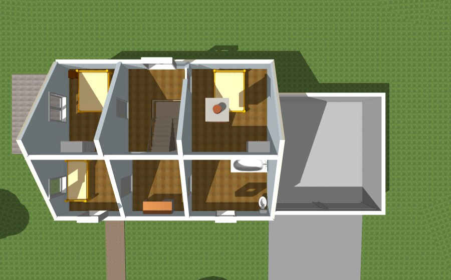

The answer comes with a line that tells the renderer, the options, the time
and the place of the camera:

```
Drawn by the OpenGL renderer (antialiasing, shadows, ambient occlusion), 1200 x 750 pixels, in 2.6 s.
Seen from: view south_east of building, aerial view at x 2377, y 1947, height 1646 cm, yaw 135 degrees,
pitch 30 degrees (positive looks down), field of view 63 degrees. All levels.
```

### Renderers

| OpenGL without shadow (0.8 s) | OpenGL, shadows and ambient occlusion (0.8 s) | Ray tracer, low quality (9.8 s) |
| --- | --- | --- |
| 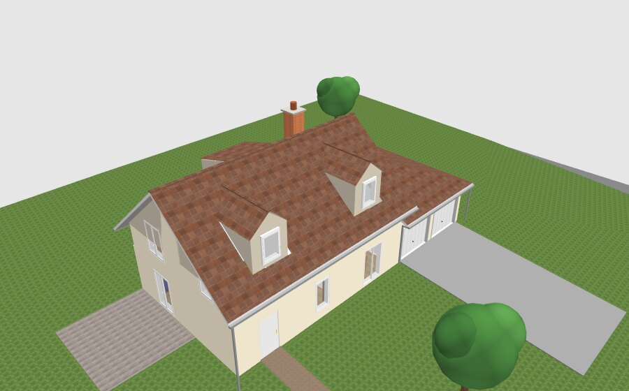 | 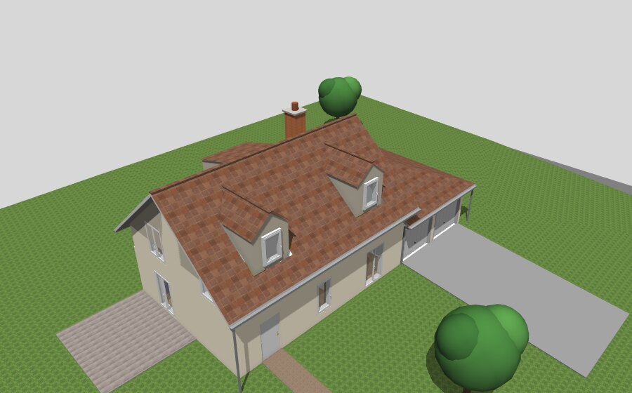 | 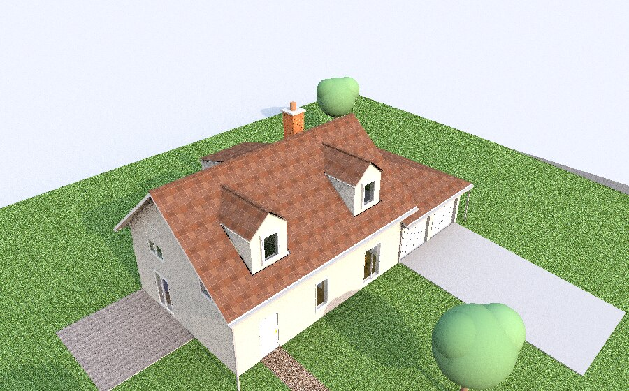 |

The times are those of these 900 x 560 pictures of the demo house under WSLg.

- `opengl` is the renderer of [OpenGL renderer](OPENGL_RENDERER.md) in a
  context without window: 8 samples per pixel, shadows and ambient occlusion
  unless turned off, the light sources of the lamps in their room. It is used
  whichever renderer the 3D view of the user uses.
- `raytrace` is the photo renderer (SunFlow) at its fastest quality, or at its
  best one with `"quality":"high"`: slower, with reflections.
- `auto` is `opengl`. If OpenGL can't draw, the ray tracer does and the answer
  says so; `"timeout":N` bounds it.
  `-Dcom.eteks.sweethome3d.opengl.images=false` turns the OpenGL pictures off.

Measured on a large home (435 pieces, 25.8 million vertices) through a
running server, while the application displayed the same home with the OpenGL
renderer. Native Windows, GeForce GTX 1660 Ti, Java 8, 3 GB heap, one call
each:

| Picture | Time |
| --- | --- |
| OpenGL with shadows and ambient occlusion, 1200 x 750: the house from a corner, a room from the inside, a floor from the top | 5.3 s, 4.6 s, 2.8 s |
| OpenGL with shadows and ambient occlusion, 1600 x 1000, a room from the inside | 3.3 s |
| OpenGL without shadow, 800 x 500, the whole home | 5.3 s |
| OpenGL with shadows and ambient occlusion, 4000 x 2500 saved in a file | 7.3 s |
| Ray tracer, low quality, 600 x 400, a room from the inside | 149.2 s |

Each picture describes a copy of the home again, which is most of the time
of an OpenGL picture. The ray tracer ran out of memory in one of its threads
during its picture, which came back with a black square: in a home of this
size, with this heap, only the OpenGL renderer is usable. Under WSLg the same
home took 1.2 to 5.6 s without shadow, 8 to 35 s with shadows, and 71 s with
the ray tracer.

### Sun study

Everything the window **3D view > Sun and shadows...** sets
([guide](VIEW_3D_NAVIGATION.md#sun-at-a-date-and-a-time)) can be set by
Claude:

| What | How |
| --- | --- |
| Date, time of day | The `set_sun` command: `{"action":"set_sun","date":"2026-06-21","time":"17:30"}` |
| Light of the 3D view from the sun, false colors | `set_sun` with `"follow":true`, `"false_colors":true`, a number of lux, or `false` |
| North, latitude, longitude, time zone | The `set_compass` command: `"north_direction"` in degrees clockwise from the top of the plan, `"latitude"`, `"longitude"`, `"time_zone":"America/New_York"`; `"georeference":true` takes the place and the true north of the GPS position of the home |
| The window itself | The `sun_study` tool: `{"window":"open"}` or `{"window":"close"}` |
| Its animations | `sun_study` with `"play":"day"` (sunrise to sunset of the date), `"play":"year"` (the days of the year at the time) or `"play":"stop"` |
| Renderer and shadows of the 3D view on screen | `sun_study` with `"renderer":"opengl"` or `"java3d"`, and `"shadows":true` or `false` |

`sun_study` without argument tells whether the window is open, what plays,
and how the 3D view is drawn. An animation moves the date or the time of the
home until it is stopped, and needs **Allow changes to this home**, as do the
renderer and the shadows, which are your preferences for all homes. Opening
and closing the window, and stopping an animation, don't need it.

Claude doesn't see an animation: to look at the sun through a day or a year
it calls `get_sun_study_image`, which returns one picture of the home at
several instants, each with its date, its time and the height of the sun
under it, and the list of the sun height, its azimuth, the length of shadows
and the light on the ground at each instant. The date, the time and the 3D
view of the home don't change.

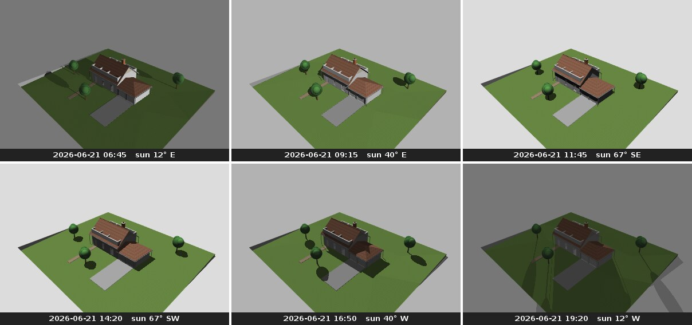

| Argument | Meaning |
| --- | --- |
| `sweep` | `day` (default): the hours of one day. `year`: dates of the year at the same time. `hours`: one picture colored by the hours of direct sun of the day |
| `steps` | Number of pictures: 2 to 12 for a day (6 by default); 2, 3, 4, 6 or 12 for a year (4 by default: the equinoxes and the solstices; 12: the 21st of each month). For `hours`, the instants counted, 4 to 96 (one each 20 minutes by default) |
| `max_hours` | `hours`: the hours shown by the last color (default: the length of the day) |
| `date` | The day shown, or the year of a year sweep (default: the date of the sun of the home) |
| `time` | Year sweep: the local time (default: the time of the sun of the home) |
| `from`, `to` | `day` and `hours`: the first and the last local time. By default from sunrise to sunset |
| `false_colors` | `true`, a maximum in lux, or `false` (default: as the 3D view of the home) |
| `view`, `target`, `camera`, `point_of_view`, `levels`, `renderer`, `shadows`, `save_to`... | As in `get_3d_image`; `width` and `height` are the ones of each picture (400 x 260 by default, at most 800 x 600; for `hours` 800 x 520, at most 1600 x 1200) |

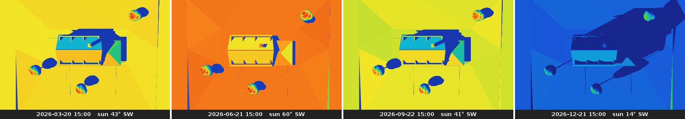

With `"sweep":"hours"`, the home is drawn at instants spread through the day,
and each point is colored by the time the sun reaches it, from dark blue (never)
to red (all day): where to plant, to sit or to put solar panels. The answer
adds the share of the surfaces in the picture that get less than 2 hours,
2 to 6 hours and more. It needs the OpenGL renderer, and takes a few seconds
on a graphics card (20 to 30 s under WSLg).

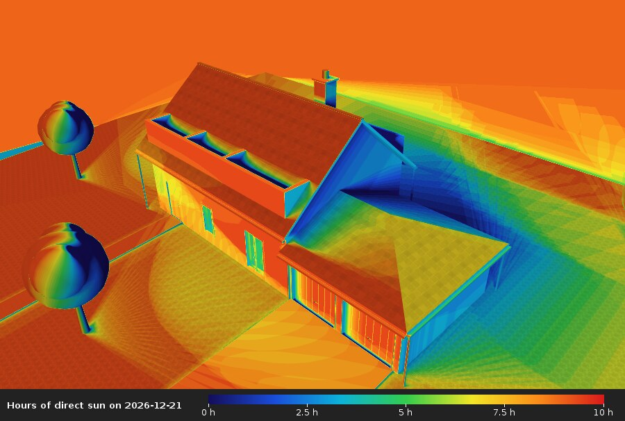

`set_sun` warns when the sun isn't computed for the GPS position of the home
(the compass was changed after `set_georeference`), and when the time zone is
more than three hours away from the solar time of the longitude.

### Elevations

`get_elevation_image` draws one `side` of the building (`south`, `north`,
`east`, `west`) square on, from the real 3D models: roofs, dormers, doors,
windows and textures. The camera stands so far that lines going away from
it stay parallel to within 2 %. The width of the walls and the heights of
the levels and of the top are drawn in meters; `"dimensions":false` leaves
them out, and `save_to` writes the picture.

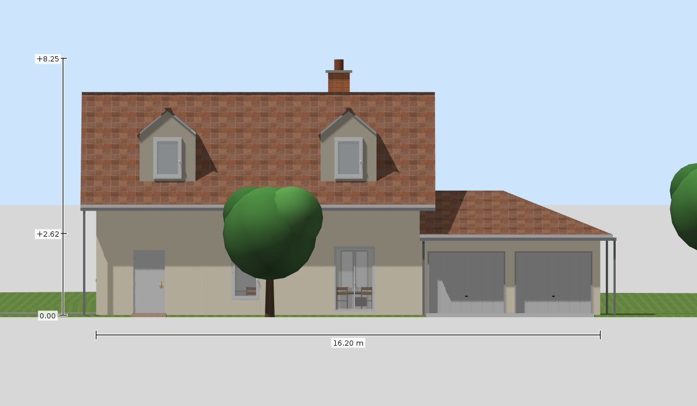

The answer gives the scale in centimeters for a pixel, so other sizes can be
measured in the picture. Trees and furniture in front of the building show.

### Comparing with a photo

`"compare_with":"<absolute path of a PNG or JPEG>"` returns the picture of
the home at the left and the photo at the right, to check roof lines and
heights. `"compare_mode":"overlay"` draws the photo over the picture instead,
stretched to its size, at `compare_opacity` (0.5 by default).

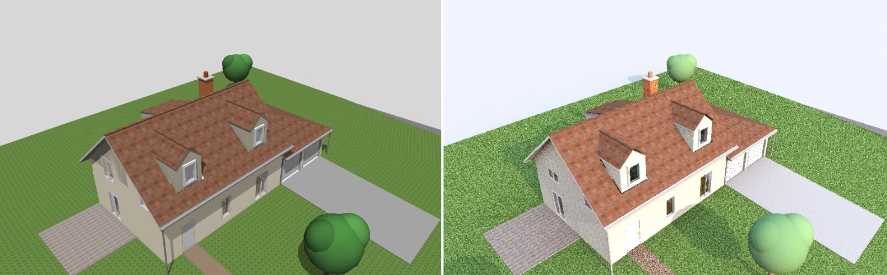

In this example a ray-traced picture of the same house stands in for the
photo. The overlay only stretches the photo: it doesn't match its
perspective, so choose a `view` or a `camera` close to where the photo was
taken.

### What is at a pixel

When something in a picture is wrong and you can't tell which item it is,
`get_3d_image` names it. Draw the picture once, read the pixel of what
puzzles you, then ask the same picture again with `identify`:

```json
{"view":"inside","target":"R1","identify":[[400,250],[400,30]]}
```

The answer gives, for each pixel (x from the left of the picture, y from its
top, 60 pixels at most), the id and the name of the item drawn there, its
part, and the point of the home it shows:

```
[400,250]: W1 wall, its right side (color #3355AA), at x 590, y 8, elevation 57 cm, 6.28 m from the camera
[400,30]: R1 room "Living", its ceiling, at x 312, y 193, elevation 250 cm, 2.99 m from the camera
```

| Item | Part told |
| --- | --- |
| A wall | Its left or right side with the finish drawn at that height: its baseboard with its color or its texture, one of its finishes by height (`left_finish` / `right_finish`) with its number and the height it goes up to, or the color or the texture of the side above them; its top, or one of its ends |
| A room | Its floor or its ceiling |
| A piece of furniture | The material of its model at that point, and the piece of a group |
| A roof built by `add_roof` | Its material (slope, fascia, gutter...) and the distance to the closest edge of its outline, with the number of that edge |

`"labels":true` draws the id of each item in sight on the picture, and lists
them in the answer. An item seen in a few pixels only may get no label.

How it works: once the OpenGL renderer drew the picture, a ray is cast
through each pixel in the triangles of the scene, on the processor. Labels
cast a grid of about 1000 rays, which added less than 0.2 s to the picture of
a furnished room under WSLg; the cost in a home with models of hundreds of
thousands of triangles wasn't measured. Limits:

- The ray tracer can't tell: the answer says so when a picture wasn't drawn
  by the OpenGL renderer.
- A glass or another material seen through is the item named. `hide_ids`
  with its id shows what is behind.
- The ground around the home and the sky are both "nothing of the home".

### Some items alone

`"only_ids":["F946"]` draws those items and nothing else: no wall, no room,
no other piece, no ground. Without a view, they are seen entirely from the
south east; `view` and `camera` work as usual. Use it to look at a piece
without the trees, the walls or the roof around it.

### A saved version, without restoring it

`get_3d_image`, `get_plan_image` and `inspect_room` take a `version`: its
number in `list_versions` (1 = the most recent) or a part of its label. The
picture shows that version; the home doesn't change and nothing is added to
its undo history. Ids, targets and levels are the ones of the version.

Without a view, `get_3d_image` draws the version from the camera of the home
as it is now, so the two pictures can be compared. `store_as` is refused: a
point of view is stored in the home, not in a version.

`compare_versions` with a `view` (or a `target`) adds the picture of the
version at the left and of the home now, or of another version, at the right.

### Inspecting a room

Most defects of a room are near its ceiling: a gap over a wall, a roof or a
gutter coming through, a wall left one story tall in a two-story room.
`inspect_room {"room":"R11"}` returns six pictures in one image, taken at eye
height from the place of the room the farthest from its sides and from the
walls that stand in it (the middle of a rectangular room; in an L-shaped
room, a place in the L, not the center of its outline):

1. to 4. toward the north, the east, the south and the west of the plan,
   the camera tilted up so that the top of each wall is in the picture;
5. straight up;
6. from a corner of the room, as `"view":"inside"`.

When that place is less than 1.5 m from the side a picture looks at, as
across a hallway, that picture is taken from the place of the room the
farthest from that side instead, along the hallway: the answer says from
where. The camera of the corner stands 45 cm at least from the sides when the
room is wide enough, never in a wall, at a place that sees the middle.

The answer gives the camera of each picture, to ask `get_3d_image` for one
of them with `identify` or `labels`. In a room whose ceiling is hidden, the
pictures look up to twice the height of the level, where the walls of a room
open to the floor above should reach.

### The inside view

`"view":"inside"` puts the camera in the outline of the room, under its
ceiling and under the roof over it: at 160 cm above the floor where there is
room for it, otherwise 25 cm under the lowest of the ceiling and the roof.
The ceiling is the height given to the room (its property
`com.eteks.sweethome3d.ceilingHeight`), otherwise the top of its level when
its ceiling is shown. Among the corners of the room, the camera goes to one
where a visitor can stand.

### Catalog pictures

`get_catalog_image` returns the icons (256 pixels at most) of up to 8 catalog
pieces or textures named exactly.

## Security

- The server listens on `127.0.0.1` only; other computers can't reach it.
- Every request needs the bearer token. It is 256 random bits, created on first
  use and stored in the file `mcp-token` of the Sweet Home 3D application folder
  (`~/.eteks/sweethome3d` on Linux), readable by its owner only. Delete that
  file to get a new token.
- The bridge program reads that token file, so it works for the user who runs
  Sweet Home 3D only. The registration written in Claude's settings holds no
  secret. **Connect Claude Desktop** changes one entry (`mcpServers.sweethome3d`)
  of Claude Desktop's configuration file, after confirmation.
- The server only starts by itself if you ticked **Start this server each time
  a home is opened** (a file `mcp-autostart` in the application folder).
- Requests with a foreign `Origin` or `Host` header are refused, so a web page
  open in a browser can't relay requests to the server (cross-site requests,
  DNS rebinding).
- File access is limited to what you ask for:

  | Reads | Writes |
  | --- | --- |
  | `add_picture`, `import_texture`, `set_background_image`: the image file given | `get_3d_image`: the `.png` file given by `save_to` |
  | `import_furniture`: the model file given, and the materials and images it names in its own folder | `export_blender`: the folder given |
  | `import_furniture_library`: the `.sh3f` file given | `export_furniture_library`: the `.sh3f` file given |
  | `get_3d_image`: the photo given by `compare_with` | `export_elevation`: the `.svg` file given |
  | `apply_commands`: the JSON file given by `file` | `save_version`: a new file in the folder of versions of the home |
  | `import_parcel`: the GeoJSON file given by `path` | `save_home` with `copy_to`: the `.sh3d` file given |
  | `open_home`: the `.sh3d` file given | `export_home`, `export_schedule`, `get_elevation_image`: the file or the folder given |
  | `compare_versions`, `restore_version`: the versions of the home | `save_home`: the file of the home, with **Allow saving** only |

  `get_3d_image` and `export_furniture_library` refuse to overwrite a file
  without `"replace":true`.
  `add_to_catalog` and `import_furniture_library` change the furniture
  catalog of the user. Writing and importing need **Allow changes to this
  home**. Writing the file of the home, and replacing a `.sh3d` file that
  exists, need **Allow saving this home in its file, and replacing files**,
  which is off each time the application starts. The tools can't read other
  files or reach the network. `start_visit` opens your web browser on the
  visit served by Sweet Home 3D on this computer. `sun_study` opens a window
of the application and, with **Allow changes to this home**, changes two of
your preferences: the renderer of the 3D view and its shadows.

## When something goes wrong

| What happens | What to do |
| --- | --- |
| Claude says the server must be started | Choose **Tools > Claude MCP server...** and **Start server**, or tick the box that starts it with each home |
| Claude Desktop doesn't list Sweet Home 3D | Quit it completely, from its icon near the clock too, and reopen it. If it still doesn't, click **Connect Claude Desktop** again |
| It worked, then stopped after an update | The registration holds the path of the application: connect again from the new version |
| The application folder can't be deleted or replaced | The bridge program launched by Claude (`sweethome3d-mcp`) runs from it: click **Release program folder** in **Tools > Claude MCP server...**, or quit Claude, then close Sweet Home 3D |
| "No item has the id ..." | The item was deleted. Ask Claude to call `get_home` again |
| "The tool ... has no argument ..." | Claude knows the tools of an older version of Sweet Home 3D. An argument the server doesn't know is refused with the list of the ones it has, instead of being dropped. Start a new conversation, or restart Claude, so it reads the tools again |
| Every picture fails with `NoClassDefFoundError` or "A class or a library can't be loaded" | A plug-in needs a library that Sweet Home 3D doesn't include since 7.32.1 (FreeHEP, Batik, iText, Jeks Parser, Java Media Framework). The answer names the missing class. Since 7.33.1 the pictures of the plan, of the 3D view and of the catalog don't use the readers and writers of images that plug-ins register (SVGTuner 1.0 registers one), so they work with such a plug-in installed; what the plug-in itself does may still fail |
| "Nothing was done: the home of this connection changed..." | The window of the home Claude worked on was closed, or Sweet Home 3D was started again. Ask Claude to call `get_home`, or `switch_home` or `open_home` for the home you want |
| A picture takes minutes | It was drawn by the ray tracer: ask for `"renderer":"opengl"`, or give a `timeout` |
| Claude can't change anything | Tick **Allow changes to this home** |
| Claude says saving isn't allowed | That is the default. Tick **Allow saving this home in its file, and replacing files**, or let it save versions and copies |
| Claude can't save a version | The home was never saved: choose **File > Save as...** once |

## Implementation

- `viewcontroller/HomeMCPHandler` - transport-independent JSON-RPC handling
  (`initialize`, `ping`, `tools/list`, `tools/call`; protocol revisions
  2025-06-18, 2025-03-26 and 2024-11-05) on top of `AssistantCommandExecutor`
  and `HomeAssistantContext`. Called in the event dispatch thread.
- `viewcontroller/HomeItemIds` - the ids of the items.
- A tool that fails with an error of Java (a class that can't be loaded, no
  memory left) answers with a tool error that gives the cause. Each handler
  has an identifier (`getHomeId`), sent by the server in the header
  `X-SweetHome3D-Home`. The bridge program sends back the one of its last
  tool call in `X-SweetHome3D-Expected-Home`, and `handle(request, expectedHomeId)`
  refuses a tool call meant for another home.
- Scratch homes: the handler of the home of the connection runs a call that
  names a scratch home in the handler of that home (`HomeOperations.getHandler`),
  so no second server is started and the port of the connection doesn't change.
  The bridge program sends an identifier of its session in the header
  `X-SweetHome3D-Session`, and the notification
  `notifications/sweethome3d/session_ended` when its client goes away;
  `swing/HomePane` closes the idle ones with a timer.
- Pixels are identified by `j3d/OpenGLSceneRenderer.pickShape`, called by
  `HomeComponent3D.createOpenGLImage` once the image is drawn.
- `tools/ImageProviders` - puts the readers and writers of images of Java
  ahead of the ones registered by plug-ins, after the plug-ins of a home are
  created and before each tool call.
- `viewcontroller/Assistant*Commands` - the commands: `AssistantBuildingCommands`
  (rooms, walls, textures), `AssistantStructureCommands` (levels, walls, plan
  visibility), `AssistantShapeCommands` (roofs, dormers, slabs, ground),
  `AssistantRoofGeometry` and `AssistantRoofModel`, `AssistantMeshBuilder`,
  `AssistantFurnitureBuilder`, `AssistantLibraryCommands`,
  `AssistantLayerCommands`, `AssistantDesignCommands`, `AssistantSiteCommands`
  (lines of the plan, compass, georeference, parcels) with `HomeGeoreference`
  and `HomeRoofs` (ceilings and headroom under roofs), `AssistantArrangeCommands`
  (group, align, mirror, measure), `AssistantGardenCommands` with
  `AssistantRoomFurnisher`, `AssistantScheduleCommands` with `HomeQuantities`
  and `AssistantSymbols`, `AssistantSceneCommands` (lights, sun, doors,
  materials).
- `viewcontroller/HomeVersions`, `HomeContents` (the contents of a home put in
  place of others, for `restore_version`), `HomeChangeJournal` (what the user
  changes by hand between two calls).
- `swing/AssistantModelInspector` - the materials and the hinges of 3D models.
- `viewcontroller/HomeViewpoints` - the cameras of the standard views and of
  the views from the inside, computed from the bounds of the items.
  `HomePane.create3DImage` applies them to a copy of the home and renders it
  with `HomeComponent3D.createOpenGLImage` or `PhotoRenderer`.
- `swing/HomeMCPServer` - Streamable HTTP transport on the JDK `HttpServer`
  (POST only: no server-initiated stream, no session), token file, header checks.
- `swing/HomeMCPBridge` - the stdio program launched by clients (forwards to
  the server, answers the handshake and the tool list itself while no server
  runs via `HomeMCPHandler.handleOffline`, and sends
  `notifications/tools/list_changed` when the tools of the server differ from
  the ones it gave its client), and the registration in Claude
  Desktop and Claude Code. `scripts/package-release.ps1` adds its launcher
  `sweethome3d-mcp` to the application image.
- `swing/HomePane.showMCPServerDialog` - the menu item and dialog.
- Tests: `HomeMCPServerTest` (handler, transport checks, token file),
  `AssistantHouseModelingTest`, `AssistantCommandExecutorTest`,
  `AssistantLayersAndLibraryTest`, `AssistantDesignCommandsTest`. A real
  Claude Code client was run against the server on 2026-11-13
  (`claude -p ... --mcp-config`): it listed the tools, read the home, searched
  the catalog and added a bed. On 2026-11-20 one was run against the
  application under native Windows (Java 8, GeForce GTX 1660 Ti) through the
  bridge: it read the demo house, added a shed with a hip roof, ran
  `check_home` and described a 3D picture.
