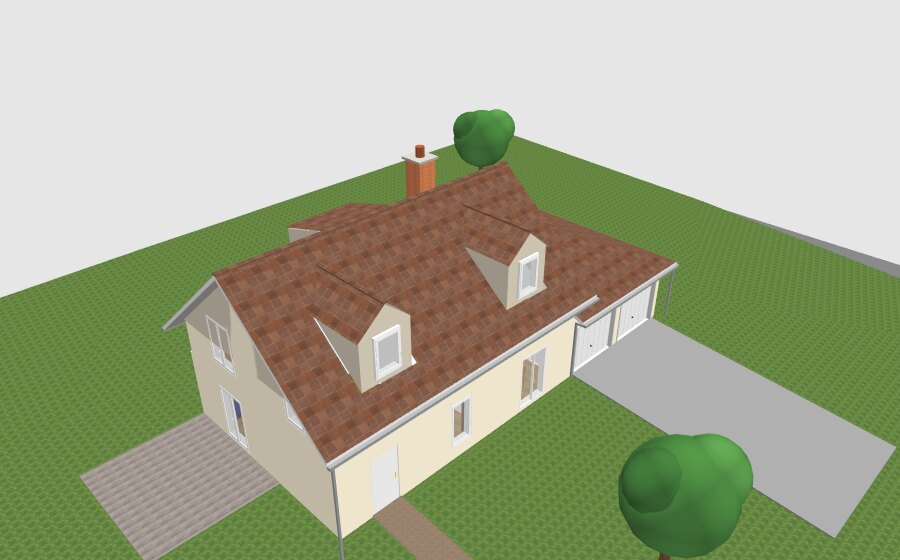
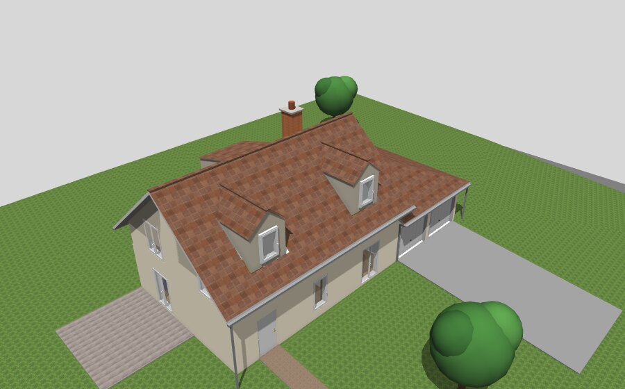

# OpenGL renderer of the 3D view

The 3D view of a home can be drawn by an OpenGL renderer instead of Java 3D.
Java 3D stays the default; the renderer is an option.

## Choosing the renderer

- **3D view > Use OpenGL renderer (experimental)** switches the 3D view of the
  home at once and is remembered for the next homes and sessions.
- **3D view > OpenGL renderer quality** has three options, applied at once and
  remembered:
  - **Smooth edges (antialiasing)**, on by default: 4 samples per pixel.
  - **Shadows**, off by default: objects cast soft shadows.
  - **Soft shading in corners (ambient occlusion)**, off by default: corners
    and surfaces close to an other one are darkened.
- `-Dcom.eteks.sweethome3d.j3d.renderer=opengl` (or `java3d`) forces a renderer
  and has the priority on the menu choice. `-Dcom.eteks.sweethome3d.opengl.antialiasing`,
  `.shadows` and `.ambientOcclusion` (`true` or `false`) do the same for the options.
- **Help > 3D rendering information** names the graphics card followed by
  `(OpenGL renderer)` when this renderer is the one in use.

| Antialiasing only | With shadows and ambient occlusion |
| --- | --- |
|  |  |

If the JOGL classes can't be loaded or the OpenGL canvas can't be created, Java 3D is used and
a message is printed on the error output.

## What it does

Java 3D remains the description of the scene. `HomeComponent3D` builds the same
tree of nodes it builds for Java 3D (walls, rooms, furniture, ground, sky,
lights) and updates it with the same listeners, but the tree is not attached to
a Java 3D universe. `OpenGLSceneRenderer` reads it:

- Each geometry is copied once to a vertex buffer kept by the graphics card and
  shared by every shape that uses it, so the 30 copies of a chair use the
  memory of one. Java 3D sent the vertices of every shape again at each frame.
- An object of the home (a wall, a piece of furniture) is described again only
  when it changes. Models and textures loaded in the background mark their
  object, or all objects, to be described again.
- Shapes are sorted by appearance to change the OpenGL state rarely, shapes out
  of the view frustum are skipped, and transparent shapes are drawn last from
  the farthest to the closest.
- Lights are computed at each pixel by a GLSL 1.20 program: the ambient and
  directional lights of the scene, limited to the groups they are scoped to,
  and the light sources of the lamps of the home (up to 8 per shape, each one
  within the bounds of its room, as in Java 3D). A lamp lights a wall smoothly
  whatever the size of its sub parts. Where shaders or frame buffer objects
  are missing, OpenGL computes the directional lights at each vertex, and
  lamps, shadows, ambient occlusion and antialiasing aren't available.
- Textures use anisotropic filtering when the graphics card offers it.

### Threads

- The **event dispatch thread** is the only one which modifies the nodes. After
  a change, it describes the scene in an immutable `Frame` (`prepareFrame`):
  the lists of shapes, the lights and the camera.
- A **rendering thread** per view (`OpenGL 3D view rendering`) draws the last
  described frame (`renderFrame`). A frame long to draw doesn't block the user
  interface. Frames are drawn on demand, not continuously.
- **Worker threads**, one per processor but one (`OpenGL scene preparation`),
  turn the geometries into vertex buffers and the textures into pixels. The
  rendering thread only copies what is ready to the graphics card, the shapes
  in sight first, then the other ones.

Under Linux, drawing a frame takes the lock of AWT (X11), so the event
dispatch thread waits whenever it draws at the same time. The rendering thread
therefore limits the time it spends copying geometries in a frame (40 ms, or
the time the frame takes to draw if longer,
`-Dcom.eteks.sweethome3d.opengl.uploadTimeBudget` in milliseconds) and pauses
between the frames it draws on its own while a home loads. Windows doesn't
share this lock, and neither limit applies there.

Under Windows, AWT must not erase the background of the canvas: its drawing
hides the frames drawn by OpenGL in an other thread, and the view stays empty.
`SweetHome3D` sets `sun.awt.noerasebackground` to `true` at launch, before AWT
starts. A program which shows `HomeComponent3D` with this renderer under
Windows without `SweetHome3D` has to set this property too.

### Camera

The point of view moves to the camera of the home in 150 ms, as the
interpolator of the Java 3D view does.

### Shadows and ambient occlusion

- Shadows come from a shadow map of 4096 pixels (8192 for the images created
  without a view) fitted to the objects of the home, flat shapes on the ground
  left out. It is drawn again only when an object changes, at most every four
  times the time it takes, and not when the camera moves. With shadows, a main
  light is added from the side of the first directional light, 58 degrees
  above the horizon, and the lights of the scene are dimmed to fill the
  shadows (to 45 %); without them the lights are exactly the ones of Java 3D.
  The light which comes from below, the one that lights ceilings, keeps 90 %
  of its strength: dimmed like the others it showed every ceiling dark gray,
  whatever its color.
- Ambient occlusion is computed from the depth of the frame (scalable ambient
  obscurance, radius 45 cm, 16 samples, depth-aware blur).

### Images: photos, videos, printing

`HomeComponent3D.getOffScreenImage` uses this renderer when it is the chosen
one, with 8 samples per pixel:

- For the displayed view (printing, PDF), the image is drawn by the OpenGL
  context of the view, with the options of the view.
- For the views which aren't displayed (**Create photo** and **Create video**
  at the two fastest quality levels), the image is drawn in an OpenGL context
  without window. The second quality level, which draws the shadow of the
  furniture on the floor with Java 3D, turns on shadows and ambient occlusion.
  This context is kept two minutes after its last image: the models of the
  furniture are still in the graphics card for the next photo.
- `-Dcom.eteks.sweethome3d.opengl.images=false` creates these images with
  Java 3D. Java 3D is also used when the image can't be created.

The two best quality levels of photos and videos are ray traced as before.

## Measured

Reference home (435 pieces, about 25,000 shapes, 25.8 million vertices), camera
sweep of `Home3DFpsBenchmark` (20 s after a 45 s warm-up), native Windows,
GeForce GTX 1660 Ti, Java 8, 4 GB heap:

| Renderer | Average FPS | Minimum FPS |
| --- | --- | --- |
| Java 3D (three runs) | 30, 30, 29 | 3, 3, 3 |
| OpenGL, antialiasing (one run) | 58 | 51 |
| OpenGL, antialiasing, shadows and ambient occlusion (four runs) | 58, 58, 58, 58 | 48, 49, 51, 50 |

The sweep moves the camera about 60 times per second, so 58 FPS is the ceiling
of this benchmark and not of the renderer. In the application, the same home
viewed by its visitor draws 11.8 million vertices in 6 ms without antialiasing
and in 7 to 10 ms with every option.

Image of the displayed view at its size: 52 ms against 1,623 ms through
Java 3D (native Windows), 173 to 542 ms against 2,078 to 2,715 ms (WSLg).

Photo of 1200 x 800 pixels created without a view, under WSLg, where copying
geometries to the graphics card is slow:

| | First photo | Next photos |
| --- | --- | --- |
| Java 3D, fastest quality | 2.5 s | 2.5 s |
| OpenGL, fastest quality | 6.5 s | 1.1 s |
| Java 3D, shadows on the floor | 7.6 s | 7.6 s |
| OpenGL, shadows and ambient occlusion | 11.2 s | 4.6 s |

The first OpenGL photo is slower than Java 3D there: it copies the models to
the graphics card, all of them when they cast shadows. Under native Windows a
first photo took 1.8 s and the next one, with shadows, 1.0 s; Java 3D wasn't
timed there.

Event dispatches longer than 50 ms while the reference home opens, under WSLg
(X11), 70 s after launch: 12.0 s in total and 2.6 s for the longest with
OpenGL, 15.3 s and 2.7 s with Java 3D. All the shapes were displayed 29 s
after launch. Almost all of this time is waiting for the lock of AWT.

```bash
make build
# then, as described in AGENTS.md for the native benchmark, add
#   -Dcom.eteks.sweethome3d.j3d.renderer=opengl -Dcom.eteks.sweethome3d.opengl.vsync=false
```

## What differs from Java 3D

- Highlights are computed at each pixel from the location of the viewer, so
  shiny surfaces look smoother and a little brighter than in Java 3D, which
  computes them at each vertex.
- Transparent shapes are sorted by the center of each shape.
- With **Shadows**, the lights differ on purpose (see above).
- An image of the displayed view (printing) is made of what the view displays:
  the marks of a selection shown in the 3D view are in the image, and
  furniture still loading isn't.
- Two parts of a model which overlap exactly flicker differently: which one
  shows depends on the size of the view, as it depends on the order of
  drawing in Java 3D.
- The frame rate overlay is drawn in the top right corner, to leave the top
  left one to the navigation arrows.

## Not tested

- macOS, Linux outside WSLg (X11 with native drivers, Wayland).
- Graphics cards other than the GeForce GTX 1660 Ti (natively and through the
  D3D12 layer of WSLg): the shaders are GLSL 1.20 and should run on any
  OpenGL 2.1 driver, but only these two were run.
- Moving furniture with the mouse in the 3D view by hand. Picking, dragging the
  camera with synthetic mouse events, moving, hiding, deleting and adding
  furniture, switching renderers and a screen scaled at 200% were checked by
  scripts in the running application.
- The light sources of lamps against the displayed Java 3D view: the image
  compared was a Java 3D off-screen image, which doesn't limit the default
  lights to the outside of the rooms as the displayed views do.

## Tests

- `OpenGLMeshTest` (no OpenGL context needed): quads, strips, fans, indexed
  geometries and lines turned into lists of triangles and segments.
- `OpenGLSceneRendererTest`: a lit square drawn off screen, its pixels and its
  picking; frames whose geometries are prepared by the worker threads and an
  image at an other size; a light source computed at each pixel; the shadow of
  a square on the ground. It needs an OpenGL context, so it is in
  `GL_TEST_EXCLUDES` and runs with `make test-local` or
  `make test TEST_SOURCES=test/com/eteks/sweethome3d/j3d/OpenGLSceneRendererTest.java`.
