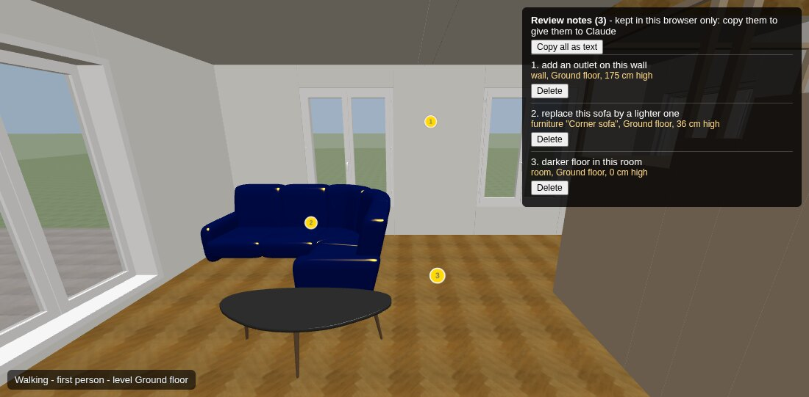

# Review Notes: From a Visit to Claude

While you visit the home in the walk-through or in the game mode, pin a note
on what you look at - "add an outlet here" on a wall, "fix this model" on a
piece of furniture, "darker floor" in a room. The notes are saved with the
home, and Claude (through the MCP server) or the design assistant reads them
with the item and the point each one is about, does what they ask, and marks
them as done.



## Writing notes

| Page | How |
| --- | --- |
| Game mode (**Tools > Game mode...**) | Aim the cross at the spot, press **N**, type, Enter |
| Walk-through (**Tools > WebXR Preview...**, on the computer) | Point the mouse at the spot, press **N**, type, Enter |

Esc cancels, Shift+Enter starts a new line. A numbered pin stays at the
point: yellow for an open note, green once done. **T** shows the list, where a
note can be deleted and all of them copied as text. Notes aren't written from
inside a headset.

A note keeps the point you aimed at (in the centimeters of the plan, with
its height) and what it is on: the wall, the door, the window, the piece of
furniture or the room, found from the shape you aimed at in the game mode,
and from where the point is in the walk-through.

## Giving them to Claude

Nothing to export: the notes are in the home. With the MCP server running
(`docs/MCP_SERVER.md`), ask Claude "do my review notes". It uses:

| Tool | What it does |
| --- | --- |
| `get_notes` | The open notes (all of them with `"all": true`): text, item by id (`W#` wall, `F#` furniture, `R#` room), the point in cm of the plan, the height above the floor, the distance from the start of a wall |
| `update_note` | Marks a note `done` (or `open`) with a `reply` you read beside the note, or deletes it |

For example `get_notes` returns:

```
- n1 [open] "add an outlet here" - on wall W1 (from -7,-7 to 608,-7), 158 cm from its start, at x 150 y 0 cm, 115 cm above the floor
- n2 [open] "fix this model: the legs are too thin" - on furniture F5 "Table", at x 201 y 150 cm, 75 cm above the floor
```

and Claude then runs the edit commands with those ids and coordinates. The
built-in design assistant sees the open notes in the description of the home
too. **Tools > Review notes...** shows them in the application, copies them,
and deletes the ones done or all of them.

What Claude can do about a note is what the edit commands can do: it can move,
resize, recolor, replace or rebuild a piece, add furniture, labels,
dimensions, rooms and walls. An electrical outlet is a piece of furniture of
the catalog if there is one, otherwise a label or a small piece built with
`create_furniture`.

## Where they are kept, and who can change them

- In the property `reviewNotes` of the home (a JSON array), saved in the
  `.sh3d` file. At most 500 notes of 2,000 characters.
- The page reads them at `notes` on the preview server and posts them back.
  Only the page served to this computer can post: the request must come from
  this computer, carry a header that the pages of other web sites can't send,
  and what isn't a list of notes is refused. Other devices of the network can
  read the notes, as they can read the home, but not change them.
- A home exported as a web page (**File > Export > Export 3D web page...**) has no
  application behind it: notes written there stay in that browser, and the
  list offers to copy them as text.

## Implementation

- `viewcontroller/HomeReviewNotes` - storage, cleaning of what is posted,
  `describe` with the ids of the items, `updateNote`.
- `HomeMCPHandler` - `get_notes`, `update_note`; `HomeAssistantContext` lists
  the open notes.
- `WebXRPreviewServer.NotesStore`, `GET` / `POST /notes`;
  `WebXRPreviewPlugin.createNotesStore` writes to the home in the event
  dispatch thread; `ReviewNotesAction` is the menu item.
- `webxr-notes.js` (no three.js: `resolveTarget`, `createNote`,
  `describeNotes`; `test/webxr/notes.test.mjs`) and `webxr-notes-ui.js`
  (pins, the box to write, the list), used by both pages.
- Tests: `HomeMCPServerTest.testReviewNotes`,
  `WebXRPreviewServerTest.testReviewNotesAreStored`.
