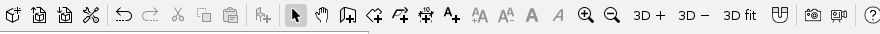
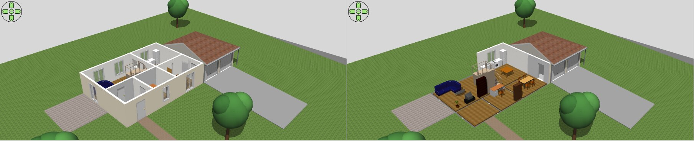

# 3D View Zoom, Standard Views and Room Dimensions

## Zoom of the 3D view

The mouse wheel used to move the camera of the aerial view by 12.5 cm per
notch, whatever its distance: hundreds of notches to step back from a house.
A notch now changes the distance to the home by 12 % (and at least 12.5 cm),
so the zoom is fast from far away and still precise close to the home. In the
virtual visit a notch walks 25 cm (2.5 cm before). Shift makes it three times
faster, and touchpads scroll smoothly (`getPreciseWheelRotation`).

Other ways to zoom:

| Control | Action |
| --- | --- |
| **3D +** / **3D −** in the tool bar | Zoom in / out; keep the button pressed to continue |
| **3D fit** in the tool bar, or `0` in the 3D view | The whole home in sight (aerial view) |
| `+` / `-` in the 3D view (Shift: faster) | Zoom in / out |
| **3D view > Zoom in / Zoom out / Show whole home**, also in the right-click menu of the 3D view | Same |

The aerial camera can now move away to 12 times the size of the home (5 times
before), at least 100 m.

## Standard views

**3D view > Standard views** shows the home from the top, from each of its
four sides and from its four corners, at the distance where it is entirely in
sight - the quick views of other design programs. They use the aerial view;
store one with **3D view > Store point of view...** to come back to it.

## Doll house display

**3D view > Hide walls in front of the camera (doll house)** leaves out of the
aerial view the walls that stand between the camera and the rooms - those on
the side of the home the camera is on, and that face it - with their doors
and windows, and brings them back as the camera turns. Seen from the top, and
in the virtual visit, every wall is shown. Nothing changes in the home: it is
a setting of the 3D view, off again at the next start.

In this picture **3D view > Display selected level** also leaves out the first
floor and the roof.

## 360 degree panorama

**3D view > Export 360° panorama...** computes a picture of everything around
the virtual visitor (place him in the plan first) with the photo renderer, and
writes a folder with `panorama.jpg` and an `index.html` to look around in it:
drag to turn, wheel to zoom. The page contains the picture, so it opens with
a double click on any computer, without a web server; on a https web site it
also offers **Enter VR** in a headset. As it is one picture, it loads at once on any device,
whatever the size of the home - a light alternative to the 3D web page for a
heavy home. Sizes: 2048 x 1024 (a few seconds for a small home), 4096 x 2048,
and 4096 x 2048 at the best quality of the renderer, which is much longer.

## Room dimensions in one step

**Plan > Add room dimensions** adds the dimension lines that give the size of
each room of the level, as floor plans show them: inside the room, 25 cm from
its sides, without repeating a size (a rectangle gets one width and one
depth). With rooms selected, only those are dimensioned; lines that already
exist aren't added again, and the whole is one step of Undo. The assistant
and Claude have the same as `{"action":"auto_dimensions"}` (optionally
`"ids":["R1"]`).

## Implementation

- `HomeController3D.zoomCamera(steps)`, `zoomCameraToFit()` and
  `viewFromDirection(yaw, pitch)`; `TopCameraState.zoomCamera` holds the
  ratio. `HomeComponent3D` maps the wheel and the keys, `HomePane` the tool
  bar buttons (`createZoom3DButton`) and menus.
- `viewcontroller/RoomDimensions.createDimensionLines`,
  `HomeController.addRoomDimensions`.
- `viewcontroller/DollHouseView` chooses the walls; `Wall3D.setHiddenInView`
  and `HomePieceOfFurniture3D.setHiddenInView` leave them out;
  `HomeComponent3D.setDollHouseView`.
- `swing/PanoramaExporter` (spherical lens of `PhotoRenderer`).
- `HomeController3DZoomTest`.
